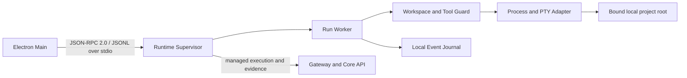

# Agent Runtime Architecture

- **Status:** Target
- **Owns:** Local execution process topology, Desktop protocol, workspace
  guard, tool policy, process/PTY supervision, execution journal, Diff/artifact
  production, Agent adapters, and platform adapters
- **Read after:** [`../AGENTS.md`](../AGENTS.md),
  [`../../../docs/business-model.md`](../../../docs/business-model.md),
  [`../../../docs/architecture.md`](../../../docs/architecture.md)
- **Mandatory before:** Initializing or changing the Agent Runtime,
  protocol, execution policy, workspace access, process handling, or recovery

## Runtime Role

The Agent Runtime is a separate per-user companion process distributed,
signed, and versioned with the Desktop application. It executes Agent work near
a user-authorized project, receives managed work through authenticated
contracts, invokes approved Agent/tool adapters, produces execution evidence,
and reports results to the cloud control plane. The initial product does not
install it as a system-wide service or accept an arbitrary executable path.

It is not a business service, authorization authority, general shell daemon, or
OS security sandbox.

## Target Topology

- A Desktop-lifetime supervisor owns the stdio protocol session, version and
  capability negotiation, worker lifecycle, cancellation, recovery, and cloud
  synchronization.
- A run-scoped worker owns one execution context and has explicit resource,
  output, and time limits.
- Workspace/tool guard canonicalizes TaskPilot-owned file operations and
  evaluates tool policy before side effects.
- Platform adapters normalize process groups or Windows Jobs, PTY, signals,
  paths, filesystem events, and encodings without hiding real OS semantics.
- The local journal stores enough idempotent state and evidence for restart
  recovery and crash diagnosis; it never becomes the canonical Agent Run record.

The Runtime is implemented in Rust. Its protocol types are the source of truth
for generated TypeScript types and JSON Schema consumed by Desktop; generated
artifacts are compatibility-checked and are not maintained by hand. Concrete Rust
libraries and on-disk schemas are selected in a later implementation change.

## Local Transport and Lifecycle

In the first phase, Electron Main starts exactly one Runtime child for its own
application lifecycle from the fixed, signed application installation. Main owns
three inherited anonymous pipes: Runtime stdin receives protocol input, Runtime
stdout emits protocol output only, and Runtime stderr emits logs only. The Runtime
does not listen on TCP, create a local socket or pipe endpoint, run as a service,
or accept connections from another client. A Desktop restart starts a new child
rather than reconnecting to a previous Runtime.

The wire protocol is JSON-RPC 2.0 encoded as UTF-8 JSONL: each line contains one
complete JSON object. Both sides reject malformed envelopes, unknown or duplicate
request IDs, unsupported methods, and messages exceeding the declared byte limit
before unbounded allocation or dispatch. Reads and writes use bounded queues with
explicit backpressure; cancellation has a versioned method and deterministic
request lifecycle. Runtime code must never write logs, banners, panic text, or
third-party output to stdout because any non-protocol line corrupts the session.

`initialize` is the first accepted request and exchanges protocol version and
compatibility range, Desktop and Runtime build identity, product profile, and
capabilities. The initial walking skeleton also exposes `runtime/info`,
`runtime/health`, and `runtime/shutdown`; their exact typed schemas and error codes
are fixed by its implementation change. Incompatible peers fail before any work
is accepted. Rust protocol types generate the Desktop TypeScript types and JSON
Schema used for compile-time and runtime contract checks.

The trusted fixed-path spawn plus inherited pipes establishes the phase-one local
process relationship. It does not require a bootstrap secret, nonce challenge, or
reconnect credential, and it does not authorize execution. Every real operation
still requires the applicable execution grant, local workspace binding, local
consent, lifecycle, and fencing checks. The Runtime never interprets possession
of stdin as permission to execute.

On normal application exit, Main requests `runtime/shutdown` with a bounded grace
period, then closes pipes or terminates the child. Runtime exits when stdin reaches
EOF or when platform supervision confirms its Main parent is gone; it stops new
requests and cloud claims before bounded cleanup. Resuming any side effect after a
new Desktop/Runtime start requires fresh grant and lease validation. Closing a
Renderer window is distinct from full application exit, and exact active-work
exit behavior belongs to a future lifecycle contract. Runtime follows the Desktop
[packaging and update contract](../../desktop/docs/architecture.md#packaging-and-updates)
and does not self-update independently.

### Future daemon transport gate

A persistent transport is not part of the first phase. Reconsider a Unix Domain
Socket on macOS and a current-user ACL-restricted Named Pipe on Windows only when
a confirmed requirement needs at least one of: work surviving Desktop exit,
Desktop restart attachment, shared CLI/Desktop clients, a resident scheduler, or
an independently managed Runtime lifecycle. That change must separately design
endpoint ownership and cleanup, single-instance locking, peer authentication,
credential rotation, reconnect semantics, replay resistance, and upgrade
compatibility; the stdio relationship must not be stretched into an implicit
daemon contract.

## Trust Boundaries

All inputs are untrusted: Desktop messages, cloud assignments, Agent output,
tool arguments, repository content, symlinks, environment values, process
output, and recovered journal records. Protocol messages arrive through the
inherited private channel but are still versioned, schema validated, bounded, and
tied to one child-process lifecycle. Transport provenance is not execution
authorization.

The Runtime never accepts the Desktop's long-lived user token. Managed execution
must validate every binding and lifecycle rule in the root
[identity and execution authorization contract](../../../docs/architecture.md#identity-and-execution-authorization),
then match `LocalWorkspaceBindingId` against the active device-local record. A
stale worker must be fenced before any new side effect or evidence acceptance.

## Local Workspace Binding and Its Limit

A business `Workspace` is the cloud tenant and data-isolation scope; it is not a
filesystem path. When a user selects a local project root through Desktop, the
Runtime creates an opaque, immutable, non-recycled `LocalWorkspaceBindingId` that
binds the product profile, Runtime instance, cloud Workspace ID, Project ID,
canonical OS root identity, and local policy version. A rebind or material root
identity change creates a new ID and revokes the old one. The execution grant
represents the local root only by this ID; the raw absolute path remains local
unless a separate, explicit disclosure contract requires it.

Execution requires both a valid cloud grant and a matching active local binding.
The Runtime handles symlinks and junctions and requires every TaskPilot-owned file
operation to remain within the bound root. Revocation prevents new TaskPilot-owned
operations and triggers the future contract's deterministic run transition.

This is **not an OS-level sandbox**. An arbitrary child process executes with
the user's OS permissions and may access files outside the bound project root,
environment secrets, credential agents, devices, or network services. Tool
policy, command review, environment minimization, Rust memory safety, and audit
reduce risk but do not create kernel-enforced isolation.

Before general Shell or CLI execution enters the product, a separate approved
security design must define enforceable macOS and Windows isolation mechanisms,
child-process network policy, full process-tree containment and cleanup, failure
behavior when isolation cannot be established, and native sandbox escape tests.
That design may make different platform trade-offs, but neither platform may ship
on a path-check-and-consent claim alone.

## Tool and Approval Boundary

Agent adapters emit structured tool intents. The Runtime owns executable/argv,
working directory, environment, path scope, timeout, resource, mediated network
target, and side-effect evaluation. A Local Execution Consent is bound to the
`LocalWorkspaceBindingId` and all immutable evaluated inputs; changing any of them
invalidates the consent.

A cloud `ApprovalRequest` is canonical workflow state owned and authorized by
Core API. Local Execution Consent is a device-local safety proof for one immutable
evaluated operation. Neither proof implies the other: local consent cannot
advance workflow state, and cloud approval cannot silently authorize a changed
command on a device. Their exact success, rejection, expiry, and recovery
transitions belong to future behavior specs. Desktop renders both with distinct
language; Runtime enforces local execution; Core API owns domain approval truth.

## Process and PTY Supervision

Before process execution ships, the process boundary must provide explicit start, output, exit,
timeout, cancellation, and cleanup semantics across macOS and Windows. It must
supervise the process tree rather than only a parent PID, preserve raw evidence
where appropriate, and normalize display output without losing original exit
information.

Platform details remain visible through narrow adapters: POSIX process groups
and signals are not assumed to equal Windows Job Objects and console behavior.
Native tests own those differences.

## Network Enforcement Boundary

Network policy is enforceable only for Runtime-owned HTTP or tool adapters that
mediate the connection and validate scheme, host, port, method, redirect, and
size. An arbitrary CLI or shell child process retains the user's network access;
without a separately designed OS-enforced sandbox, firewall, proxy, or network
namespace, the Runtime must not claim domain-level egress restriction or present
such a restriction as guaranteed in consent UI.

## Journal, Diff, and Artifacts

The journal lives outside every bound project root in a per-user Runtime data
directory with restrictive native ACLs. Records carry schema version, stable
event IDs, ordering data, operation identity, grant/lease fencing data, approval
or consent references, checksums, tool results, state snapshots, and
synchronization status. Writes use crash-safe append or atomic replacement plus
a documented durability policy. High-volume raw output uses bounded local
storage referenced from journal entries.

A journal record is recovery evidence, never authority to restart work. Recovery
revalidates the current grant and lease/fencing token before another side effect;
an uncertain external outcome becomes `OutcomeUnknown` rather than automatic
replay. Checksums detect corruption but are not described as tamper-proof unless
a separately protected integrity key and threat model exist. Runtime startup
checks the journal schema against the supported upgrade and rollback range; an
incompatible schema fails diagnosably and is never silently discarded or replayed.

Diff and artifact production is limited to authorized evidence and applies
size, binary, path, redaction, retention, and upload policies defined by later
behavior changes. The Runtime does not silently upload an entire workspace or
secret-like content.

## Cloud Control Plane Boundary

Gateway/Core API authorize managed work and own User, Workspace, Project,
WorkflowRun, StepRun, AgentRun, ApprovalRequest, and durable business state.
The Runtime submits authenticated, idempotent execution evidence and never
connects to or mutates Core API business tables.

A cloud outage does not grant new authority. Exact continue-versus-pause rules
must be deterministic in the future execution spec and bounded by the grant and
local policy; this architecture intentionally does not choose an ambiguous
either/or behavior.

## Non-Goals

- No canonical business state or approval authority.
- No direct Core API database access.
- No reuse of a Desktop long-lived user token.
- No unrestricted generic remote shell interface.
- No claim that path checks isolate arbitrary child processes.
- No assumption that macOS process/PTY behavior proves Windows behavior.
- No phase-one daemon, multi-client endpoint, Desktop-restart attachment, or
  independently updated Runtime.
