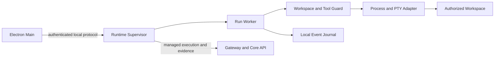

# Agent Runtime Architecture

- **Status:** Target
- **Owns:** Local execution process topology, Desktop protocol, workspace
  guard, tool policy, process/PTY supervision, execution journal, Diff/artifact
  production, Agent adapters, and platform adapters
- **Read after:** [`../AGENTS.md`](../AGENTS.md),
  [`../../../docs/business-model.md`](../../../docs/business-model.md),
  [`../../../docs/architecture.md`](../../../docs/architecture.md)
- **Mandatory before:** Initializing or changing the Agent Runtime,
  protocol, execution policy, workspace access, process handling, or recovery

## Runtime Role

The Agent Runtime is a separately supervised local application that
executes Agent work near a user-authorized project. It receives managed work
through future authenticated contracts, invokes approved Agent/tool adapters,
produces execution evidence, and reports results to the cloud control plane.

It is not a business service, authorization authority, general shell daemon, or
OS security sandbox.

## Target Topology

- A long-lived supervisor owns protocol sessions, version negotiation, worker
  lifecycle, cancellation, recovery, and cloud synchronization.
- A run-scoped worker owns one execution context and has explicit resource,
  output, and time limits.
- Workspace/tool guard canonicalizes TaskPilot-owned file operations and
  evaluates tool policy before side effects.
- Platform adapters normalize process groups or Windows Jobs, PTY, signals,
  paths, filesystem events, and encodings without hiding real OS semantics.
- The local journal stores enough idempotent state and evidence for reconnect
  and crash diagnosis; it never becomes the canonical Agent Run record.

Concrete language, libraries, on-disk schemas, and transport are selected in a
later implementation change.

## Trust Boundaries

All inputs are untrusted: Desktop messages, cloud assignments, Agent output,
tool arguments, repository content, symlinks, environment values, process
output, and recovered journal records. Protocol messages are authenticated,
versioned, schema validated, bounded, and tied to one Runtime instance.

The Runtime never accepts the Desktop's long-lived user token. Before managed
execution is implemented, a capability spec must define the execution grant's
issuer, binding to User/Workspace/Project/Agent Run/Runtime instance, expiry,
refresh, revocation, replay prevention, and logout behavior.

## Workspace Authorization and Its Limit

A user selects a workspace root through the Desktop. The Runtime records a
canonical identity appropriate to each OS, handles symlinks and junctions, and
requires every TaskPilot-owned file operation to remain within the authorized
scope. Revocation prevents new TaskPilot-owned operations and triggers the
future contract's deterministic run transition.

This is **not an OS-level sandbox**. An arbitrary child process executes with
the user's OS permissions and may access files outside the selected workspace,
environment secrets, credential agents, devices, or network services. Tool
policy, command review, environment minimization, and audit reduce risk but do
not create kernel-enforced isolation. Any stronger isolation requires a
separate design with explicit platform guarantees and usability trade-offs.

## Tool and Approval Boundary

Agent adapters emit structured tool intents. The Runtime owns executable/argv,
working directory, environment, path scope, timeout, resource, network, and
side-effect evaluation. Any approval is bound to immutable evaluated inputs;
changing them invalidates the approval.

Whether an operation requires user or business approval, and the exact
success/rejection/recovery transitions, are behavior decisions deferred to
future specs. Desktop renders the request; Runtime enforces local execution;
Core API owns domain approval truth.

## Process and PTY Supervision

The process boundary must eventually provide explicit start, output, exit,
timeout, cancellation, and cleanup semantics across macOS and Windows. It must
supervise the process tree rather than only a parent PID, preserve raw evidence
where appropriate, and normalize display output without losing original exit
information.

Platform details remain visible through narrow adapters: POSIX process groups
and signals are not assumed to equal Windows Job Objects and console behavior.
Native tests own those differences.

## Journal, Diff, and Artifacts

The journal records stable event IDs, ordering data, operation identity,
approval references, tool results, state snapshots, and synchronization status
needed for idempotent recovery. High-volume raw output may use bounded local
storage referenced from journal entries.

Diff and artifact production is limited to authorized evidence and applies
size, binary, path, redaction, retention, and upload policies defined by later
behavior changes. The Runtime does not silently upload an entire workspace or
secret-like content.

## Cloud Control Plane Boundary

Gateway/Core API authorize managed work and own User, Workspace, Project,
WorkflowRun, StepRun, AgentRun, ApprovalRequest, and durable business state.
The Runtime submits authenticated, idempotent execution evidence and never
connects to or mutates Core API business tables.

A cloud outage does not grant new authority. Exact continue-versus-pause rules
must be deterministic in the future execution spec and bounded by the grant and
local policy; this architecture intentionally does not choose an ambiguous
either/or behavior.

## Non-Goals

- No canonical business state or approval authority.
- No direct Core API database access.
- No reuse of a Desktop long-lived user token.
- No unrestricted generic remote shell interface.
- No claim that path checks isolate arbitrary child processes.
- No assumption that macOS process/PTY behavior proves Windows behavior.
