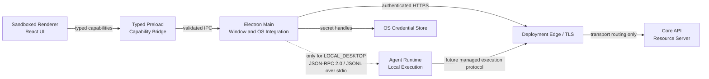
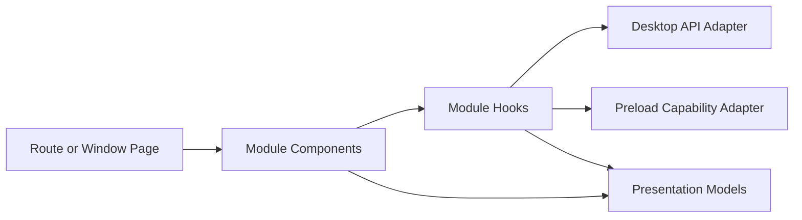

# Desktop Architecture

- **Status:** Target
- **Owns:** Electron process boundaries, Renderer structure, typed local IPC,
  cloud API integration, native integration, packaging, and update boundaries
- **Read after:** [`../AGENTS.md`](../AGENTS.md),
  [`../../../docs/business-model.md`](../../../docs/business-model.md),
  [`../../../docs/architecture.md`](../../../docs/architecture.md)
- **Mandatory before:** Initializing or changing the Desktop application
  structure, dependencies, IPC, authentication integration, or packaging

## Runtime Role

The Desktop application is the first-party Windows and macOS client. It renders
TaskPilot workflows, and Electron Main sends authenticated HTTPS requests through
the deployment edge/TLS boundary directly to the Core API Desktop surface. The
MVP does not require a Gateway. Ordinary product capabilities and
`REMOTE_MANAGED` Agent Runs do not require a local Runtime. When a user invokes `LOCAL_DESKTOP` capabilities,
Electron Main may start and control the separately supervised Rust
[`Agent Runtime`](../../agent-runtime/docs/architecture.md) through a versioned
JSON-RPC 2.0 protocol carried as JSONL over inherited stdio pipes.

The Desktop does not execute Agent tools, directly edit workspace files, own
business truth, connect to business databases, or host a remote-provider SDK.

## Technology Direction

- Electron with sandboxed Renderer processes and `contextIsolation`
- React with strict TypeScript and Vite for Renderer UI
- A narrow typed Preload API; no direct Node.js or Electron access in Renderer
- TanStack Query for remote cloud state
- Main-owned narrow transport types and a typed client for the first-party
  Desktop API, checked against Core API runtime OpenAPI contract fixtures; no
  generated Desktop client in the first phase
- Generated TypeScript types and JSON Schema derived from Runtime-owned Rust
  protocol types for the Main-to-Runtime client
- Renderer query adapters that invoke typed Preload capabilities and never hold
  credentials or call authenticated cloud endpoints directly
- Platform adapters for OS credential storage, deep-link/single-instance
  handling, notifications, paths, signing, installation, and updates

Current dependency and packaging versions are pinned by `package.json`, the
workspace lockfile, and `electron-builder.yml`. Signing, installers, update
policy, and Runtime packaging remain later release capabilities.

## Trust and Process Boundaries



- Renderer is untrusted display and interaction code. It receives serializable,
  least-privilege view models and capability results.
- Preload exposes an explicit API surface and does not forward arbitrary
  channels, command strings, filesystem access, or Electron objects.
- Main owns windows, application lifecycle, the authenticated cloud client,
  token refresh, deep links, credential handles, native dialogs, notifications,
  and Runtime lifecycle/connection supervision. It does not host Agent
  execution.
- Agent Runtime owns controlled `LOCAL_DESKTOP` work. It is not required for
  login, Workspace/Project flows, or `REMOTE_MANAGED` run viewing, and it never
  receives the Desktop's long-lived user token.
- Core API is the current application-layer Resource Server and authoritative
  source for identity, Workspace, Project, Work Item, workflow, Agent Run, and
  approval state. The deployment edge does not create a trusted principal; a
  future Gateway remains defense in depth rather than an authorization owner.

## Current Source Boundaries

```text
apps/desktop/
├── src/
│   ├── main/
│   │   ├── api/
│   │   ├── auth/
│   │   ├── credentials/
│   │   ├── projects/
│   │   ├── session/
│   │   └── workspaces/
│   ├── preload/
│   ├── renderer/
│   └── shared/
├── tests/
└── cypress/
```

`shared` contains only serializable schemas and contracts shared across Electron
process boundaries. It contains no business persistence, credential material,
Node handles, or Runtime implementation. Future Runtime integration remains a
separate Main-owned boundary and is not present in the first-use slice.

## Renderer Architecture

Renderer business code is organized by cohesive domain module, then technical
responsibility. Pages compose capabilities; components render; Hooks adapt
React and query state; models contain pure presentation logic; API adapters map
transport DTOs to frontend models.



Components do not call `fetch`, Electron IPC, or Runtime protocols directly.
Renderer cloud adapters call typed Preload capabilities; Main performs the
credentialed HTTPS request and returns least-privilege serializable results.
Remote resources remain owned by TanStack Query; shareable navigation by the
router; form state by its form boundary; temporary interaction by local React
state. Workspace- and Project-scoped cache keys include their stable IDs and
must not rely on mutable global "current" scope.

Renderer consumes provider-neutral Agent and Run view models plus normalized
capabilities. It never receives provider SDK objects, credentials, raw callback
payloads, raw provider status names, or opaque remote handles. A future
provider-specific configuration surface may use a narrowly scoped UI adapter,
but provider fields must not leak into Project, Board, Work Item, workflow, or
generic Run presentation models. Capability-driven UI disables or omits an
unsupported action explicitly rather than inferring support from provider name.

## Authentication Boundary

**Current:** The runnable Desktop uses one GitHub federated sign-in capability.
Electron Main binds a one-shot HTTP receiver on `127.0.0.1` before creating an
attempt, persists its exact port/nonce and opaque attempt recovery input in a
dedicated OS-credential namespace, and opens only the allowlisted GitHub
authorization URL in the system browser. This slice does not register a deep
link, embed a WebView, or hold the GitHub client secret.

- Renderer owns interaction only. Preload exposes fixed methods for capability
  discovery, start/continue/cancel, first registration, session
  view/subscription, and logout; it exposes no arbitrary URL, HTTP, or token
  getter.
- Main alone holds the poll secret, completion proof, loopback URI/nonce,
  registration continuation, TaskPilot access/refresh tokens, and OS credential
  handles. Renderer receives only an opaque `flowId`, bounded registration
  preview, safe terminal status, or `CurrentUserView`.
- The loopback receiver accepts only the exact nonce-bearing path, `POST`, a
  bounded body, and one valid completion proof. After persisting valid proof,
  Main restores, shows, and focuses the existing window. It closes the receiver
  after completion, cancellation, expiry, failure, or window destruction.
- Main can rebind the exact safe receiver after restart and resume the same
  unexpired attempt. Core API directly returns an active session for a known
  identity or completed registration; there is no separate delivery ACK,
  abandon, or refresh-recovery protocol.
- Main writes refresh material to the OS credential facility before publishing
  authenticated state. If that write fails, it best-effort logs out the newly
  issued session and does not expose authenticated UI. Refresh is single-flight
  per generation; logout, cancellation, and window close fence late responses.
- Account and cloud environment form distinct credential namespaces. A terminal
  `401` and logout use generation-first cleanup; transient Redis/Core API
  failures hide protected data rather than claiming a valid session.
- Renderer presents one client-known `zh-CN` User Agreement/Privacy Policy
  bundle, preserves the registration draft while either document is viewed,
  and rejects an unknown server bundle. Explicit consent submits exact bundle,
  agreement, privacy-policy, and locale versions; Core API generates
  `acceptedAt`. Renderer does not submit a trusted acceptance boolean.
- Core API remains authoritative for GitHub identity proof, internal `UserId`,
  and session lifecycle. Agent Runtime does not participate in login or receive
  Desktop credentials.

## Legal Documents and Localization

**Current:** Renderer owns a local internationalization context backed by pinned
`i18next` and `react-i18next` dependencies. It resolves `zh-CN` and `en` from a
safe local preference first and then the ordered operating-system language list,
defaults unsupported language lists and missing ordinary messages to English,
and keeps `<html lang>` synchronized. The preference is non-sensitive Renderer
state in `localStorage`; storage failure leaves the in-memory choice usable.
Message resources are static application modules: localization performs no
network fetch and introduces no Main, Preload, or generic IPC capability.

Auth and Account surfaces resolve all product copy from the static catalogs and
expose one shared keyboard-operable language selector. First registration ships
versioned `zh-CN` and `en` User Agreement/Privacy Policy bundles. The complete
`(locale, legalBundleVersion, termsVersion, privacyVersion)` quartet identifies
the exact displayed texts; a missing or unknown quartet has no cross-locale
fallback and blocks consent/registration. Switching language preserves profile
input but invalidates consent to the previously displayed texts. Effective dates
use `Intl.DateTimeFormat` with the bundle locale. Core API remains the acceptance
authority and generates `acceptedAt`.

## Electron Security Baseline

Every application window starts from deny-by-default settings:

- `nodeIntegration` is disabled, `contextIsolation`, Renderer sandboxing, and
  `webSecurity` remain enabled, and no `remote` module or `<webview>` is exposed;
- production Renderer content is packaged with the application; arbitrary remote
  pages and scripts are not loaded into a privileged window;
- unpackaged development may load only the explicit checkout-configured loopback Vite origin; its HMR
  CSP allowance and IPC origin are development-only, while packaged builds
  continue to use local files and the production CSP;
- the sandboxed Preload is bundled as a single CommonJS entrypoint so it does
  not depend on unsupported filesystem module loading inside the sandbox;
- Content Security Policy excludes remote script execution and unnecessary
  `unsafe-eval`; deviations require an explicit security review;
- Main validates schema, lifecycle, authorization, `event.senderFrame`, expected
  origin, frame, and session for every IPC request; channel names alone confer no
  authority;
- navigation, `window.open`, permission requests, downloads, external URLs, and
  protocol/deep-link inputs are denied by default and pass through explicit
  allowlists with length and scheme checks; and
- production builds enable appropriate Electron Fuses and packaged-resource
  integrity checks. Disabling a security control requires a documented threat
  argument and a packaged-app regression test.

## Agent Runtime Integration

The Runtime is a signed companion executable distributed, versioned, and updated
with the Desktop application, not a system-wide service. It is started lazily
only when an enabled `LOCAL_DESKTOP` capability requires it; login, application
shell, Workspace/Project operations, and `REMOTE_MANAGED` run viewing remain
usable when the Runtime is absent or unavailable. Once local execution is
implemented, Electron Main starts at most one Runtime child for its own
application lifecycle from a fixed packaged path, owns its stdin/stdout/stderr
pipes, supervises health and termination, and never accepts a Runtime executable
selected from a project root, configuration value, environment variable, or
other mutable user path. A Desktop restart starts a new Runtime when next needed;
it does not attach to an orphan from a previous Main process.

Main implements the Desktop side of the transport owned by the
[Agent Runtime architecture](../../agent-runtime/docs/architecture.md#local-transport-and-lifecycle):
JSON-RPC 2.0 envelopes encoded as UTF-8 JSONL, with Runtime stdout reserved for
protocol messages and stderr reserved for logs. Main performs `initialize` before
other requests, negotiates protocol version, build identity, and capabilities,
then uses `runtime/info`, `runtime/health`, and `runtime/shutdown` for the initial
walking skeleton. Both sides enforce request IDs, cancellation semantics, bounded
queues, and a maximum message size; malformed output or stdout log contamination
fails the session closed.

The fixed trusted launch path plus inherited anonymous pipes establish the initial
local process boundary, so phase one adds no bootstrap secret, nonce challenge, or
reconnect credential. This relationship proves neither that a requested operation
is safe nor that it is authorized. Main revalidates Renderer-originated requests,
and managed execution still follows the root
[identity and execution authorization contract](../../../docs/architecture.md#identity-and-execution-authorization).
Desktop does not mint an execution grant, turn its user session or stdio channel
into Runtime authority, substitute a raw local path for
`LocalWorkspaceBindingId`, or relax a grant binding.

Closing a Renderer window does not by itself imply full application exit. On full
Main shutdown it first requests bounded graceful shutdown and then closes the
pipes or terminates the child; Runtime exits on stdin EOF or confirmed parent
loss. Background and active-work exit behavior remains an explicit future product
lifecycle decision. A daemon transport is designed only if a real requirement
appears for work surviving Desktop exit, Desktop restart attachment, shared
CLI/Desktop clients, a resident scheduler, or an independently managed Runtime.

## First Implementation Slice

**Current:** the runnable Desktop slice contains the secure Electron
Main/Preload/sandboxed-Renderer shell; system-browser GitHub login; first
registration with in-app legal-document review; OS-credential-backed session
restore, refresh, and logout; and an authenticated account view. It excludes
Agent Runtime startup.

**Target:** Workspace listing/creation/selection, active `WorkspaceId`, Project
discovery, and the full application shell remain later end-to-end slices. The
current Desktop API contract therefore contains only authentication, session,
and current-user capabilities. Project mutation, Agent configuration,
`REMOTE_MANAGED` UI, `LOCAL_DESKTOP` execution, shell/PTY, and local workspace
binding remain later changes.

## API Contract Integration

- The first-party Desktop API is separate from the public HTTP API.
- In the first phase, Main owns narrow hand-written transport types; Core API
  runtime OpenAPI contract tests and Main adapter fixtures detect shape drift.
  No generated Desktop client or breaking-compatibility gate is required until
  a later Change establishes a versioned contract lifecycle.
- Transport types do not become business models automatically. The current
  handwritten types cover only authentication, session, and current user;
  Workspace/Project transport types wait for those runnable slices.
- API adapters normalize transport errors into a stable client error model.
- Mutable requests carry the version or idempotency identifier required by the
  cloud contract.
- Realtime progress is a hint over an authoritative reloadable cloud state; a
  stream is never a second source of business truth.

## Cross-Platform Boundary

Most product, React, IPC-schema, and Runtime-client code is shared. Platform
adapters isolate only real OS differences: credential storage, deep links,
single-instance behavior, notifications, paths, child-process lifecycle and
process-tree cleanup, code signing, installers, and update distribution. The
initial stdio protocol itself is shared and does not require separate Unix Domain
Socket and Windows Named Pipe implementations.

Electron packages Chromium on both Windows and macOS. Browser-engine matrix
language therefore does not apply to the Desktop product; release evidence must
instead cover packaged Electron/Chromium plus native behavior on each supported
OS and architecture.

## Packaging and Updates

Signed artifacts, notarization, installer formats, update channels, rollback,
and release provenance are required design concerns but not yet implemented.
Desktop and Runtime are signed and released as one compatibility-tested bundle;
an update must verify publisher identity, signature, integrity, channel, and
anti-downgrade policy before activation, then switch atomically or roll back both
components together. No application may enable arbitrary silent code download,
unsigned updates, or a Runtime binary supplied from a mutable workspace path.
Concrete tooling and release commands are recorded only after the build exists.

## Non-Goals

- No business persistence or final authorization in Desktop.
- No Node.js, Electron, credentials, raw IPC, or unrestricted filesystem access
  in Renderer.
- No Agent tool execution, PTY, workspace guard, or execution journal in Main.
- No second browser Web client in the initial architecture.
- No promise of an OS-level sandbox for arbitrary child processes.
- No platform abstraction for behavior that is genuinely identical.
