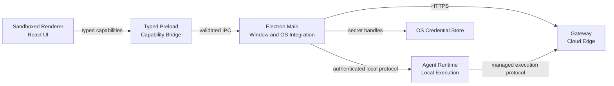
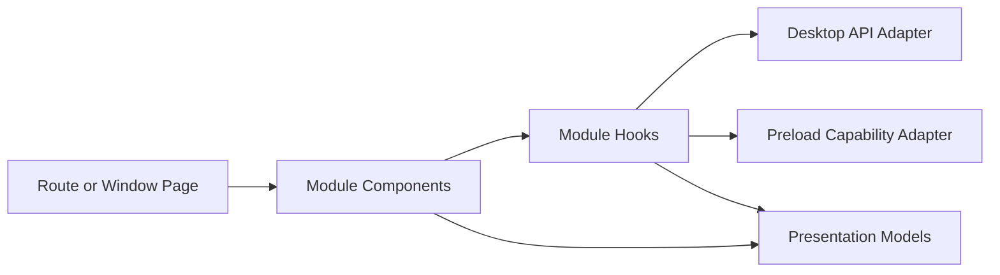

# Desktop Architecture

- **Status:** Target
- **Owns:** Electron process boundaries, Renderer structure, typed local IPC,
  cloud API integration, native integration, packaging, and update boundaries
- **Read after:** [`../AGENTS.md`](../AGENTS.md),
  [`../../../docs/business-model.md`](../../../docs/business-model.md),
  [`../../../docs/architecture.md`](../../../docs/architecture.md)
- **Mandatory before:** Initializing or changing the Desktop application
  structure, dependencies, IPC, authentication integration, or packaging

## Runtime Role

The Desktop application is the first-party Windows and macOS client. It renders
TaskPilot workflows, communicates with cloud services only through the Gateway,
and controls the separately supervised
[`Agent Runtime`](../../agent-runtime/docs/architecture.md) through
a future authenticated, versioned local protocol.

The Desktop does not execute Agent tools, directly edit workspace files, own
business truth, or connect to business databases.

## Technology Direction

- Electron with sandboxed Renderer processes and `contextIsolation`
- React with strict TypeScript and Vite for Renderer UI
- A narrow typed Preload API; no direct Node.js or Electron access in Renderer
- TanStack Query for remote cloud state
- Generated types plus a typed transport adapter for the first-party Desktop API
- Platform adapters for OS credential storage, deep-link/single-instance
  handling, notifications, paths, signing, installation, and updates

Stable versions and concrete packaging/update libraries are selected only when
the application is initialized through a later OpenSpec change.

## Trust and Process Boundaries



- Renderer is untrusted display and interaction code. It receives serializable,
  least-privilege view models and capability results.
- Preload exposes an explicit API surface and does not forward arbitrary
  channels, command strings, filesystem access, or Electron objects.
- Main owns windows, application lifecycle, deep links, credential handles,
  native dialogs, notifications, and connection supervision. It does not host
  Agent execution.
- Agent Runtime owns controlled local work. It never receives the
  Desktop's long-lived user token.
- Gateway/Core API remain the authoritative source for identity, Workspace,
  Project, Work Item, workflow, Agent Run, and approval state.

## Planned Source Boundaries

```text
apps/desktop/
├── AGENTS.md
├── docs/
└── src/                       # created by a later implementation change
    ├── main/
    │   ├── app/
    │   ├── ipc/
    │   ├── native/
    │   └── runtime-client/
    ├── preload/
    ├── renderer/
    │   ├── app/
    │   ├── pages/
    │   ├── modules/
    │   ├── components/
    │   └── api/
    └── shared-ipc/
```

`shared-ipc` contains only serializable schemas and contracts shared across
Electron process boundaries. It contains no business persistence, credential
material, Node handles, or Runtime implementation.

## Renderer Architecture

Renderer business code is organized by cohesive domain module, then technical
responsibility. Pages compose capabilities; components render; Hooks adapt
React and query state; models contain pure presentation logic; API adapters map
transport DTOs to frontend models.



Components do not call `fetch`, Electron IPC, or Runtime protocols directly.
Remote resources remain owned by TanStack Query; shareable navigation by the
router; form state by its form boundary; temporary interaction by local React
state. Workspace- and Project-scoped cache keys include their stable IDs and
must not rely on mutable global "current" scope.

## Authentication Boundary

A later implementation change must specify and test the concrete Desktop login
flow. This architecture only fixes these boundaries:

- interactive login uses the system browser rather than embedding provider
  credentials in the Renderer;
- authorization responses return through an explicitly registered callback
  mechanism with single-instance and state/PKCE protections;
- long-lived Desktop credentials are stored through an OS credential facility
  and are never exposed to Renderer;
- logout clears local credential material and invalidates cloud sessions as
  required by the future authentication contract;
- Agent Runtime does not reuse or retain the Desktop's long-lived token.

Exact callback behavior, token lifecycle, and failure semantics belong to the
future authentication capability spec.

## Agent Runtime Integration

Main supervises connectivity to the Runtime and presents its typed state to the
Renderer. The local protocol must be versioned, authenticated, bounded in
message size, resilient to reconnects, and explicit about which side owns each
operation. Renderer-originated requests are revalidated by Main and Runtime.

A future execution-grant contract must define issuer, binding to User,
Workspace, Project, Agent Run and Runtime instance, expiry, refresh, revocation,
replay prevention, and logout handling before managed execution is implemented.

## API Contract Integration

- The first-party Desktop API is separate from the public HTTP API.
- Generated transport types are not edited manually and do not become business
  models automatically.
- API adapters normalize transport errors into a stable client error model.
- Mutable requests carry the version or idempotency identifier required by the
  cloud contract.
- Realtime progress is a hint over an authoritative reloadable cloud state; a
  stream is never a second source of business truth.

## Cross-Platform Boundary

Most product, React, IPC-schema, and Runtime-client code is shared. Platform
adapters isolate only real OS differences: credential storage, deep links,
single-instance behavior, notifications, paths, process lifecycle integration,
code signing, installers, and update distribution.

Electron packages Chromium on both Windows and macOS. Browser-engine matrix
language therefore does not apply to the Desktop product; release evidence must
instead cover packaged Electron/Chromium plus native behavior on each supported
OS and architecture.

## Packaging and Updates

Signed artifacts, notarization, installer formats, update channels, rollback,
and release provenance are required design concerns but not yet implemented.
No application may enable silent code download or unsigned updates by default.
Concrete tooling and release commands are recorded only after the build exists.

## Non-Goals

- No business persistence or final authorization in Desktop.
- No Node.js, Electron, credentials, raw IPC, or unrestricted filesystem access
  in Renderer.
- No Agent tool execution, PTY, workspace guard, or execution journal in Main.
- No second browser Web client in the initial architecture.
- No promise of an OS-level sandbox for arbitrary child processes.
- No platform abstraction for behavior that is genuinely identical.
