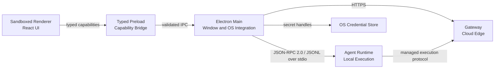
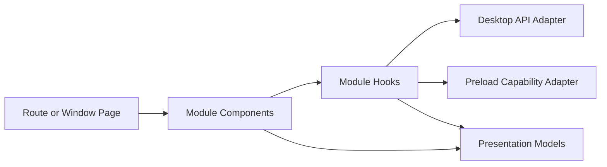

# Desktop Architecture

- **Status:** Target
- **Owns:** Electron process boundaries, Renderer structure, typed local IPC,
  cloud API integration, native integration, packaging, and update boundaries
- **Read after:** [`../AGENTS.md`](../AGENTS.md),
  [`../../../docs/business-model.md`](../../../docs/business-model.md),
  [`../../../docs/architecture.md`](../../../docs/architecture.md)
- **Mandatory before:** Initializing or changing the Desktop application
  structure, dependencies, IPC, authentication integration, or packaging

## Runtime Role

The Desktop application is the first-party Windows and macOS client. It renders
TaskPilot workflows, communicates with cloud services only through the Gateway,
and controls the separately supervised Rust
[`Agent Runtime`](../../agent-runtime/docs/architecture.md) through a versioned
JSON-RPC 2.0 protocol carried as JSONL over inherited stdio pipes.

The Desktop does not execute Agent tools, directly edit workspace files, own
business truth, or connect to business databases.

## Technology Direction

- Electron with sandboxed Renderer processes and `contextIsolation`
- React with strict TypeScript and Vite for Renderer UI
- A narrow typed Preload API; no direct Node.js or Electron access in Renderer
- TanStack Query for remote cloud state
- Generated types plus a Main-owned typed transport client for the first-party
  Desktop API
- Generated TypeScript types and JSON Schema derived from Runtime-owned Rust
  protocol types for the Main-to-Runtime client
- Renderer query adapters that invoke typed Preload capabilities and never hold
  credentials or call authenticated cloud endpoints directly
- Platform adapters for OS credential storage, deep-link/single-instance
  handling, notifications, paths, signing, installation, and updates

Stable versions and concrete packaging/update libraries are selected only when
the application is initialized through a later OpenSpec change.

## Trust and Process Boundaries



- Renderer is untrusted display and interaction code. It receives serializable,
  least-privilege view models and capability results.
- Preload exposes an explicit API surface and does not forward arbitrary
  channels, command strings, filesystem access, or Electron objects.
- Main owns windows, application lifecycle, the authenticated cloud client,
  token refresh, deep links, credential handles, native dialogs, notifications,
  and Runtime lifecycle/connection supervision. It does not host Agent
  execution.
- Agent Runtime owns controlled local work. It never receives the
  Desktop's long-lived user token.
- Gateway/Core API remain the authoritative source for identity, Workspace,
  Project, Work Item, workflow, Agent Run, and approval state.

## Planned Source Boundaries

```text
apps/desktop/
├── AGENTS.md
├── docs/
└── src/                       # created by a later implementation change
    ├── main/
    │   ├── app/
    │   ├── ipc/
    │   ├── cloud-client/
    │   ├── native/
    │   └── runtime-client/
    ├── preload/
    ├── renderer/
    │   ├── app/
    │   ├── pages/
    │   ├── modules/
    │   ├── components/
    │   └── api/
    └── shared-ipc/
```

`shared-ipc` contains only serializable schemas and contracts shared across
Electron process boundaries. It contains no business persistence, credential
material, Node handles, or Runtime implementation.

## Renderer Architecture

Renderer business code is organized by cohesive domain module, then technical
responsibility. Pages compose capabilities; components render; Hooks adapt
React and query state; models contain pure presentation logic; API adapters map
transport DTOs to frontend models.



Components do not call `fetch`, Electron IPC, or Runtime protocols directly.
Renderer cloud adapters call typed Preload capabilities; Main performs the
credentialed HTTPS request and returns least-privilege serializable results.
Remote resources remain owned by TanStack Query; shareable navigation by the
router; form state by its form boundary; temporary interaction by local React
state. Workspace- and Project-scoped cache keys include their stable IDs and
must not rely on mutable global "current" scope.

## Authentication Boundary

A later implementation change must specify and test the concrete Desktop login
flow. This architecture only fixes these boundaries:

- interactive login uses the system browser rather than embedding provider
  credentials in the Renderer;
- authorization responses return through an explicitly registered callback
  mechanism with single-instance and state/PKCE protections;
- long-lived Desktop credentials are stored through an OS credential facility
  and are never exposed to Renderer;
- logout clears local credential material and invalidates cloud sessions as
  required by the future authentication contract;
- Agent Runtime does not reuse or retain the Desktop's long-lived token.

Exact callback behavior, token lifecycle, and failure semantics belong to the
future authentication capability spec. Main keeps cloud-client session state
separate from Renderer storage; account switch and logout clear OS-held credential
material, Main cookies/cache/tokens where applicable, pending callbacks,
query-visible protected state, and Runtime session binding.

## Electron Security Baseline

Every application window starts from deny-by-default settings:

- `nodeIntegration` is disabled, `contextIsolation`, Renderer sandboxing, and
  `webSecurity` remain enabled, and no `remote` module or `<webview>` is exposed;
- production Renderer content is packaged with the application; arbitrary remote
  pages and scripts are not loaded into a privileged window;
- Content Security Policy excludes remote script execution and unnecessary
  `unsafe-eval`; deviations require an explicit security review;
- Main validates schema, lifecycle, authorization, `event.senderFrame`, expected
  origin, frame, and session for every IPC request; channel names alone confer no
  authority;
- navigation, `window.open`, permission requests, downloads, external URLs, and
  protocol/deep-link inputs are denied by default and pass through explicit
  allowlists with length and scheme checks; and
- production builds enable appropriate Electron Fuses and packaged-resource
  integrity checks. Disabling a security control requires a documented threat
  argument and a packaged-app regression test.

## Agent Runtime Integration

The Runtime is a signed companion executable distributed, versioned, and updated
with the Desktop application, not a system-wide service. In the first phase,
Electron Main starts one Runtime child for its own application lifecycle from a
fixed packaged path, owns its stdin/stdout/stderr pipes, supervises health and
termination, and never accepts a Runtime executable selected from a project root,
configuration value, environment variable, or other mutable user path. A Desktop
restart starts a new Runtime; it does not attach to an orphan from a previous Main
process.

Main implements the Desktop side of the transport owned by the
[Agent Runtime architecture](../../agent-runtime/docs/architecture.md#local-transport-and-lifecycle):
JSON-RPC 2.0 envelopes encoded as UTF-8 JSONL, with Runtime stdout reserved for
protocol messages and stderr reserved for logs. Main performs `initialize` before
other requests, negotiates protocol version, build identity, and capabilities,
then uses `runtime/info`, `runtime/health`, and `runtime/shutdown` for the initial
walking skeleton. Both sides enforce request IDs, cancellation semantics, bounded
queues, and a maximum message size; malformed output or stdout log contamination
fails the session closed.

The fixed trusted launch path plus inherited anonymous pipes establish the initial
local process boundary, so phase one adds no bootstrap secret, nonce challenge, or
reconnect credential. This relationship proves neither that a requested operation
is safe nor that it is authorized. Main revalidates Renderer-originated requests,
and managed execution still follows the root
[identity and execution authorization contract](../../../docs/architecture.md#identity-and-execution-authorization).
Desktop does not mint an execution grant, turn its user session or stdio channel
into Runtime authority, substitute a raw local path for
`LocalWorkspaceBindingId`, or relax a grant binding.

Closing a Renderer window does not by itself imply full application exit. On full
Main shutdown it first requests bounded graceful shutdown and then closes the
pipes or terminates the child; Runtime exits on stdin EOF or confirmed parent
loss. Background and active-work exit behavior remains an explicit future product
lifecycle decision. A daemon transport is designed only if a real requirement
appears for work surviving Desktop exit, Desktop restart attachment, shared
CLI/Desktop clients, a resident scheduler, or an independently managed Runtime.

## API Contract Integration

- The first-party Desktop API is separate from the public HTTP API.
- Generated transport types are not edited manually and do not become business
  models automatically.
- API adapters normalize transport errors into a stable client error model.
- Mutable requests carry the version or idempotency identifier required by the
  cloud contract.
- Realtime progress is a hint over an authoritative reloadable cloud state; a
  stream is never a second source of business truth.

## Cross-Platform Boundary

Most product, React, IPC-schema, and Runtime-client code is shared. Platform
adapters isolate only real OS differences: credential storage, deep links,
single-instance behavior, notifications, paths, child-process lifecycle and
process-tree cleanup, code signing, installers, and update distribution. The
initial stdio protocol itself is shared and does not require separate Unix Domain
Socket and Windows Named Pipe implementations.

Electron packages Chromium on both Windows and macOS. Browser-engine matrix
language therefore does not apply to the Desktop product; release evidence must
instead cover packaged Electron/Chromium plus native behavior on each supported
OS and architecture.

## Packaging and Updates

Signed artifacts, notarization, installer formats, update channels, rollback,
and release provenance are required design concerns but not yet implemented.
Desktop and Runtime are signed and released as one compatibility-tested bundle;
an update must verify publisher identity, signature, integrity, channel, and
anti-downgrade policy before activation, then switch atomically or roll back both
components together. No application may enable arbitrary silent code download,
unsigned updates, or a Runtime binary supplied from a mutable workspace path.
Concrete tooling and release commands are recorded only after the build exists.

## Non-Goals

- No business persistence or final authorization in Desktop.
- No Node.js, Electron, credentials, raw IPC, or unrestricted filesystem access
  in Renderer.
- No Agent tool execution, PTY, workspace guard, or execution journal in Main.
- No second browser Web client in the initial architecture.
- No promise of an OS-level sandbox for arbitrary child processes.
- No platform abstraction for behavior that is genuinely identical.
