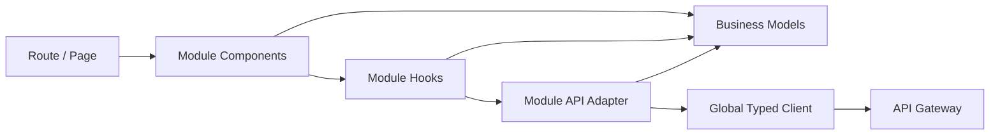
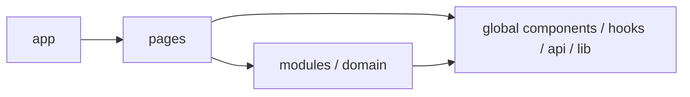
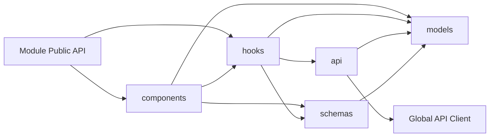

# Web Architecture

- **Status:** Target
- **Owns:** Web runtime structure, frontend data flow, UI system, and API client
  integration
- **Read after:** [`../AGENTS.md`](../AGENTS.md),
  [`../../../docs/business-model.md`](../../../docs/business-model.md),
  [`../../../docs/architecture.md`](../../../docs/architecture.md)
- **Mandatory before:** Initializing or changing the Web application structure

## Runtime Role

The Web application is the first-party browser client. It renders TaskPilot
workflows and consumes only the first-party Web API through the Gateway.

## Technology Direction

- React with strict TypeScript
- Vite
- shadcn/ui with Radix UI and Tailwind CSS
- TanStack Query for server state
- `openapi-typescript` for generated Web API types
- `openapi-fetch` for typed HTTP transport

Stable versions are selected when the project is initialized.

## Architecture Decision

Organize business code by domain module first and technical responsibility
second. React is the view technology, not the application architecture.

- Pages are route adapters and compose business capabilities.
- Domain modules own cohesive frontend business behavior.
- Components render; Hooks adapt React and TanStack Query; models contain pure
  business logic; API adapters isolate transport DTOs and external changes.
- Conventional names such as `components`, `hooks`, `models`, `api`, and
  `schemas` mean the same thing in every module.

A domain module is justified by cohesive non-view business logic, an external
data boundary, or cross-page reuse. Reuse is sufficient but not required. Do
not create a module merely to mirror a backend package.

This design uses separation of concerns and directional dependencies without
adopting methodology-specific layer names.

## Data Flow



Components do not call endpoint functions or `fetch` directly. Hooks coordinate
React state, TanStack Query, mutations, and cache effects. API adapters perform
typed transport and map external DTOs into frontend models. Models remain
independent of React, TanStack Query, routing, and transport.

## Planned Source Boundaries

```text
apps/web/
├── AGENTS.md
├── docs/
├── src/
│   ├── app/
│   │   ├── providers/
│   │   └── router/
│   ├── pages/
│   │   └── <page>/
│   │       ├── <PageName>Page.tsx
│   │       ├── components/       # Route-only composition, when needed
│   │       ├── hooks/            # Route-only state, when needed
│   │       └── index.ts
│   ├── modules/
│   │   └── <domain>/
│   │       ├── components/
│   │       ├── hooks/
│   │       ├── models/
│   │       ├── api/
│   │       ├── schemas/
│   │       ├── types/            # Only declarations without a better owner
│   │       └── index.ts
│   ├── components/
│   │   └── ui/
│   ├── hooks/
│   ├── api/
│   │   ├── generated/
│   │   └── client.ts
│   ├── lib/
│   ├── config/
│   └── test/
└── ...
```

This tree is a placement target, not current filesystem state.

## Top-Level Responsibilities

| Directory | Responsibility |
| --- | --- |
| `app` | Application bootstrap, providers, router, auth and error boundaries |
| `pages` | Route parsing, page composition, and route-only presentation state |
| `modules` | Cohesive frontend business capabilities and their internal layers |
| `components` | Application-wide business-neutral React components |
| `hooks` | Application-wide business-neutral React Hooks |
| `api` | Generated transport types and the global typed HTTP client |
| `lib` | Framework and business-neutral utilities |
| `config` | Validated environment and application configuration |

Pages do not own business models or endpoint adapters. A page-specific
capability with meaningful non-view behavior is still a domain module, even
when only one route currently uses it.

### Dependency Direction



- Top-level technical directories import no page or domain-module code.
- Pages do not import one another.
- Domain modules do not import pages.
- `app` composes pages and application-wide infrastructure.

### Cross-Module Dependencies

A frontend module may depend on another module only when it consumes a stable
business capability that the provider intentionally exports from its
`index.ts`. Cross-module deep imports and cycles are forbidden.

- A page composes multiple modules for route-specific workflows by default.
- A module-to-module dependency is justified by business ownership, not by a
  convenient internal Component or Hook.
- Shared business vocabulary remains owned by its domain module; reuse does not
  move it to a business-neutral root directory.
- The implemented module dependency graph is explicit in architecture lint
  configuration and updated with the owning documentation when a new direction
  is introduced.
- A workflow that coordinates several modules but has no stable domain owner
  remains page composition until a cohesive workflow module emerges.

### Module Internal Direction



- `models` contains pure TypeScript business concepts, policies, calculations,
  and transformations. It imports no React, routing, Query, or transport code.
- `schemas` validates forms and other frontend boundaries. It may use model
  types; models do not depend on schemas.
- `api` calls the global client and owns transport adaptation. It maps generated
  DTOs when the UI needs a different shape, semantics, composition, or
  compatibility boundary; simple stable transport data does not require a
  mechanical duplicate model.
- `hooks` adapts React and TanStack Query to API adapters and models. It does not
  contain reusable pure business rules.
- `components` renders models and invokes Hooks. It never imports module API
  adapters directly.
- `index.ts` is the module's only cross-owner import surface. Other pages and
  modules do not deep-import module internals.

When a runtime schema is the source of truth, export its inferred TypeScript
type from `schemas`; do not duplicate it under `types`. Use `types` only for
declarations that belong to the module but are neither models nor
schema-derived types.

These dependency directions are mandatory. Their automated lint, cycle checks,
fixtures, and CI enforcement are owned by the
[`testing strategy`](testing-strategy.md#architecture-regression-tests).

## Incremental Modularization

Start route-only presentation in its page. Create or extract a domain module as
soon as any of these conditions holds:

- Non-view business rules form a cohesive concept.
- API DTO conversion or external-system adaptation needs an owner.
- Multiple components or pages use the same business capability.
- A Hook is accumulating pure calculations, policy branches, or transport
  details.

Move only genuinely business-neutral reuse to top-level technical directories.
Do not create empty module folders or speculative abstractions.

Small cohesive code may remain together until one of these boundaries becomes
real. File count alone is not a reason to split.

## State Ownership

| State | Owner |
| --- | --- |
| Remote resources and mutations | TanStack Query |
| Route identity, filters, and shareable selection | URL/router state |
| Form state and validation | Form boundary |
| Temporary component interaction | Local React state |
| Authentication session | Application auth boundary |

Do not duplicate query results into a general client-side store. Every
Workspace-owned Query key contains `workspaceId`; Project-owned keys also
contain `projectId`. A scope change cancels obsolete requests and prevents late
responses, optimistic state, or cached data from appearing in the newly active
scope. Cache removal versus retention may be chosen per sensitivity and reuse
need, but cache identity never relies on a mutable global "current Workspace".

## API Contract Integration

- The Web API OpenAPI document is distinct from the public HTTP API.
- Generated types live under `src/api/generated` and are not edited manually.
- Generated DTOs are transport contracts, not frontend business models.
- Module API adapters own transport adaptation and external compatibility.
  Create a frontend model only when it adds semantic value; generated transport
  types may be used directly for simple stable data that does not escape the
  owning module.
- Only transport types are generated. Models and API adapters are handwritten
  where needed; generated React Hooks are not used initially.
- Query options and Query keys are owned by the domain module that owns the
  query. Add a custom Hook when React lifecycle, multiple queries, mutations, or
  reusable behavior require it; do not wrap every endpoint mechanically.
- Mutation success invalidates or updates the smallest correct Workspace- and
  Project-scoped cache.
- Transport errors are normalized into the shared machine-readable error model
  before reaching page UI.
- Mutable edit and transition requests carry the version of the state on which
  the user acted. Version conflicts are presented as refresh, compare, or retry
  decisions rather than silently overwriting newer state.
- Retryable high-risk commands propagate the API's idempotency identifier.

## UI Architecture

- Use shadcn/ui primitives instead of local reimplementations.
- Design-system primitives under `components/ui` use generic props, contain no
  TaskPilot business vocabulary, and access no routes, permissions, Query
  Hooks, or endpoint APIs.
- Page and module Components may express business meaning. A visual shape does
  not determine ownership: `Dialog`, `Form`, and `Card` are primitives;
  `EditWorkItemDialog`, `CreateAgentForm`, and `WorkItemCard` are business Components.
- Keep operational screens compact, predictable, and optimized for repeated
  work.
- Prefer Dialog or Sheet interactions when create or edit flows do not require a
  new page.
- Board, Work Item Type, Workflow, and Agent editors consume backend-validated definitions; the Web
  does not create unsupported DSL semantics. Server diagnostics use stable
  codes and document paths that editors can map to controls.
- Action visibility uses server-provided allowed actions or transitions. Role
  names may explain the UI but never reimplement the authorization policy.
- Authoritative Agent Run state is fetched and cached through normal queries.
  Active execution progress and output use a Workspace-scoped SSE stream;
  reconnect reloads authoritative state before resuming incremental updates.
  Polling with backoff is a fallback when streaming is unavailable, not a
  second source of truth. WebSocket is not an initial default.
- Accessibility and responsive behavior are acceptance requirements, not later
  polish.

## Non-Goals

- No direct database or internal service access.
- No public API SDK ownership.
- No duplicated domain authorization in the browser.
- No generated React hooks in the initial implementation.
- No methodology-specific layers or vocabulary without an explicit later
  decision.
- No module created only to mirror a backend package.
- No business rules hidden in Components, Hooks, transport DTOs, or validation
  schemas.
- No one-to-one DTO-to-model conversion or endpoint-to-Hook wrapper without
  semantic or behavioral value.
- No browser-side permission derivation from role names.
- No WebSocket or custom bidirectional realtime protocol without a proven need.
- No monorepo package for a client with only one consumer.
