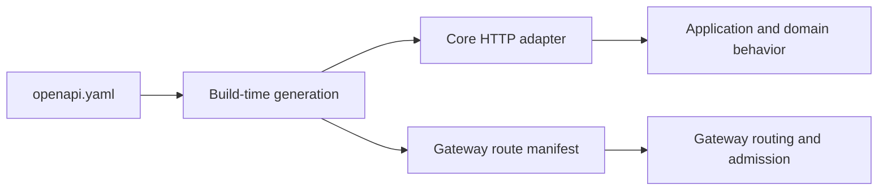

# Canonical API Contract Architecture

- **Status:** Current
- **Owns:** The canonical OpenAPI artifact, build-time Core HTTP generation,
  Gateway route-manifest projection, and contract validation boundaries
- **Read after:** [`../AGENTS.md`](../AGENTS.md),
  [`../../../docs/business-model.md`](../../../docs/business-model.md),
  [`../../../docs/architecture.md`](../../../docs/architecture.md)
- **Mandatory before:** Changing canonical operations, wire schemas, security,
  ingress metadata, generation, or projections

## Current Boundary

`openapi.yaml` is the sole checked-in HTTP contract for TaskPilot's canonical
resource API. It owns method/path, stable operation ID, parameters, wire
request/response schemas, statuses, security declarations, shared Problem
Details, descriptions/tags, and explicit ingress metadata.

The module generates two build-only projections:

1. Kotlin/Spring HTTP interfaces and wire models for the Core HTTP adapter.
2. An immutable JSON route manifest containing method, path, operation ID, and
   ingress for operations admitted by the Gateway.

Core remains the owner of business behavior, authentication, authorization,
transactions, and persistence. Gateway remains the owner of transport admission
and policy. Neither consumer may create a second complete contract source.

Write schemas document the current product limits and sparse mutation shape, while
response schemas deliberately retain historical-value compatibility. Optional
mutation properties are non-null when present and generated with property-level
Jackson null-fail annotations. Description and assignee clearing use explicit
SET/CLEAR envelopes rather than raw JSON `null`; Work Item creation separately
allows an omitted or explicit-null assignee to mean unassigned. Kotlin/Spring Bean
Validation projection is disabled because its UTF-16 length semantics cannot own
TaskPilot's trimmed NFC Unicode-code-point policy. Core application validation owns
persisted product text, while Core HTTP adapters explicitly retain transport-only
credential and legal-metadata bounds declared by the contract.

## Current Session Logout Representation

The existing `POST /v1/session:logout` operation accepts an optional strict
`LogoutRequest`. With absent body or `{}`, Core authenticates the legacy strict
bearer credential. A non-null `refreshToken` (1–512 Unicode code points) instead
requires no Authorization header. The empty security alternative permits this
body-credential mode; it does not make logout anonymous. Null/invalid shapes,
unknown properties and dual credentials are rejected with 400; missing legacy
credentials return 401. Valid unknown, expired or revoked credentials return
idempotent 204; Redis unavailability returns 503. Core owns credential validation
and atomic revocation, not the generated DTO or Gateway. Secrets have no examples
or defaults. Legacy bearer-only logout cannot locate a still-refreshable session
after its access index expires. Deploy Core support before Desktop; roll back Desktop before Core.

## Dependency Direction

Generated output is deterministic and remains under this module's `build/`
directory. Consumers use Gradle task outputs; no runtime service discovery or
Core `/v3/api-docs` lookup participates in routing.
