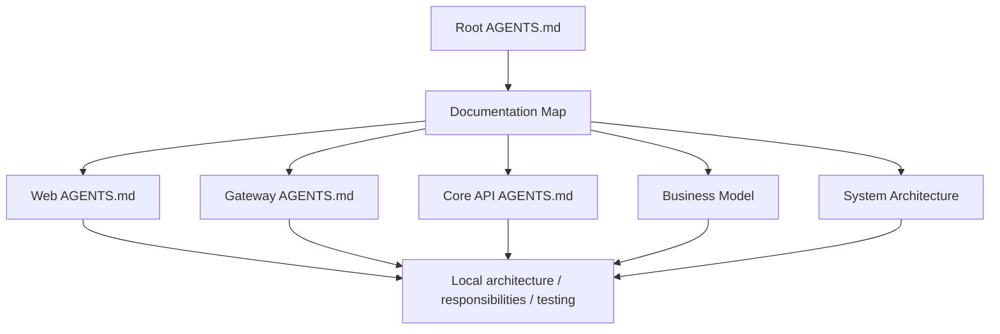

# TaskPilot Documentation Map

- **Status:** Current
- **Owns:** Repository documentation inventory, navigation paths, and document
  ownership boundaries
- **Read after:** [`../AGENTS.md`](../AGENTS.md)
- **Mandatory before:** Adding, moving, renaming, or changing the ownership of
  repository documentation

## How to Navigate

Start from the repository root [`AGENTS.md`](../AGENTS.md). Then follow the path
that matches the change:

Use these reading routes:

| Change | Required reading |
| --- | --- |
| Business terminology, behavior, lifecycle, workflow, Board, Work Item, Agent, approval, or custom field | [`business-model.md`](business-model.md) |
| Cross-project architecture, runtime topology, shared API policy, or project boundary | [`architecture.md`](architecture.md) |
| Web code, UI behavior, frontend structure, or Web tests | Root documents above, then [`apps/web/AGENTS.md`](../apps/web/AGENTS.md) and its linked document |
| Gateway route, policy, filter, configuration, or tests | Root architecture, then [`services/gateway/AGENTS.md`](../services/gateway/AGENTS.md) and its linked document |
| Core API code, persistence, API, workflow runtime, provider integration, or tests | Root business model and architecture, then [`services/core-api/AGENTS.md`](../services/core-api/AGENTS.md) and its linked document |
| Documentation ownership or navigation | This map and the root `AGENTS.md` documentation rules |

## Root Documents

| Document | Status | Owns |
| --- | --- | --- |
| [`../AGENTS.md`](../AGENTS.md) | Current | Mandatory repository-wide instructions and navigation rules |
| [`../README.md`](../README.md) | Current | Human-facing project orientation |
| [`business-model.md`](business-model.md) | Target | Product vocabulary, identity and relationship maps, Event Storming scenarios, state machines, and MVP business rules |
| [`architecture.md`](architecture.md) | Target | System topology, cross-project boundaries, shared technical contracts, and architecture-wide quality policy |

## Web Documents

| Document | Status | Owns |
| --- | --- | --- |
| [`../apps/web/AGENTS.md`](../apps/web/AGENTS.md) | Current | Mandatory Web navigation and local working rules |
| [`../apps/web/docs/architecture.md`](../apps/web/docs/architecture.md) | Target | Web runtime structure, dependency direction, state ownership, and API integration |
| [`../apps/web/docs/responsibilities.md`](../apps/web/docs/responsibilities.md) | Target | UI capability ownership and placement rules |
| [`../apps/web/docs/testing-strategy.md`](../apps/web/docs/testing-strategy.md) | Target | Web test layers, critical journeys, browser coverage, and quality gates |

## Gateway Documents

| Document | Status | Owns |
| --- | --- | --- |
| [`../services/gateway/AGENTS.md`](../services/gateway/AGENTS.md) | Current | Mandatory Gateway navigation and local working rules |
| [`../services/gateway/docs/architecture.md`](../services/gateway/docs/architecture.md) | Target | Gateway runtime, request pipeline, routes, and transport policies |
| [`../services/gateway/docs/responsibilities.md`](../services/gateway/docs/responsibilities.md) | Target | Gateway policy ownership and non-responsibilities |
| [`../services/gateway/docs/testing-strategy.md`](../services/gateway/docs/testing-strategy.md) | Target | Gateway security, routing, filter, and reliability verification |

## Core API Documents

| Document | Status | Owns |
| --- | --- | --- |
| [`../services/core-api/AGENTS.md`](../services/core-api/AGENTS.md) | Current | Mandatory Core API navigation and local working rules |
| [`../services/core-api/docs/architecture.md`](../services/core-api/docs/architecture.md) | Target | Core runtime structure, application transactions, persistence, APIs, durable jobs, and provider boundary |
| [`../services/core-api/docs/responsibilities.md`](../services/core-api/docs/responsibilities.md) | Target | Core API capability ownership, use-case placement, and collaboration rules |
| [`../services/core-api/docs/testing-strategy.md`](../services/core-api/docs/testing-strategy.md) | Target | Core API business, persistence, API, concurrency, and Runner verification |

## Ownership Rules

- The business model owns **what the product means and must do**.
- The root architecture owns **how the whole system is divided and connected**.
- A child architecture owns **how one runnable subproject is structured**.
- A responsibilities document owns **where behavior belongs inside that
  subproject**.
- A testing strategy owns **how the subproject proves its behavior and risks**.
- `AGENTS.md` files own **mandatory navigation and working constraints**, not
  duplicated design detail.
- The root README orients humans but is not a second architecture or business
  specification.

When a concern moves to a child document, the former owner keeps only a summary
and link. No two documents should maintain the same detailed rule. A child
engineering document may refine implementation but cannot redefine business
vocabulary or contradict a cross-project boundary.

## Keeping the Map Complete

When adding, moving, renaming, or deleting an engineering document:

1. Update this inventory and its reading route in the same change.
2. Update the relevant root or child `AGENTS.md` navigation link.
3. Update inbound links from the former owner.
4. Declare the document's Status, Owns, Read after, and Mandatory before
   metadata.
5. Check every relative Markdown link and every Mermaid diagram.
6. Do not add a document that duplicates an existing owner's detailed rules.
