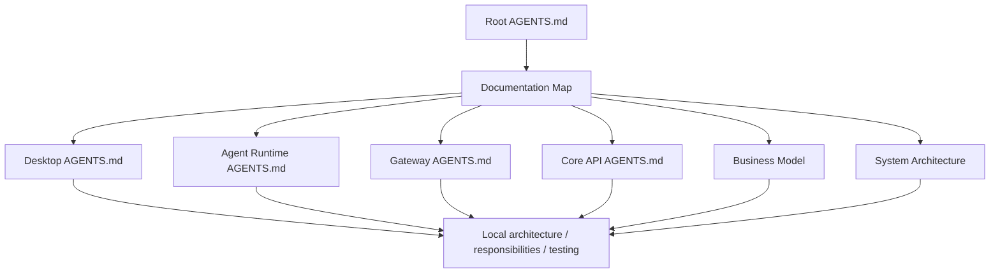

# TaskPilot Documentation Map

- **Status:** Current
- **Owns:** Repository documentation inventory, navigation paths, and document
  ownership boundaries
- **Read after:** [`../AGENTS.md`](../AGENTS.md)
- **Mandatory before:** Adding, moving, renaming, or changing the ownership of
  repository documentation

## How to Navigate

Start from the repository root [`AGENTS.md`](../AGENTS.md), then follow the path
matching the change:

| Change | Required reading |
| --- | --- |
| Business terminology, lifecycle, workflow, Board, Work Item, Agent, approval, or custom field | [`business-model.md`](business-model.md) |
| Cross-project architecture, trust boundaries, shared API policy, or project boundary | [`architecture.md`](architecture.md) |
| Desktop window, Renderer UI, Electron process, native integration, packaging, or Desktop tests | Root documents, then [`apps/desktop/AGENTS.md`](../apps/desktop/AGENTS.md) and its linked document |
| Local Agent execution, workspace access, tools, process/PTY, journal, Diff/artifact, or Runtime tests | Root business model and architecture, then [`apps/agent-runtime/AGENTS.md`](../apps/agent-runtime/AGENTS.md) and its linked document |
| Gateway route, identity normalization, provider-callback ingress, policy, filter, configuration, or tests | Root architecture, then [`services/gateway/AGENTS.md`](../services/gateway/AGENTS.md) and its linked document |
| Core API persistence, API, workflow runtime, provider integration, execution evidence, or tests | Root business model and architecture, then [`services/core-api/AGENTS.md`](../services/core-api/AGENTS.md) and its linked document |
| Mascot artwork: creating, regenerating, editing, or placing it anywhere | [`brand/mascot.md`](brand/mascot.md) |
| Documentation ownership or navigation | This map and the root `AGENTS.md` documentation rules |

## Root Documents

| Document | Status | Owns |
| --- | --- | --- |
| [`../AGENTS.md`](../AGENTS.md) | Current | Mandatory repository-wide instructions and navigation rules |
| [`../README.md`](../README.md) | Current | Human-facing project orientation |
| [`business-model.md`](business-model.md) | Target | Product vocabulary, identity and relationships, Event Storming scenarios, state machines, and MVP rules |
| [`architecture.md`](architecture.md) | Target | System topology, cross-project boundaries, shared technical contracts, and architecture-wide quality policy |

## Brand Documents

| Document | Status | Owns |
| --- | --- | --- |
| [`brand/mascot.md`](brand/mascot.md) | Proposed | Mascot character definition, identity invariants, approved artwork in [`brand/mascot/`](brand/mascot/), and derivation rules |

## Desktop Documents

| Document | Status | Owns |
| --- | --- | --- |
| [`../apps/desktop/AGENTS.md`](../apps/desktop/AGENTS.md) | Current | Mandatory Desktop navigation and local working rules |
| [`../apps/desktop/docs/architecture.md`](../apps/desktop/docs/architecture.md) | Target | Electron boundaries, Renderer structure, typed IPC, provider-neutral Agent presentation, native integration, API integration, and packaging |
| [`../apps/desktop/docs/responsibilities.md`](../apps/desktop/docs/responsibilities.md) | Target | Desktop capability ownership and placement rules |
| [`../apps/desktop/docs/testing-strategy.md`](../apps/desktop/docs/testing-strategy.md) | Target | Renderer, IPC, packaged Electron, accessibility, and native platform verification |
| [`../apps/desktop/docs/design-foundation.md`](../apps/desktop/docs/design-foundation.md) | Target | Approved Desktop visual direction, layout grammar, design tokens, typography, interaction states, and first-slice screen wireframes |

## Agent Runtime Documents

| Document | Status | Owns |
| --- | --- | --- |
| [`../apps/agent-runtime/AGENTS.md`](../apps/agent-runtime/AGENTS.md) | Current | Mandatory Runtime navigation and local security rules |
| [`../apps/agent-runtime/docs/architecture.md`](../apps/agent-runtime/docs/architecture.md) | Target | Local Desktop execution topology, protocols, workspace/tool/process boundaries, journal, evidence, and platform adapters |
| [`../apps/agent-runtime/docs/responsibilities.md`](../apps/agent-runtime/docs/responsibilities.md) | Target | Runtime capability ownership and placement rules |
| [`../apps/agent-runtime/docs/testing-strategy.md`](../apps/agent-runtime/docs/testing-strategy.md) | Target | Policy, protocol, filesystem, process/PTY, recovery, and native platform verification |

## Gateway Documents

| Document | Status | Owns |
| --- | --- | --- |
| [`../services/gateway/AGENTS.md`](../services/gateway/AGENTS.md) | Current | Mandatory Gateway navigation and local working rules |
| [`../services/gateway/docs/architecture.md`](../services/gateway/docs/architecture.md) | Target | Gateway runtime, request pipeline, Desktop/local-Runtime/provider-callback/public routes, and transport policies |
| [`../services/gateway/docs/responsibilities.md`](../services/gateway/docs/responsibilities.md) | Target | Gateway policy ownership and non-responsibilities |
| [`../services/gateway/docs/testing-strategy.md`](../services/gateway/docs/testing-strategy.md) | Target | Gateway security, routing, filter, identity, and reliability verification |

## Core API Documents

| Document | Status | Owns |
| --- | --- | --- |
| [`../services/core-api/AGENTS.md`](../services/core-api/AGENTS.md) | Current | Mandatory Core API navigation and local working rules |
| [`../services/core-api/docs/architecture.md`](../services/core-api/docs/architecture.md) | Target | Core runtime, transactions, persistence, APIs, durable jobs, executor routing, local execution evidence, and remote-provider boundary |
| [`../services/core-api/docs/responsibilities.md`](../services/core-api/docs/responsibilities.md) | Target | Core API capability ownership, use-case placement, and collaboration rules |
| [`../services/core-api/docs/testing-strategy.md`](../services/core-api/docs/testing-strategy.md) | Target | Core API business, persistence, API, concurrency, remote-provider adapter, and local-Runtime protocol verification |

## Ownership Rules

- The business model owns **what the product means and must do**.
- The root architecture owns **how the whole system is divided and connected**.
- A child architecture owns **how one runnable subproject is structured**.
- A responsibilities document owns **where behavior belongs inside that
  subproject**.
- A testing strategy owns **how the subproject proves its behavior and risks**.
- `AGENTS.md` files own **mandatory navigation and working constraints**, not
  duplicated design detail.
- The root README orients humans but is not a second architecture or business
  specification.

When a concern moves to a child document, the former owner keeps only a summary
and link. A child document may refine implementation but cannot redefine
business vocabulary or contradict a cross-project boundary.

## Keeping the Map Complete

When adding, moving, renaming, or deleting an engineering document:

1. Update this inventory and its reading route in the same change.
2. Update the relevant root or child `AGENTS.md` navigation link.
3. Update inbound links from the former owner.
4. Declare Status, Owns, Read after, and Mandatory before metadata.
5. Check every relative Markdown link and render every changed Mermaid diagram.
6. Do not add a document that duplicates an existing owner's detailed rules.
