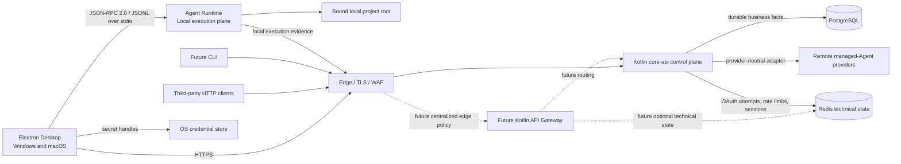

# TaskPilot Architecture

- **Status:** Target
- **Owns:** System topology, cross-project technical constraints, quality
  policy, and top-level project boundaries
- **Read after:** [`../AGENTS.md`](../AGENTS.md)
- **Mandatory before:** Creating a subproject or changing a cross-project
  boundary

## Scope

This document is the authoritative home for overall system architecture,
cross-project technical constraints, and confirmed project boundaries while the
repository is being formed. Product vocabulary and behavior belong to the
[`business model`](business-model.md). This document may temporarily contain
frontend, Gateway, backend, CLI, or infrastructure decisions until a real
subproject exists to own the detail.

The repository now contains runnable Desktop and Core API subprojects. Their
current first-use slice covers system-browser GitHub authentication, first
registration, opaque-session restore/refresh/logout, production Flyway
migrations for durable identity facts, Redis-backed temporary authentication
state, and non-production runtime OpenAPI. Workspace and Project capabilities,
Agent Runtime, Gateway, broader product behavior, deployment, signing, and
updates remain Target unless explicitly marked Current.

## Diagram Conventions

Architecture documents use Mermaid as the rendering format and select notation
by the question being answered:

| Question | Mermaid diagram |
| --- | --- |
| How systems or modules connect | `flowchart` |
| Which domain concepts relate | `classDiagram` |
| How a lifecycle changes state | `stateDiagram-v2` |
| How one scenario executes over time | `sequenceDiagram` |
| How implemented tables relate | `erDiagram` |

Use UML semantics through Mermaid where they improve precision. Keep diagrams
conceptual and pair them with tables for ownership, invariants, and details.
Physical ER diagrams belong to the owning backend subproject after its schema
exists.

## System Shape



The Desktop is the first-party interaction surface. Its sandboxed Renderer uses
a typed Preload/Main boundary and never owns cloud credentials or sends
credentialed requests directly. Electron Main owns the authenticated cloud
client and OS integration. A bundled Rust Agent Runtime child is introduced
and launched lazily from a fixed trusted path only when a `LOCAL_DESKTOP`
capability requires it; login, Workspace/Project flows, and `REMOTE_MANAGED` run
viewing do not depend on that child. Main communicates with a started Runtime
through inherited stdin/stdout pipes using JSON-RPC 2.0 with one JSON message per
line; Runtime stderr is reserved for logs. The Runtime owns local Agent/tool
execution, process/PTY supervision, logs, Diff, and artifacts. It does not own
business state or write `core-api` tables.

`core-api` remains the owner of AgentRun and approval business truth. An Agent
Version selects exactly one execution mode. `REMOTE_MANAGED` execution is
invoked by a server-side provider adapter and does not require Desktop or Agent
Runtime availability. `LOCAL_DESKTOP` execution is dispatched to the local
Runtime through a separate authenticated managed-execution surface. Both paths
report normalized progress, results, cancellation, errors, and artifacts into
the same AgentRun control-plane lifecycle; provider-specific states and IDs do
not become TaskPilot identity or business status.

Managed local execution uses a future authenticated, short-lived execution-grant
contract; the Runtime never receives or stores the Desktop's long-lived user
token. The grant's issuer, subject/resource bindings, expiry, refresh,
revocation, replay prevention, and logout behavior must be specified before
local execution is implemented. Remote provider credentials remain behind
Core API-managed secret references and are never sent to Desktop.

A business `Workspace` is the cloud tenant scope, not a filesystem path. The
Runtime represents an authorized local project root with a device-local opaque
`LocalWorkspaceBindingId`; its raw absolute path stays local by default. Local
path checks constrain TaskPilot-owned file tools and execution policy but are not an
OS-level sandbox. Arbitrary child processes retain the user's OS permissions and
may access resources outside the selected root. Before TaskPilot exposes general
Shell or CLI execution, a separate design must define and natively verify macOS
and Windows isolation, child-process network policy, whole-process-tree cleanup,
and sandbox failure and escape behavior. Rust, local consent, and canonical path
checks do not satisfy that gate by themselves.

For the MVP, Desktop Main reaches the Core API through the deployment edge/TLS
boundary. That edge may provide transport protection such as TLS termination,
basic request-size/rate controls, and observability, but it does not create a
trusted application principal. Core API is the only current application-layer
Resource Server: it validates the Desktop bearer token and remains responsible
for every business authorization decision. The Gateway is a future optional
boundary, not an MVP request hop; introducing it requires a separate Change for
a proven multi-backend, multi-API-surface, or centralized edge-policy need and
must not weaken Core API authentication or authorization.

Redis is current technical infrastructure for Core API OAuth attempts,
registration continuations, login rate limits, and opaque sessions. These keys
are bounded by TTL and fail closed when Redis is unavailable. PostgreSQL remains
the system of record for durable User, External Identity, and legal-acceptance
facts; Redis never owns business truth. A future Gateway may also use Redis only
for a separately justified technical requirement.

Current first registration treats `(locale, legalBundleVersion, termsVersion,
privacyVersion)` as the cross-project identity of the exact legal texts shown by
Desktop. Core API accepts only a canonical, duplicate-free configured locale
allowlist combined with its configured version triple, generates `acceptedAt`,
and atomically stores the complete acceptance evidence with User and External
Identity. Unknown or non-canonical combinations fail closed before durable
writes. This allowlist is a legal-contract boundary, not general server-side
i18n: Problem Details remain stable transport contracts, locale is not a User
attribute. The registration preview HTTP DTO exposes the required version triple and canonical legal-locale allowlist to Desktop so it can fail closed before submission; the PostgreSQL schema is unchanged.

## Top-Level Project Boundaries

```text
taskpilot/
├── apps/
│   ├── desktop/              # Current Electron/React first-use slice
│   │   ├── AGENTS.md
│   │   ├── docs/
│   │   ├── src/
│   │   └── tests/
│   ├── agent-runtime/
│   │   ├── AGENTS.md
│   │   └── docs/
│   └── cli/                   # Future
├── services/
│   ├── gateway/
│   │   ├── AGENTS.md
│   │   └── docs/
│   └── core-api/
│       ├── AGENTS.md
│       ├── build.gradle.kts
│       ├── docs/
│       └── src/               # Current first-use APIs, persistence, and layered tests
├── contracts/                 # Future, when API specifications exist
├── docs/
│   ├── README.md              # Documentation knowledge map
│   ├── business-model.md      # Product vocabulary and behavior
│   └── architecture.md        # Cross-project technical architecture
├── gradle/                    # Current version catalog and Wrapper metadata
├── gradlew
├── gradlew.bat
├── settings.gradle.kts
├── build.gradle.kts
├── AGENTS.md
└── README.md
```

Do not create future directories until their project or artifact is actually
initialized. Desktop and Core API are the currently initialized runnable
subprojects; Agent Runtime and Gateway still have documentation owners only. The
future CLI receives the same structure when created.

## Technology Direction

- Desktop: Electron, React, strict TypeScript, Vite, and TanStack Query, with
  sandboxed Renderer and typed Preload IPC. See
  [`apps/desktop/docs/architecture.md`](../apps/desktop/docs/architecture.md).
- Agent Runtime: a bundled Rust child process supervised by Electron Main, with
  JSON-RPC 2.0 / JSONL over stdio and narrow Windows/macOS platform adapters.
  Rust protocol types generate TypeScript types and JSON Schema; concrete Rust
  libraries are selected when the Runtime is initialized. See
  [`apps/agent-runtime/docs/architecture.md`](../apps/agent-runtime/docs/architecture.md).
- Gateway: Kotlin and Spring Cloud Gateway. See
  [`services/gateway/docs/architecture.md`](../services/gateway/docs/architecture.md).
- Core API: Kotlin, Spring Boot, and Spring Modulith. See
  [`services/core-api/docs/architecture.md`](../services/core-api/docs/architecture.md).
- Data: PostgreSQL as the system of record for durable business facts; Redis for
  bounded, short-lived OAuth workflow, rate-limit, and opaque-session state.
- Build: pnpm for JavaScript projects, Cargo for the Rust Runtime, and Gradle
  Kotlin DSL for Kotlin projects.
- Local development: the root pnpm commands are a cross-project entry point,
  not the owner of Kotlin compilation or database migration. Explicit
  `bootstrap` validates system prerequisites, installs the locked JavaScript
  graph, precompiles Desktop and Core API, and pulls missing images; routine
  `dev` delegates Core API compilation/runtime to the Gradle Wrapper and Flyway
  execution to Spring Boot. Compose owns PostgreSQL and Redis. Each checkout has
  a deterministic Compose project, independent PostgreSQL/Redis volumes, and persisted
  loopback ports propagated through Compose, Spring Boot, Vite, Electron, and
  Desktop transport. Git-ignored `.env.local` owns the GitHub OAuth App values
  and independent federated HMAC/AEAD keys; incomplete configuration leaves the
  Core API healthy while disabling the capability. Git-ignored state records
  only process ownership and logs. Re-running the complete launcher replaces
  only host process trees proven to belong to the same checkout, waits for the
  previous launcher to exit, and uses PID-conditional state cleanup so an old
  launcher cannot erase its successor's record. The controller never takes
  over or stops unknown processes and never runs Flyway repair. For a Core API
  startup failure that is specifically classified as a Flyway schema-history
  incompatibility, it may rebuild the disposable local PostgreSQL volume and
  retry once only after proving all three boundaries: Flyway reported the exact
  configured loopback JDBC target in the current startup log, the Compose
  project belongs to this checkout, and the volume has matching standard
  Compose project and logical-volume labels. Connection failures, ordinary
  migration SQL errors, external or non-loopback databases, unknown resources,
  and a second startup failure fail closed without deletion. Compose startup
  removes only orphan containers in the same proven project. Automated smoke
  checks health and fail-closed behavior in an isolated temporary Core API
  without rewriting the real OAuth configuration or contacting GitHub. The
  real macOS development OAuth journey was manually accepted on 2026-10-12;
  browser close/focus remains platform evidence rather than a unit-test claim.
  This is not a production deployment topology.

Stable, mutually compatible versions are selected when each subproject is
initialized. Windows and macOS share product code and protocols, but signing,
packaging, native integrations, process behavior, and releases require separate
platform evidence.

## Subproject Documentation

| Subproject | Architecture | Responsibilities | Testing |
| --- | --- | --- | --- |
| Desktop | [`architecture`](../apps/desktop/docs/architecture.md) | [`responsibilities`](../apps/desktop/docs/responsibilities.md) | [`testing strategy`](../apps/desktop/docs/testing-strategy.md) |
| Agent Runtime | [`architecture`](../apps/agent-runtime/docs/architecture.md) | [`responsibilities`](../apps/agent-runtime/docs/responsibilities.md) | [`testing strategy`](../apps/agent-runtime/docs/testing-strategy.md) |
| Gateway | [`architecture`](../services/gateway/docs/architecture.md) | [`responsibilities`](../services/gateway/docs/responsibilities.md) | [`testing strategy`](../services/gateway/docs/testing-strategy.md) |
| Core API | [`architecture`](../services/core-api/docs/architecture.md) | [`responsibilities`](../services/core-api/docs/responsibilities.md) | [`testing strategy`](../services/core-api/docs/testing-strategy.md) |

## SDD Delivery and Review Workflow (Current)

TaskPilot's repository-level OpenSpec workflow is implemented by the project
default [`taskpilot-sdd` schema](../openspec/schemas/taskpilot-sdd/schema.yaml),
its [`test-plan` template](../openspec/schemas/taskpilot-sdd/templates/test-plan.md),
and the workflow Skills routed by [`AGENTS.md`](../AGENTS.md). This section
describes the cross-project quality gate; it does not mean the Target application
components described elsewhere in this document already exist.

```mermaid
flowchart LR
    explore["Evidence + explore"]
    model["Proportionate business modeling"]
    confirm["Human proposal confirmation"]
    plan["Proposal / Specs / Design / Test Plan"]
    apply["Apply"]
    checks["Focused and affected checks"]
    feedback["Model-drift audit + owner-doc feedback"]
    verify["Optional independent verify"]
    sync["Delta spec sync"]
    archive["Archive"]

    explore --> model --> confirm --> plan --> apply --> checks --> feedback --> sync --> archive
    confirm -->|not ready| explore
    checks -. high risk or user request .-> verify
    verify -->|blocking finding| apply
    verify -->|no blocker| feedback
    apply -->|new domain evidence| model
```



- A possible Change starts in read-only exploration, not proposal authoring.
  Existing evidence is inspected first; material ambiguity and high-impact
  decisions are resolved through a visible decision tree, using
  `grill-with-tree` where available or an equivalent cross-Agent interaction.
  Proposal artifacts may be written only after the user confirms the resulting
  scope, decisions, non-goals, and proposal action.
- Every feature performs a proportionate business-modeling pass before planning
  is complete. The pass starts from concrete scenarios and analyzes the
  affected canonical language, identity, ownership/reference/cardinality,
  lifecycle, invariants, authorization and tenant scope, version/history, real
  asynchronous boundaries, and material failure or recovery paths. Lightweight
  Event Storming, example mapping, relationship diagrams, state machines,
  decision trees, and threat modeling are selected by risk; none implies
  tactical DDD, event sourcing, or one code artifact per analysis concept.
- The Change records its model impact and the owner documents expected to
  receive stable conclusions. A no-model-change conclusion is acceptable only
  when it points to the existing approved rule being implemented. Decisions
  that alter behavior, data ownership, security, or task ordering are resolved
  before apply; safely deferred details name their later resolution gate.
- Before implementation, `test-plan.md` maps changed scenarios and material
  risks to the lowest reliable verification layer, names focused and affected
  commands, and records any justified automation gaps. It references this
  document and the nearest child testing strategy rather than repeating their
  tool and layer matrices.
- TDD is optional and is appropriate for business-feature behavior with clear,
  automatable boundaries. When selected, tests and the production behavior they
  protect land in the same task group, and Green cannot be obtained by weakening
  the approved contract or assertion, skipping a test, or moving production
  behavior into test code.
- Documentation, workflow, configuration, generated-file, dependency,
  scaffolding, and exploratory changes use verification matched to their actual
  type and risk. Do not manufacture failing tests, fixtures, or Red/Green phases
  merely to demonstrate process compliance.
- Apply should continue through the selected Change's pending tasks and pause
  only when a concrete blocker requires user action. An implementation
  discovery that changes the approved model or contract is such a decision
  boundary: update the Change and the owning source of truth before encoding the
  new rule in further production code.
- After implementation, run the focused and affected checks declared by the
  Change's test plan. Applicable coverage, architecture, contract, database,
  browser, packaged Desktop, and system gates remain blocking when the owning
  testing strategy requires them.
- `openspec-verify-change` is an optional read-only second pass for high-risk
  work or explicit user requests. Its findings return to apply, but routine
  archive readiness does not depend on a verification receipt, policy,
  fingerprint, or repository-specific preflight.
- Before archive, assess every delta spec and sync it into the corresponding
  main spec. A Change with `skip_specs: true` reports that no delta sync is
  applicable; this marker never waives implementation verification or strict
  validation.
- Before delta-spec sync and archive, compare the implemented code, migrations,
  APIs, tests, and operational evidence with the planned model. Reconcile drift
  and feed stable product semantics into `docs/business-model.md`, cross-project
  contracts into this architecture, delegated details into child documents,
  and observable behavior into main OpenSpec specs. Update Current/Target status
  from evidence. Documentation should normally evolve with its owning slice;
  this final audit is a reconciliation gate, not a final catch-all authoring
  phase. If no owner document changes, the Change records why.
- The canonical test tools, layer ownership, critical scenarios, and local
  commands remain in the Desktop, Agent Runtime, Gateway, and Core API
  [testing strategies](#subproject-documentation). This workflow only requires
  each change to select and evidence the relevant parts.

Workflow Skills are managed by the official OpenSpec integration for each Agent.
Generated Skill files are not edited manually, and the repository does not wrap
or re-test OpenSpec's own generation, state-machine, or validation behavior.
Use OpenSpec's official schema and strict validation commands for repository-owned
artifacts.

## Repository Commit Quality Strategy (Current)

The repository owns local `pre-commit` and `commit-msg` feedback gates in
`.githooks/`, with dependency-free Node implementations and tests in
`tools/git-hooks/`. `pnpm bootstrap` reuses `pnpm hooks:install` behavior to set
the relative `.githooks` path through Git worktree-specific configuration.
Installation is per checkout: it pins an inherited expected value for the
current worktree, leaves linked worktrees unchanged, and fails closed rather
than overwriting any effective custom `core.hooksPath`.

The commit-message contract is
`<type>(<optional-scope>)<optional-!>: <description>`. Its allowed type set is
`feat`, `fix`, `refactor`, `docs`, `test`, `build`, `ci`, `perf`, `chore`, and
`revert`. There are no implicit merge, revert, fixup, or squash exemptions; in
particular, Git's default `Revert "..."` subject must be edited to a value such
as `revert(core-api): restore previous session behavior`.

The pre-commit selector treats the staged Git index as the only source for
which modules changed. It parses NUL-delimited name-status records, classifies
both sides of a rename and only the target of a copy, deduplicates gates, and
runs them in the fixed order below:

| Owner | Versioned path boundary | Current command |
| --- | --- | --- |
| Hook tooling | `.githooks/**`, `tools/git-hooks/**` | `pnpm hooks:test` |
| Development tooling | `tools/dev/**`, `compose.yaml`, `.env.local.example` | `pnpm dev:test` |
| Desktop | Executable/configuration paths under `apps/desktop/**` | `pnpm --filter @taskpilot/desktop qualityCheck` |
| Core API | Executable/configuration paths under `services/core-api/**`, root Gradle files, `gradle/**` | platform wrapper plus `--no-daemon :services:core-api:qualityCheck` |

Root pnpm package, workspace, and lock files select Hook tooling, Development
tooling, and Desktop together. Markdown, OpenSpec artifacts, Agent instructions,
and known repository metadata are explicit exemptions. Any other staged path
fails closed until its ownership and quality gate are declared. This mapping
accelerates local feedback only; main or release verification must still catch
an incorrect dependency map as required by the risk-based test policy.

Module quality commands execute against the worktree, so selection alone cannot
prove that the staged snapshot was tested. Before execution, the hook rejects
tracked unstaged and untracked files that map to a selected gate, while ignoring
dirty files in unrelated mapped modules. It never stashes, resets, cleans,
constructs another worktree, or mutates the index. Each failure reports the
rule or gate, concrete cause, triggering paths and command when applicable, and
a manual next step. Child Desktop and Core API testing strategies continue to
own the contents of their quality gates; this repository strategy only owns
selection and orchestration.

POSIX quality commands execute directly with fixed argv. On Windows, Node cannot
directly launch `.cmd` or `.bat`, so only those fixed commands use an escaped
`cmd.exe` adapter; staged paths and commit content never enter that command line.

The hooks are developer feedback rather than a trust or supply-chain boundary:
`git commit --no-verify` can bypass them. They do not replace CI, review,
release, or supported-platform evidence. Automated tests cover platform logical
commands, the Windows batch adapter, and the POSIX hook entry used by Git for
Windows, but real Windows Git execution remains separate platform evidence.

## Cross-Project Testing Boundaries

- Each subproject owns comprehensive risk-based tests for its behavior and
  trust boundary.
  Broader system tests sample cross-project integration and do not repeat each
  subproject's validation, routing, permission, or error matrix.
- Desktop Renderer integration uses the controlled Preload capability boundary;
  Main integration tests own the credentialed HTTP/cloud adapter. Packaged
  Electron journeys own real Renderer/Preload/Main behavior; native Windows/macOS
  tests own OS credential, deep-link, process, packaging, and lifecycle risks
  that Renderer tests cannot prove.
- Agent Runtime policy and protocol tests run below system E2E; real
  filesystem, process-tree, PTY, journal/recovery, and platform tests remain at
  the Runtime boundary.
- System E2E selects the real boundaries needed by the scenario. MVP ordinary
  product flows use Desktop, the deployment edge/TLS test boundary, Core API,
  and PostgreSQL; a future Gateway is included only after its own initialization
  Change. A provider fake sits at the server-side adapter boundary for
  `REMOTE_MANAGED`; packaged Agent Runtime plus its managed-execution surface is
  used for `LOCAL_DESKTOP`. Third-party identity and Agent providers may be
  deterministic test doubles at TaskPilot-owned outbound boundaries.
- System E2E state is prepared through controlled test fixtures or APIs rather
  than repeated UI setup. Test-only setup capabilities are unavailable in
  production and cannot bypass the business rule under test.
- Once initialized, Gateway routing, header trust, credential, timeout, and
  rate-limit matrices remain Gateway integration tests. Core API authentication,
  domain, tenancy, authorization, persistence, migration, concurrency, and
  idempotency matrices remain Core API tests.
- The initial Desktop API uses runtime OpenAPI contract tests and Swagger UI;
  generated-client and compatibility gates are introduced only by a later
  Change with a versioned-contract requirement. No contract gate substitutes
  for runtime API or system integration tests.
- Essential security, contract, database, migration, and critical-journey tests
  are blocking before release; nightly execution may broaden coverage but is
  never their only home.

## Risk-Based Test Portfolio

Test depth follows the cost of an escaped defect rather than the size of a file
or a desire to maximize test count:

| Risk class | Examples | Minimum evidence |
| --- | --- | --- |
| Critical | Tenant isolation, authentication and authorization, destructive writes, workflow transitions, idempotency, concurrency, migrations, execution grants and Runtime recovery | Focused rule tests, real-boundary integration tests, negative cases, and a representative cross-system journey when user-visible |
| High | Main Work Item and Board workflows, public API compatibility, cache scope, retries, external-provider failure | Unit or module integration tests, contract tests where applicable, and selected packaged Desktop or infrastructure integration |
| Routine | Presentation variants, formatting, simple mapping, non-critical configuration | The lowest reliable unit or component layer; broader tests only when they catch a distinct failure mode |

Every feature or defect fix identifies its important success, rejection,
boundary, and recovery cases. An escaped production defect adds a regression
test at the lowest layer that reproduces it and, when the escape exposed a
missing boundary check, a test at that boundary as well.

## Coverage and Effectiveness Policy

Coverage is a guardrail over executable production code, not the definition of
quality. The generated projects must report at least:

1. Changed executable line and branch coverage for production code.
2. Whole-subproject line and branch coverage as a non-regression trend.
3. Coverage of critical behaviors and risk cases, maintained as named tests or
   a risk-to-test matrix rather than inferred from line coverage.
4. Contract, architecture-boundary, migration, packaged Desktop, and supported-platform results,
   which source coverage cannot represent.

After coverage instrumentation exists, the initial blocking floor is 80% line
coverage and 75% branch coverage on changed executable production code. Changed
critical domain, tenant, authorization, concurrency, and idempotency rules
require at least 90% branch coverage unless the change records a concrete,
time-bounded exception. Whole-subproject coverage must not decrease without an
explicit explanation and approval.

These floors are minimum signals, not reasons to add assertions without defect
detection value. A change still fails review when an important behavior,
negative path, or boundary is untested even if its percentages pass.

Generated clients, generated schemas, third-party vendored code, and
compiler-generated artifacts are excluded from source coverage. Declarative
migrations are evaluated by migration tests rather than line coverage. Ordinary
production adapters, controllers, filters, error handlers, repositories, and
configuration logic are not excluded merely because they are inconvenient to
test. Every exclusion is visible in versioned configuration and justified by
category.

For pure critical rules, targeted mutation analysis is introduced after the
relevant toolchain exists. It first establishes a baseline, then prevents the
changed critical scope from regressing. Surviving meaningful mutations require
better assertions or a documented equivalent test; mutation score is not
combined with line coverage into one synthetic quality number.

## Feedback-Time and Reliability Policy

The test portfolio must preserve short feedback loops while retaining
production-realistic boundaries:

- Run focused tests first, then affected subproject suites in parallel, while
  keeping architecture, contract, and changed-risk gates mandatory.
- Establish CI p95 duration baselines after initialization. Initial design
  targets are about 10 seconds for a focused local test, 5 minutes for a fast
  subproject pull-request suite, and 15 minutes for all blocking pull-request
  verification. If a target is missed, split and parallelize suites or optimize
  fixtures before removing coverage.
- Reuse expensive service or container processes where isolation is preserved;
  never reuse mutable test data between cases.
- Use change-based test selection only as an acceleration. Main or scheduled
  full suites must detect incorrect dependency maps, and critical security,
  migration, and contract gates cannot be skipped solely by path heuristics.
- Track pass duration, failure cause, retry count, and flake rate by suite.
  Automatic retries do not convert a flaky test into a pass for quality
  reporting.
- A deterministic failure is blocking. A flaky test is fixed promptly or placed
  in a visible quarantine with an owner, reason, and expiry; quarantined
  critical coverage must be replaced before merge or release.
- Preserve failure artifacts sufficient to reproduce the failing layer while
  redacting credentials and personal data.

Exact CI stages, commands, coverage tools, Electron/platform versions, and deployment
topology are defined when the runnable projects and CI configuration exist.
Thresholds may be raised from evidence after a stable baseline; lowering a
threshold is an architectural policy change, not a local test workaround.

## Cross-Project API Boundaries

- The first-party Desktop API and public HTTP API are separate API products.
- Both may be implemented by `core-api`, but they have separate controllers,
  transport models, and compatibility policies. The initial Desktop API exposes
  runtime-generated OpenAPI and Swagger UI; a committed versioned artifact is
  not required until a later Change establishes that contract lifecycle.
- Desktop Main owns narrow hand-written transport types checked against
  runtime OpenAPI contract fixtures. The current contract covers in-app GitHub
  authentication, opaque-session lifecycle, PERSONAL Workspace discovery, and
  the complete current Project lifecycle; generated TypeScript transport types
  may be introduced later only with an explicit source-of-truth and drift policy.
- Core API `access` owns User, External Identity, legal acceptance, and session
  authentication; `workspace` owns Workspace and Workspace Membership; `project`
  owns Project, Project Membership, Board, Column, Work Item, and Placement. Their
  PostgreSQL baseline, first-registration
  provisioning, narrow capability contracts, and current Workspace/Project HTTP
  behavior are Current.
- The narrow `onboarding` capability is the approved first-registration
  coordinator: it may depend on Access, Workspace, and Project, owns no tables or endpoints,
  and commits all PostgreSQL records before Access issues a Redis session.
- The public API exposes HTTP only; TaskPilot does not publish a public SDK.
- The future CLI consumes the public HTTP API like any external client.
- In the MVP, the deployment edge routes the Desktop to Core API without
  producing trusted identity. A future Gateway may route and apply technical
  policy to multiple API surfaces but never owns business flows or replaces
  Core API authentication and authorization.
- Remote managed-Agent providers are integrations behind Core API-owned adapter
  ports; provider SDK types, credentials, callbacks, and raw status vocabularies
  do not cross into Desktop or business contracts.
- Local Agent Runtime uses a distinct authenticated managed-execution surface;
  it does not reuse the Desktop's long-lived user credential or the public API
  as a generic remote shell.

### Identity and Execution Authorization

**Current Core API boundary:** Desktop identity is established through the
GitHub federated endpoints owned by Core API. Core API exposes an anonymous
capability, creates short-lived attempts bound to an exact loopback completion
URI, receives only the fixed GitHub callback, validates one-time state and PKCE,
and requires both the Main-held poll secret and browser completion proof before
returning a registration continuation or an issued active session. The callback
page sends the proof only to the bound loopback origin, attempts best-effort
browser close after loopback success, and Main activates the existing Desktop
window only after persisting that proof. Provider HTTP
calls run outside database transactions; raw Provider payloads and tokens do not
cross the adapter or persist. Core API owns stable internal `UserId`,
provider-neutral External Identity mapping, immutable User Agreement/Privacy
Policy consent-bundle acceptance, opaque access/refresh sessions, token rotation,
replay revocation, and logout.

**Current Desktop boundary:** Electron Main launches the system browser, owns
the loopback receiver and all poll, completion, continuation, access, and
refresh secrets, and stores long-lived refresh material only through OS
credential facilities. Renderer receives only presentable state and a safe
`CurrentUserView`; it never receives those secrets. Main/Preload/Renderer and
integrated system tests cover this boundary with browser, loopback, Provider,
session-failure, PostgreSQL, Redis, and credential doubles or containers. A
packaged macOS arm64 smoke also verifies the current native credential lifecycle;
real GitHub OAuth, Windows native behavior, signing/installers, and release-platform
certification remain separate evidence. No embedded WebView, repository
permission, Gateway identity assertion, or production deployment behavior is
implied.

The deployment edge does not normalize or assert identity. Core API remains
authoritative for current authentication and Workspace/Project business
authorization. The current authenticated journey enters the User's PERSONAL
Workspace and selects the registration bootstrap Project, a valid recent Project,
the first accessible ACTIVE Project, or the Project creation empty state. A
future Gateway may apply route-specific credential
validation or normalize internal context only as defense in depth; credential
formats remain route-specific, and Core API still independently authenticates
and authorizes. Desktop credentials never enter Renderer or Agent Runtime.

Before Runtime execution exists, a behavior change must define a short-lived
execution grant bound to issuer, User, Workspace, Project, Agent Run, Attempt,
durable-job claim, lease epoch or fencing token, pinned Agent Version,
registered opaque `LocalWorkspaceBindingId`, Runtime instance, allowed
capability/policy digest, limits, and expiry. Core API validates the binding
registration and cloud scope; Runtime separately requires the matching active
device-local binding. The raw absolute path is not grant material and remains
local unless an explicit disclosure contract says otherwise. The contract must
also define renewal, revocation, replay protection, logout, lease loss, and
`OutcomeUnknown` handling.

A cloud `ApprovalRequest` and a device-local `Local Execution Consent` are
different proofs: neither implies the other or advances the other's state.

### Shared HTTP Contract

The API surfaces share protocol conventions while retaining distinct models and
compatibility policies:

- Errors use a Problem Details-compatible envelope with stable `code`, HTTP
  status, correlation identifier, and optional field/definition diagnostics.
  Clients never branch on human-readable messages.
- Mutable resources expose an explicit version. Commands based on stale state
  receive a stable conflict result instead of silently overwriting newer data.
- Retryable operations define idempotency before implementation.
- Authorization remains authoritative in `core-api`. Desktop responses may
  expose allowed actions for presentation, but the client does not derive
  domain permission from role names.
- Definition validation returns path-addressable diagnostics for visual editors
  without moving canonical DSL rules into the Desktop.
- In the first Desktop API phase, `core-api` produces runtime OpenAPI JSON and
  Swagger UI, and runtime contract tests are verified with Main adapter tests.
  It does not require a committed standalone schema, generated Desktop client,
  or breaking-change compatibility gate. A later Change may introduce those
  controls when cross-version or multi-client needs justify them.

Exact status codes, headers, payloads, and executable contract-test commands are
recorded with the first API implementation.

## Business Model Boundary

Product language, logical business objects, lifecycles, workflow semantics,
Event Storming scenarios, and MVP rules are owned by the
[`business model`](business-model.md). Read it before changing any business
behavior, business-facing API or persistence model, Board/Work Item semantics,
workflow DSL, Agent configuration, execution, approval, comments, or custom
fields.

This architecture document does not duplicate that model. In particular:

- Event Storming is an analysis method, not a requirement for event sourcing,
  a command bus, one module per noun, or one repository per business object.
- `core-api` begins as a pragmatic modular monolith organized into a few
  cohesive capability areas. Direct application-service collaboration and one
  clear database transaction are preferred for ordinary synchronous use cases.
- Business lifecycle transitions remain explicit and testable even when they
  are implemented without tactical-DDD patterns.
- Durable jobs or reliable events are used for long-running Agent work,
  provider callbacks, external side effects, realtime notification, audit, and
  other actual asynchronous boundaries.
- A Board projects canonical Work Items through Board-local Placements; it never
  becomes a second source of Work Item state. Current Card moves change layout
  only; future workflow-derived actions require an explicit business-model Change.

Implementation structure and persistence may refine the logical model, but may
not silently rename concepts, merge independent lifecycles, or contradict its
business rules.

## Backend Evolution

The initial backend is one Spring Modulith application. It is not a collection
of microservices. Ordinary use cases use direct application-service calls and
clear local transactions; durable jobs or reliable events are introduced only
for genuine asynchronous boundaries.

Module boundaries must allow later extraction, but no external broker, service
discovery platform, or distributed transaction mechanism is introduced before
an actual service boundary exists. Detailed transaction, durable-job, Agent Runtime protocol, and future
extraction constraints belong to the
[`Core API architecture`](../services/core-api/docs/architecture.md).

## SaaS Direction

Tenant identity and isolation are cross-cutting requirements. In the MVP,
`core-api` derives the principal from a verified bearer token and remains
responsible for authorization and tenant-scoped data access. A future Gateway
may normalize trusted context as defense in depth, but its output is never
sufficient proof of membership or permission.

The initial design must permit future plans, quotas, enterprise identity, audit,
and selected tenant isolation strategies without implementing those
capabilities speculatively.

## Ownership Rule

- Overall topology and cross-project technical contracts remain in this
  document; business relationships and rules belong to
  [`business-model.md`](business-model.md).
- Confirmed detail stays here until a real child project can own it.
- Delegation moves detail to the child `docs/` and replaces the root detail with
  a summary and link in the same change.
- Root and child documentation must not maintain duplicate detailed rules.
- A child document may refine the root architecture but must not silently
  contradict it.
- A cross-project architectural change updates this document first.

## Initial Non-Goals

- No microservices.
- No Node.js BFF.
- No public SDK.
- No external message broker.
- No business persistence or orchestration in the Gateway.
- No long-running Agent execution in a `core-api` HTTP request or transaction.
- No direct Agent Runtime access to `core-api` business tables.
- No browser Web client in the initial first-party product.
- No OS-level sandbox claim for arbitrary local child processes.
- No shared package without multiple real consumers.
