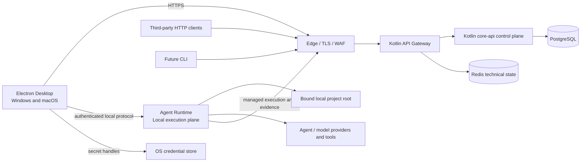
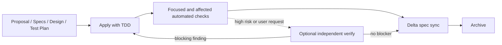

# TaskPilot Architecture

- **Status:** Target
- **Owns:** System topology, cross-project technical constraints, quality
  policy, and top-level project boundaries
- **Read after:** [`../AGENTS.md`](../AGENTS.md)
- **Mandatory before:** Creating a subproject or changing a cross-project
  boundary

## Scope

This document is the authoritative home for overall system architecture,
cross-project technical constraints, and confirmed project boundaries while the
repository is being formed. Product vocabulary and behavior belong to the
[`business model`](business-model.md). This document may temporarily contain
frontend, Gateway, backend, CLI, or infrastructure decisions until a real
subproject exists to own the detail.

The repository currently contains documentation-only subproject boundaries. No
runnable application, build configuration, database migration, or API
specification has been initialized.

## Diagram Conventions

Architecture documents use Mermaid as the rendering format and select notation
by the question being answered:

| Question | Mermaid diagram |
| --- | --- |
| How systems or modules connect | `flowchart` |
| Which domain concepts relate | `classDiagram` |
| How a lifecycle changes state | `stateDiagram-v2` |
| How one scenario executes over time | `sequenceDiagram` |
| How implemented tables relate | `erDiagram` |

Use UML semantics through Mermaid where they improve precision. Keep diagrams
conceptual and pair them with tables for ownership, invariants, and details.
Physical ER diagrams belong to the owning backend subproject after its schema
exists.

## System Shape



The Desktop is the first-party interaction surface. Its sandboxed Renderer uses
a typed Preload/Main boundary and never owns cloud credentials or sends
credentialed requests directly. Electron Main owns the authenticated cloud
client, OS integration, and lifecycle of the separate Agent Runtime companion
process. The Runtime owns local Agent/tool execution, process/PTY supervision,
logs, Diff, and artifacts. It does not own business state or write `core-api`
tables.

`core-api` remains the owner of AgentRun and approval business truth. Managed
local execution uses a future authenticated, short-lived execution-grant
contract; the Runtime never receives or stores the Desktop's long-lived user
token. The grant's issuer, subject/resource bindings, expiry, refresh,
revocation, replay prevention, and logout behavior must be specified before
execution is implemented.

A business `Workspace` is the cloud tenant scope, not a filesystem path. The
Runtime represents an authorized local project root with a device-local opaque
`LocalWorkspaceBindingId`; its raw absolute path stays local by default. Local
path checks constrain TaskPilot-owned file tools and execution policy but are not an
OS-level sandbox. Arbitrary child processes retain the user's OS permissions and
may access resources outside the selected root unless a future isolation design
adds enforceable platform controls.

Redis is optional technical infrastructure. The Gateway may use it for a proven
distributed rate-limit requirement. `core-api` adds Redis only for a documented
cache or coordination use case; Redis never owns business truth.

## Top-Level Project Boundaries

```text
taskpilot/
├── apps/
│   ├── desktop/
│   │   ├── AGENTS.md
│   │   └── docs/
│   ├── agent-runtime/
│   │   ├── AGENTS.md
│   │   └── docs/
│   └── cli/                   # Future
├── services/
│   ├── gateway/
│   │   ├── AGENTS.md
│   │   └── docs/
│   └── core-api/
│       ├── AGENTS.md
│       └── docs/
├── contracts/                 # Future, when API specifications exist
├── docs/
│   ├── README.md              # Documentation knowledge map
│   ├── business-model.md      # Product vocabulary and behavior
│   └── architecture.md        # Cross-project technical architecture
├── AGENTS.md
└── README.md
```

Do not create future directories until their project or artifact is actually
initialized. Desktop, Agent Runtime, Gateway, and Core API currently have
documentation owners only; the future CLI receives the same structure when
created.

## Technology Direction

- Desktop: Electron, React, strict TypeScript, Vite, and TanStack Query, with
  sandboxed Renderer and typed Preload IPC. See
  [`apps/desktop/docs/architecture.md`](../apps/desktop/docs/architecture.md).
- Agent Runtime: separately supervised local execution with narrow
  Windows/macOS platform adapters. Concrete language and libraries are deferred.
  See [`apps/agent-runtime/docs/architecture.md`](../apps/agent-runtime/docs/architecture.md).
- Gateway: Kotlin and Spring Cloud Gateway. See
  [`services/gateway/docs/architecture.md`](../services/gateway/docs/architecture.md).
- Core API: Kotlin, Spring Boot, and Spring Modulith. See
  [`services/core-api/docs/architecture.md`](../services/core-api/docs/architecture.md).
- Data: PostgreSQL as the system of record; Redis only for a justified
  short-lived technical cache or coordination use case.
- Build: pnpm for JavaScript projects and Gradle Kotlin DSL for Kotlin projects.

Stable, mutually compatible versions are selected when each subproject is
initialized. Windows and macOS share product code and protocols, but signing,
packaging, native integrations, process behavior, and releases require separate
platform evidence.

## Subproject Documentation

| Subproject | Architecture | Responsibilities | Testing |
| --- | --- | --- | --- |
| Desktop | [`architecture`](../apps/desktop/docs/architecture.md) | [`responsibilities`](../apps/desktop/docs/responsibilities.md) | [`testing strategy`](../apps/desktop/docs/testing-strategy.md) |
| Agent Runtime | [`architecture`](../apps/agent-runtime/docs/architecture.md) | [`responsibilities`](../apps/agent-runtime/docs/responsibilities.md) | [`testing strategy`](../apps/agent-runtime/docs/testing-strategy.md) |
| Gateway | [`architecture`](../services/gateway/docs/architecture.md) | [`responsibilities`](../services/gateway/docs/responsibilities.md) | [`testing strategy`](../services/gateway/docs/testing-strategy.md) |
| Core API | [`architecture`](../services/core-api/docs/architecture.md) | [`responsibilities`](../services/core-api/docs/responsibilities.md) | [`testing strategy`](../services/core-api/docs/testing-strategy.md) |

## SDD Delivery and Review Workflow (Current)

TaskPilot's repository-level OpenSpec workflow is implemented by the project
default [`taskpilot-sdd` schema](../openspec/schemas/taskpilot-sdd/schema.yaml),
its [`test-plan` template](../openspec/schemas/taskpilot-sdd/templates/test-plan.md),
and the generated workflow Skills routed by [`AGENTS.md`](../AGENTS.md). This
section describes the cross-project quality gate; it does not mean the Target
application components described elsewhere in this document already exist.



- Before implementation, `test-plan.md` maps changed scenarios and material
  risks to the lowest reliable test layer, names focused and affected commands,
  and records justified exceptions. It references this document and the nearest
  child testing strategy rather than repeating their tool and layer matrices.
- Each executable behavior is delivered as one slice: first prove a valid Red
  failure caused by the missing or incorrect behavior, then make the smallest
  clear Green implementation, then Refactor under the focused and
  risk-appropriate affected protection suite. Compile failures, unavailable
  environments, flaky tests, and unrelated failures are not Red evidence.
- Tests and the production behavior they protect land in the same task group.
  Green cannot be obtained by weakening the approved contract or assertion,
  skipping a test, or moving production behavior into test code.
- Documentation-only, generated-file, tooling, dependency, and pure scaffolding
  changes may record behavioral TDD as not applicable. They still require
  planned automated structural evidence such as schema validation, fixtures, a
  self-test, lint, or build; manual observation does not replace an automatable
  gate.
- After apply completes, run the focused and affected automated checks declared
  by the Change's test plan. Applicable coverage, architecture, contract,
  database, browser, packaged Desktop, and system gates remain blocking when
  the owning testing strategy requires them.
- `openspec-verify-change` is an optional read-only second pass for high-risk
  work or explicit user requests. Its findings return to apply, but routine
  archive readiness does not depend on a verification receipt, policy,
  fingerprint, or repository-specific preflight.
- Before archive, assess every delta spec and sync it into the corresponding
  main spec. A Change with `skip_specs: true` reports that no delta sync is
  applicable; this marker never waives implementation tests or strict
  validation.
- The canonical test tools, layer ownership, critical scenarios, and local
  commands remain in the Desktop, Agent Runtime, Gateway, and Core API
  [testing strategies](#subproject-documentation). This workflow only requires
  each change to select and evidence the relevant parts.

The official workflow Skills are reproducibly refreshed with
[`tools/openspec/update-workflows.sh`](../tools/openspec/update-workflows.sh),
which uses temporary OpenSpec profile state instead of modifying a developer's
global profile and verifies that all seven generated Skills report the installed
OpenSpec version. Generated Skill files are never edited manually. The isolated
[`tools/openspec/test-workflow.sh`](../tools/openspec/test-workflow.sh) is the
semantic regression gate for the schema graph, TDD guidance, strict Change
validation, and fixture isolation.

## Cross-Project Testing Boundaries

- Each subproject owns comprehensive risk-based tests for its behavior and
  trust boundary.
  Broader system tests sample cross-project integration and do not repeat each
  subproject's validation, routing, permission, or error matrix.
- Desktop Renderer integration uses the controlled Preload capability boundary;
  Main integration tests own the credentialed HTTP/cloud adapter. Packaged
  Electron journeys own real Renderer/Preload/Main behavior; native Windows/macOS
  tests own OS credential, deep-link, process, packaging, and lifecycle risks
  that Renderer tests cannot prove.
- Agent Runtime policy and protocol tests run below system E2E; real
  filesystem, process-tree, PTY, journal/recovery, and platform tests remain at
  the Runtime boundary.
- A system E2E runs packaged TaskPilot Desktop, Agent Runtime, Gateway,
  Core API, and PostgreSQL across their real boundaries. Third-party identity,
  model, and Agent providers may be deterministic test doubles at
  TaskPilot-owned outbound boundaries.
- System E2E state is prepared through controlled test fixtures or APIs rather
  than repeated UI setup. Test-only setup capabilities are unavailable in
  production and cannot bypass the business rule under test.
- Gateway routing, header trust, credential, timeout, and rate-limit matrices
  remain Gateway integration tests. Core API domain, tenancy, authorization,
  persistence, migration, concurrency, and idempotency matrices remain Core API
  tests.
- OpenAPI compatibility and generated-client checks are contract gates, not a
  substitute for runtime API or system integration tests.
- Essential security, contract, database, migration, and critical-journey tests
  are blocking before release; nightly execution may broaden coverage but is
  never their only home.

## Risk-Based Test Portfolio

Test depth follows the cost of an escaped defect rather than the size of a file
or a desire to maximize test count:

| Risk class | Examples | Minimum evidence |
| --- | --- | --- |
| Critical | Tenant isolation, authentication and authorization, destructive writes, workflow transitions, idempotency, concurrency, migrations, execution grants and Runtime recovery | Focused rule tests, real-boundary integration tests, negative cases, and a representative cross-system journey when user-visible |
| High | Main Work Item and Board workflows, public API compatibility, cache scope, retries, external-provider failure | Unit or module integration tests, contract tests where applicable, and selected packaged Desktop or infrastructure integration |
| Routine | Presentation variants, formatting, simple mapping, non-critical configuration | The lowest reliable unit or component layer; broader tests only when they catch a distinct failure mode |

Every feature or defect fix identifies its important success, rejection,
boundary, and recovery cases. An escaped production defect adds a regression
test at the lowest layer that reproduces it and, when the escape exposed a
missing boundary check, a test at that boundary as well.

## Coverage and Effectiveness Policy

Coverage is a guardrail over executable production code, not the definition of
quality. The generated projects must report at least:

1. Changed executable line and branch coverage for production code.
2. Whole-subproject line and branch coverage as a non-regression trend.
3. Coverage of critical behaviors and risk cases, maintained as named tests or
   a risk-to-test matrix rather than inferred from line coverage.
4. Contract, architecture-boundary, migration, packaged Desktop, and supported-platform results,
   which source coverage cannot represent.

After coverage instrumentation exists, the initial blocking floor is 80% line
coverage and 75% branch coverage on changed executable production code. Changed
critical domain, tenant, authorization, concurrency, and idempotency rules
require at least 90% branch coverage unless the change records a concrete,
time-bounded exception. Whole-subproject coverage must not decrease without an
explicit explanation and approval.

These floors are minimum signals, not reasons to add assertions without defect
detection value. A change still fails review when an important behavior,
negative path, or boundary is untested even if its percentages pass.

Generated clients, generated schemas, third-party vendored code, and
compiler-generated artifacts are excluded from source coverage. Declarative
migrations are evaluated by migration tests rather than line coverage. Ordinary
production adapters, controllers, filters, error handlers, repositories, and
configuration logic are not excluded merely because they are inconvenient to
test. Every exclusion is visible in versioned configuration and justified by
category.

For pure critical rules, targeted mutation analysis is introduced after the
relevant toolchain exists. It first establishes a baseline, then prevents the
changed critical scope from regressing. Surviving meaningful mutations require
better assertions or a documented equivalent test; mutation score is not
combined with line coverage into one synthetic quality number.

## Feedback-Time and Reliability Policy

The test portfolio must preserve short feedback loops while retaining
production-realistic boundaries:

- Run focused tests first, then affected subproject suites in parallel, while
  keeping architecture, contract, and changed-risk gates mandatory.
- Establish CI p95 duration baselines after initialization. Initial design
  targets are about 10 seconds for a focused local test, 5 minutes for a fast
  subproject pull-request suite, and 15 minutes for all blocking pull-request
  verification. If a target is missed, split and parallelize suites or optimize
  fixtures before removing coverage.
- Reuse expensive service or container processes where isolation is preserved;
  never reuse mutable test data between cases.
- Use change-based test selection only as an acceleration. Main or scheduled
  full suites must detect incorrect dependency maps, and critical security,
  migration, and contract gates cannot be skipped solely by path heuristics.
- Track pass duration, failure cause, retry count, and flake rate by suite.
  Automatic retries do not convert a flaky test into a pass for quality
  reporting.
- A deterministic failure is blocking. A flaky test is fixed promptly or placed
  in a visible quarantine with an owner, reason, and expiry; quarantined
  critical coverage must be replaced before merge or release.
- Preserve failure artifacts sufficient to reproduce the failing layer while
  redacting credentials and personal data.

Exact CI stages, commands, coverage tools, Electron/platform versions, and deployment
topology are defined when the runnable projects and CI configuration exist.
Thresholds may be raised from evidence after a stable baseline; lowering a
threshold is an architectural policy change, not a local test workaround.

## Cross-Project API Boundaries

- The first-party Desktop API and public HTTP API are separate API products.
- Both may be implemented by `core-api`, but they have separate controllers,
  transport models, compatibility policies, and OpenAPI documents.
- Desktop-generated TypeScript transport types belong in the Desktop project.
- The public API exposes HTTP only; TaskPilot does not publish a public SDK.
- The future CLI consumes the public HTTP API like any external client.
- Gateway routes and protects both API surfaces without owning business flows.
- Agent Runtime uses a distinct authenticated managed-execution surface;
  it does not reuse the Desktop's long-lived user credential or the public API
  as a generic remote shell.

### Identity and Execution Authorization

Desktop identity is established through a future system-browser login contract.
Gateway normalizes verified identity context; Core API remains authoritative for
Workspace/Project access and business authorization. Long-lived Desktop
credentials stay behind OS credential facilities and never enter Renderer or
Agent Runtime.

Before Runtime execution exists, a behavior change must define a short-lived
execution grant bound to issuer, User, Workspace, Project, Agent Run, Attempt,
durable-job claim, lease epoch or fencing token, pinned Agent Version,
registered opaque `LocalWorkspaceBindingId`, Runtime instance, allowed
capability/policy digest, limits, and expiry. Core API validates the binding
registration and cloud scope; Runtime separately requires the matching active
device-local binding. The raw absolute path is not grant material and remains
local unless an explicit disclosure contract says otherwise. The contract must
also define renewal, revocation, replay protection, logout, lease loss, and
`OutcomeUnknown` handling.

A cloud `ApprovalRequest` and a device-local `Local Execution Consent` are
different proofs: neither implies the other or advances the other's state.

### Shared HTTP Contract

The API surfaces share protocol conventions while retaining distinct models and
compatibility policies:

- Errors use a Problem Details-compatible envelope with stable `code`, HTTP
  status, correlation identifier, and optional field/definition diagnostics.
  Clients never branch on human-readable messages.
- Mutable resources expose an explicit version. Commands based on stale state
  receive a stable conflict result instead of silently overwriting newer data.
- Retryable operations define idempotency before implementation.
- Authorization remains authoritative in `core-api`. Desktop responses may
  expose allowed actions for presentation, but the client does not derive
  domain permission from role names.
- Definition validation returns path-addressable diagnostics for visual editors
  without moving canonical DSL rules into the Desktop.
- `core-api` produces separate OpenAPI artifacts. Desktop API changes and
  generated Desktop transport types are verified together; public API
  artifacts additionally receive compatibility checks.

Exact status codes, headers, payloads, artifact paths, and generation commands
are recorded with the first API implementation.

## Business Model Boundary

Product language, logical business objects, lifecycles, workflow semantics,
Event Storming scenarios, and MVP rules are owned by the
[`business model`](business-model.md). Read it before changing any business
behavior, business-facing API or persistence model, Board/Work Item semantics,
workflow DSL, Agent configuration, execution, approval, comments, or custom
fields.

This architecture document does not duplicate that model. In particular:

- Event Storming is an analysis method, not a requirement for event sourcing,
  a command bus, one module per noun, or one repository per business object.
- `core-api` begins as a pragmatic modular monolith organized into a few
  cohesive capability areas. Direct application-service collaboration and one
  clear database transaction are preferred for ordinary synchronous use cases.
- Business lifecycle transitions remain explicit and testable even when they
  are implemented without tactical-DDD patterns.
- Durable jobs or reliable events are used for long-running Agent work,
  provider callbacks, external side effects, realtime notification, audit, and
  other actual asynchronous boundaries.
- A Board projects Work Items and workflow execution; it never becomes a second
  source of business state.

Implementation structure and persistence may refine the logical model, but may
not silently rename concepts, merge independent lifecycles, or contradict its
business rules.

## Backend Evolution

The initial backend is one Spring Modulith application. It is not a collection
of microservices. Ordinary use cases use direct application-service calls and
clear local transactions; durable jobs or reliable events are introduced only
for genuine asynchronous boundaries.

Module boundaries must allow later extraction, but no external broker, service
discovery platform, or distributed transaction mechanism is introduced before
an actual service boundary exists. Detailed transaction, durable-job, Agent Runtime protocol, and future
extraction constraints belong to the
[`Core API architecture`](../services/core-api/docs/architecture.md).

## SaaS Direction

Tenant identity and isolation are cross-cutting requirements. The Gateway may
normalize trusted tenant context, while `core-api` remains responsible for
authorization and tenant-scoped data access.

The initial design must permit future plans, quotas, enterprise identity, audit,
and selected tenant isolation strategies without implementing those
capabilities speculatively.

## Ownership Rule

- Overall topology and cross-project technical contracts remain in this
  document; business relationships and rules belong to
  [`business-model.md`](business-model.md).
- Confirmed detail stays here until a real child project can own it.
- Delegation moves detail to the child `docs/` and replaces the root detail with
  a summary and link in the same change.
- Root and child documentation must not maintain duplicate detailed rules.
- A child document may refine the root architecture but must not silently
  contradict it.
- A cross-project architectural change updates this document first.

## Initial Non-Goals

- No microservices.
- No Node.js BFF.
- No public SDK.
- No external message broker.
- No business persistence or orchestration in the Gateway.
- No long-running Agent execution in a `core-api` HTTP request or transaction.
- No direct Agent Runtime access to `core-api` business tables.
- No browser Web client in the initial first-party product.
- No OS-level sandbox claim for arbitrary local child processes.
- No shared package without multiple real consumers.
