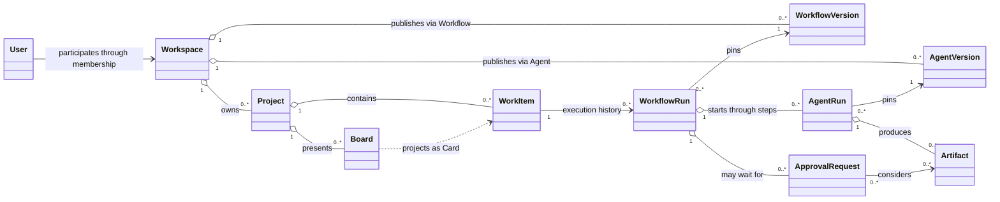
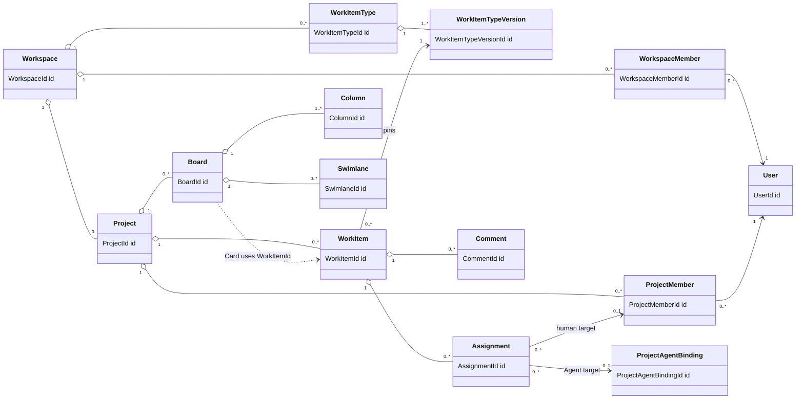
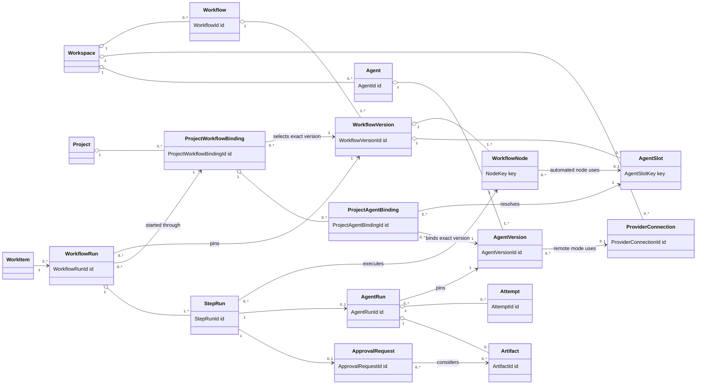
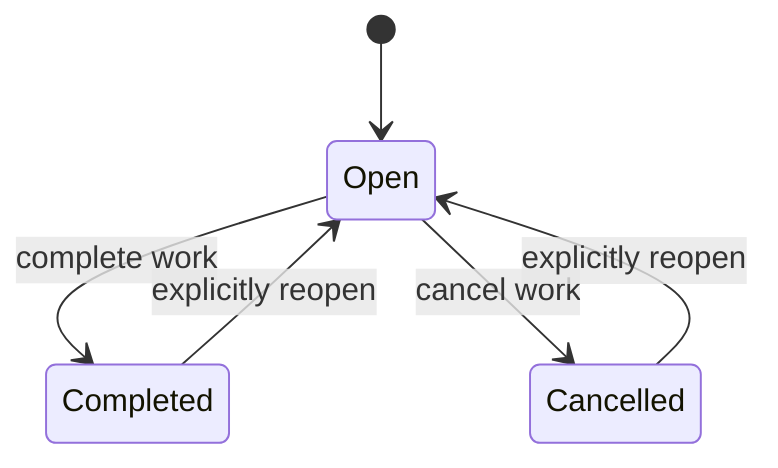
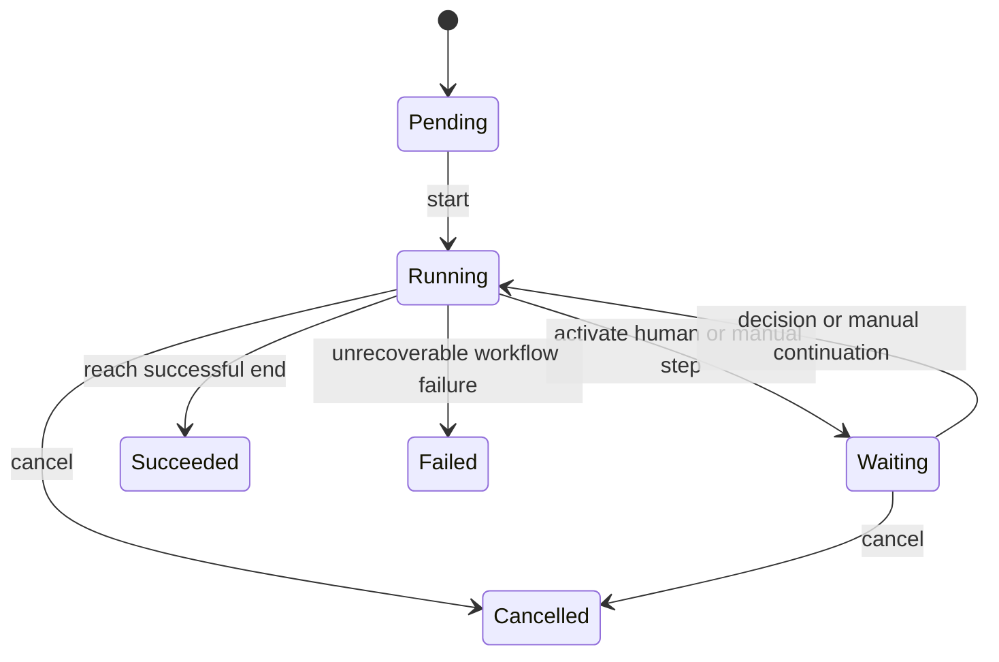
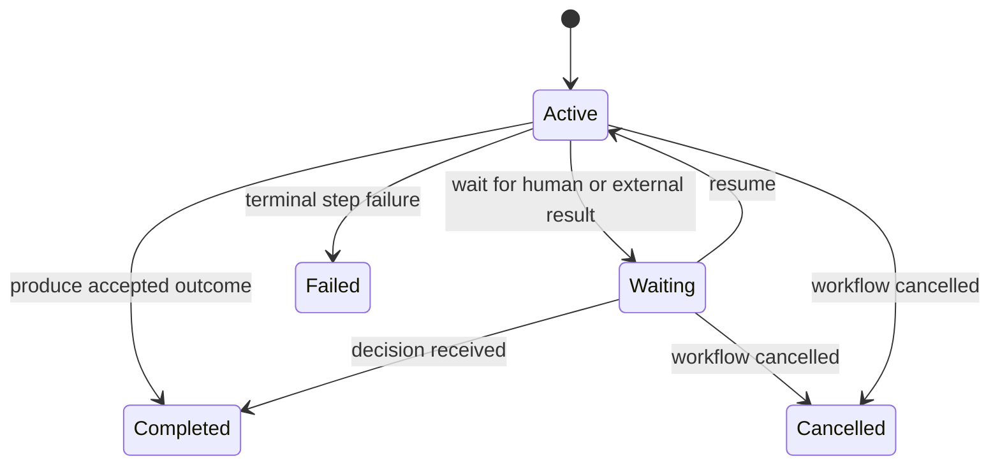
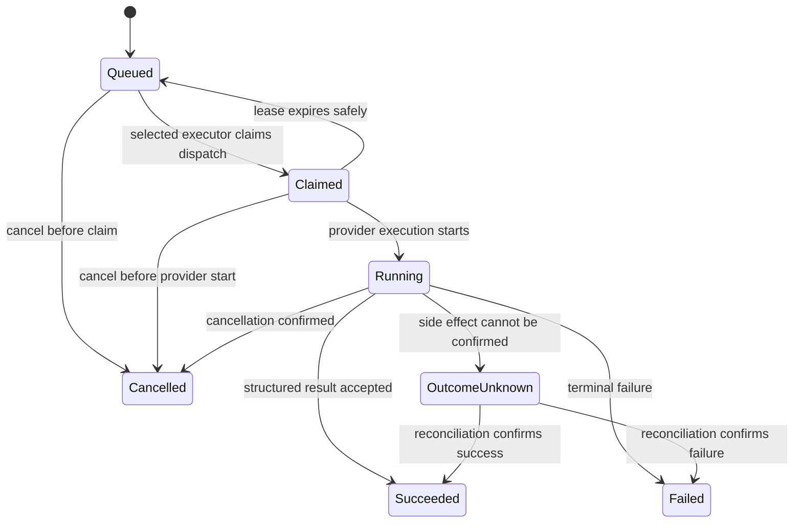
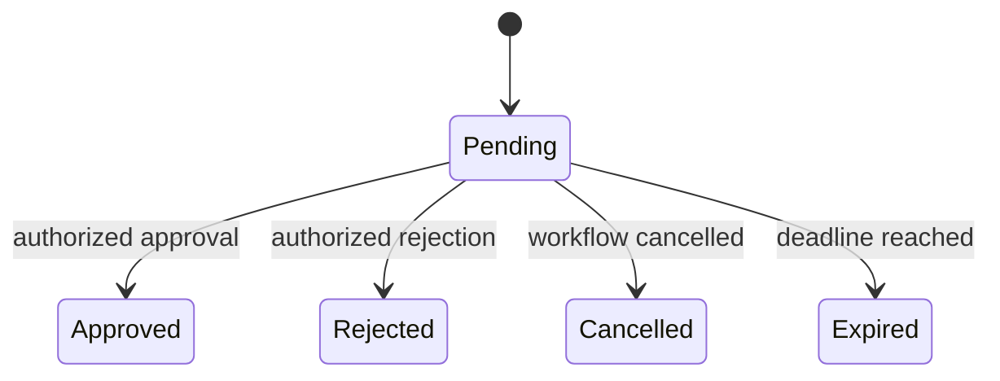

# TaskPilot Business Model

- **Status:** Target
- **Owns:** Product vocabulary, logical business objects, relationships,
  lifecycles, workflow semantics, Event Storming scenarios, and MVP business
  rules
- **Read after:** [`../README.md`](../README.md)
- **Mandatory before:** Changing user-visible business behavior, business
  naming, workflows, boards, work items, Agent configuration or execution,
  approvals, custom fields, comments, or related API and persistence models

## Purpose and Modeling Approach

TaskPilot is a human-and-Agent work coordination product. It combines project
work management, configurable boards, reusable workflows, human approval, and
managed Agent execution.

This document uses Event Storming to discover business facts, policies, state,
and asynchronous boundaries. It is deliberately **not** a requirement to build
a tactical-DDD architecture:

- A command or event named here is first an analysis concept. It becomes a code
  type only when that makes the implementation clearer or more reliable.
- Logical business objects are not automatically aggregates, modules, tables,
  repositories, or services.
- Related records may be updated in one clear application transaction when
  that is the simplest correct implementation.
- Ordinary CRUD-style use cases may use direct application-service calls.
- Reliable events or durable jobs are reserved for long-running work, external
  integrations, realtime notification, audit, and other genuine asynchronous
  boundaries.
- Event sourcing, command buses, one-repository-per-object, and one-module-per-
  noun are not implied.

The implementation should preserve the business distinctions and lifecycle
rules in this document while choosing the smallest maintainable code structure.

## Scope

The target business scope includes:

- Login and user identity.
- Personal and organization workspaces.
- Workspace and project membership.
- Projects, configurable boards, work items, comments, and custom fields.
- Reusable, versioned workflow definitions expressed by a declarative DSL.
- Human and Agent assignment.
- Versioned Agent configuration with replaceable managed-Agent providers.
- Workflow execution, Agent execution, realtime progress, artifacts, and human
  approval.
- A future event/audit stream from which operational statistics can be built.

## MVP Decisions

The following are approved target constraints for the first implementation:

| Topic | Decision |
| --- | --- |
| Personal ownership | A personal account receives a `PERSONAL` Workspace; Projects always belong to a Workspace |
| Work truth | `WorkItem` is the canonical work record; a Card is a Board projection, not a separate business object |
| Board terminology | Todo/Doing/Done are Columns; a Swimlane is a configurable horizontal grouping |
| Workflow concurrency | A WorkItem has at most one active WorkflowRun; previous runs remain history |
| Workflow shape | One active StepRun at a time; conditions and bounded loops are supported; parallel branches are deferred |
| Agent assignment | Assignment selects responsibility or an executor; only workflow execution starts an AgentRun |
| Agent portability | Workflow nodes reference logical Agent Slots; a Project resolves slots to concrete versioned Agents |
| Human gates | Approval is an explicit request and decision, not an unrestricted card move or comment |
| Versioning | Published workflow, work-item type, and Agent versions are immutable; running records pin exact versions |
| DSL safety | Definitions are declarative and versioned; arbitrary executable scripts are forbidden |
| Provider strategy | Volcengine Managed Agent is the first target provider, accessed through a replaceable provider adapter |
| Statistics | Detailed analytics are deferred; important facts must remain auditable so projections can be added later |

## Ubiquitous Language

Use these terms in product copy, API design, code, tests, and engineering
documentation.

| Term | Meaning |
| --- | --- |
| User | A person who can authenticate and act in TaskPilot |
| Workspace | The ownership, membership, and data-isolation boundary; either personal or organizational |
| Workspace Member | A User's membership and role within an organization Workspace |
| Project | A Workspace-owned collaboration scope containing people, work, boards, and enabled automation |
| Project Member | A User who can participate in a Project with a project-level role |
| Work Item | The canonical record of a piece of work: content, custom values, assignments, and overall lifecycle |
| Assignment | A Work Item responsibility link to exactly one Project Member or Project Agent Binding |
| Work Item Type | A reusable identity for a configurable kind of Work Item |
| Work Item Type Version | An immutable definition of fields and validation for one Work Item Type |
| Board | A configurable Project view over Work Items and their active workflow state |
| Column | A vertical Board stage such as Todo, Doing, Waiting, or Done |
| Swimlane | A horizontal Board grouping rule, for example by owner, priority, type, or Agent |
| Card | The UI projection of a Work Item on a Board; it has no independent business lifecycle |
| Workflow | A reusable identity for a work-execution process |
| Workflow Version | An immutable, validated graph of nodes, transitions, policies, and Agent Slots |
| Workflow Run | One execution of a pinned Workflow Version for a Work Item |
| Step Run | One activation of one workflow node; returning to a node creates a new Step Run |
| Agent Slot | A logical workflow role such as `coding`, `review`, `test`, or `deploy` |
| Agent | A stable TaskPilot identity for an automated worker |
| Agent Version | An immutable executable configuration including execution mode, provider or local-adapter configuration, prompt, tools, Skills, Memory policy, schemas, and limits |
| Project Agent Binding | A Project's binding of an Agent Slot to an allowed Agent Version |
| Project Workflow Binding | A Project's use of an exact Workflow Version plus Project-specific defaults |
| Agent Run | One tracked execution of an Agent Version for an Agent Step Run, pinned to one execution mode and executor route |
| Attempt | One technical attempt within an Agent Run; retrying infrastructure does not create a new workflow step |
| Approval Request | A canonical pending or completed human gate associated with a Human Approval Step Run |
| Local Execution Consent | A device-local safety confirmation for one immutable evaluated operation; it is not canonical business approval and does not advance a Workflow |
| Artifact | A referenced output such as code, a report, test evidence, a file, a build, or a deployment result |
| Comment | Human collaboration attached to a Work Item; it is not an approval decision |
| Provider Connection | Workspace-owned connection metadata and secret references for a remote managed-Agent provider |
| Execution Mode | The immutable Agent Version choice of `REMOTE_MANAGED` provider execution or `LOCAL_DESKTOP` execution near a user project; hybrid execution is deferred |

### Terms That Must Stay Separate

| Do not conflate | Reason |
| --- | --- |
| Work Item and Card | The Work Item owns work data; the Card is one view of it |
| Board and Workflow | The Board presents and initiates actions; the Workflow defines valid execution |
| Column and Swimlane | Columns represent vertical stages; Swimlanes group cards horizontally |
| Work Item lifecycle and Workflow Run status | A work record can remain open while execution waits, fails, or is restarted |
| Workflow Step and Agent Run | A workflow step is a business execution position; an Agent Run is one automated execution |
| Agent Run status and business outcome | An Agent may execute successfully while a review outcome requests changes |
| Assignment and execution | Assignment selects responsibility; workflow activation starts work |
| Attempt retry and business rework | Technical retry stays in one Agent Run; review rework creates a new Step Run |
| Agent recommendation and human decision | Agent output may inform a gate but cannot silently become protected approval |
| Approval Request and Local Execution Consent | The former is canonical workflow approval; the latter only permits a bound operation on one device and cannot advance business state |

## Logical Business Model

Modeling priority in this document is:

1. Stable identity and ownership boundary.
2. Relationships, cardinality, and version pinning.
3. Lifecycle and business invariants.
4. Attributes only when they change one of the above.

The diagrams below are conceptual relationship maps. They are neither database
ER diagrams nor DDD aggregate diagrams. An open diamond means logical ownership
or containment; it does not require one in-memory aggregate, cascade delete, or
one transaction. In the maps:

- `o--` means logical ownership or containment;
- `-->` means a durable business reference;
- `..>` means a derived projection or use without ownership;
- `pins` means history retains that exact immutable version.

### Relationship Overview



The overview intentionally hides membership records, immutable definition
versions, workflow steps, retries, and view configuration. The following maps
make those relationships explicit.

### Ownership, Membership, and Work



An Assignment has exactly one target: either a Project Member or a Project
Agent Binding. A Card has no separate identity; every Card action addresses the
underlying `WorkItemId`. Columns and Swimlanes have identities because users can
configure and reference them independently.

### Definitions, Bindings, and Runtime



A Project Workflow Binding is the context in which a Project enables one exact
Workflow Version. Its Project Agent Bindings resolve that version's logical
Agent Slots to exact Agent Versions. A Workflow Run and every Agent Run retain
the resolved version identities so later configuration changes cannot rewrite
history.

### Identity and Uniqueness Rules

`...Id` and `...Key` in the diagrams are logical identity types, not a database
column specification. The implementation may use UUIDv7, ULID, or another
opaque representation after API and persistence constraints are known.

| Rule | Meaning |
| --- | --- |
| Stable internal identity | Every independently referenced business record has an immutable, non-recycled ID |
| Typed references | APIs, jobs, audit facts, and code distinguish `ProjectId`, `WorkItemId`, `AgentRunId`, and other identity kinds even if their serialized format is the same |
| Names are not identity | Display names, titles, slugs, provider labels, and Board positions may change and must not be relationship keys |
| Workspace isolation | Every cross-reference must resolve within one Workspace unless a future sharing model explicitly authorizes otherwise |
| Version identity | `WorkflowVersionId`, `AgentVersionId`, and `WorkItemTypeVersionId` identify immutable definitions; a version number is unique only within its stable parent identity |
| Scoped definition key | `NodeKey`, `AgentSlotKey`, and custom-field keys are portable DSL keys whose identity is the pair `(definitionVersionId, key)` |
| External identity namespace | A provider's remote identifier is unique only together with its `ProviderConnectionId` and remote object kind; it never replaces a TaskPilot ID |
| Projection identity | A Card reuses `WorkItemId`; filtered Board results and realtime messages must not invent a `CardId` |
| Human-facing key | A future key such as `PROJ-123` may be unique within a Project for display/search, but internal references continue using `WorkItemId` |
| Historical pinning | Runtime records reference exact immutable version IDs, not “latest” definitions or mutable names |

Important logical uniqueness constraints are:

- one Workspace Membership per `(WorkspaceId, UserId)`;
- one Project Membership per `(ProjectId, UserId)`;
- one version number per stable Workflow, Agent, or Work Item Type;
- one Project Agent Binding per `(ProjectWorkflowBindingId, AgentSlotKey)`;
- at most one active Workflow Run per Work Item in the MVP;
- at most one active Step Run per Workflow Run in the MVP;
- one Agent Run for an Agent Step Run, while that Agent Run may have multiple
  uniquely sequenced Attempts.

These are business uniqueness rules. The Core API persistence design must later
choose the appropriate unique constraints, partial indexes, locking, or
transaction strategy to enforce them; this document does not prescribe tables.

## Business Areas

The first implementation should group code coarsely by capability, not create a
module for every object:

| Business area | Main concepts | Responsibility |
| --- | --- | --- |
| Access | User, login, Workspace, Workspace Member | Authentication context, ownership boundary, and membership |
| Project Work | Project, Project Member, Work Item, Work Item Type, Board, Comment | Human collaboration and the canonical work record |
| Automation | Workflow, Project Workflow Binding, Workflow Run, Step Run, Approval Request | Process definition, Project use, state progression, and human gates |
| Agents | Provider Connection, Agent, Agent Version, Project Agent Binding, Agent Run, Attempt, Artifact | Agent configuration, executor selection, provider integration, execution control, and outputs |

These are maintainability-oriented code areas, not promised microservices or
formal bounded contexts. Split them only when ownership, scale, security, or
change patterns make a smaller boundary materially useful.

## Ownership and Membership

### Workspace

A Workspace has a type:

- `PERSONAL`: provisioned for one User and not modeled as a separate User-owned
  Project path.
- `ORGANIZATION`: supports explicit Workspace membership and organization-level
  administration.

Every Project, reusable Workflow, Work Item Type, Agent, and Provider Connection
belongs to exactly one Workspace. Cross-Workspace references are invalid.

### Project

A Project belongs to one Workspace. Project membership may be a subset of the
Workspace membership and owns project-level roles. An Agent is not a User or a
Project Member: enabling an Agent grants execution capability, not human access
or approval authority.

## Work Items and Custom Fields

A Work Item contains stable system fields such as title, description, creator,
overall lifecycle, and timestamps. Configurable values conform to the pinned
Work Item Type Version.

A Work Item Type Version defines field keys, labels, data types, requiredness,
defaults, allowed values, validation, and presentation hints. The implementation
may store definitions and values as validated JSON/JSONB rather than introducing
an EAV table for every value. Publishing a new version does not silently change
existing Work Items; migration is explicit.

Human and Agent assignments are distinct:

- Human assignment identifies responsibility or ownership.
- Agent assignment or slot override selects the automation to use.
- Agent assignment never grants user permissions.
- Assignment alone does not start execution.

Comments are append-oriented collaboration records associated with a Work Item.
They do not substitute for structured workflow outcomes or approval decisions.

## Board Semantics

A Board stores view and interaction configuration: Columns, Swimlane rules,
filters, sorting, visible card fields, and allowed action mappings. It does not
store a second copy of Work Item or workflow state.

A Card is computed from the Work Item plus its active Workflow Run, Step Run,
latest Agent Run summary, pending Approval Request, and selected presentation
fields.

Dragging a Card expresses intent. The server resolves that intent to an allowed
business action, such as starting a workflow, completing a manual step, or
cancelling work. A client cannot bypass workflow or approval rules by writing a
Column identifier directly.

WIP limits may initially be advisory. A hard concurrent capacity guarantee is
not claimed until an explicit locking or reservation strategy exists.

## Agent Configuration and Provider Boundary

An Agent is a stable TaskPilot object; each published Agent Version is
immutable and includes one execution mode:

- `REMOTE_MANAGED`: a remote managed-Agent provider owns execution. The version
  references a Workspace-scoped Provider Connection and, when applicable, a
  provider-owned Agent or deployment reference.
- `LOCAL_DESKTOP`: the Desktop-owned Agent Runtime executes near an authorized
  local project. The version declares portable local capability requirements;
  device identity, local paths, and `LocalWorkspaceBindingId` are execution
  context and never part of the reusable Agent Version.

An Agent Version may also include its System Prompt and model policy, MCP servers
and allowed tools, Skill references and versions, Memory policy, input and
structured output schemas, and time, retry, cost, resource, and permission
limits. `HYBRID` remote reasoning with local tool execution is not an implicit
combination of the two modes; it requires a later explicit protocol and threat
model.

Project Agent Bindings map logical Agent Slots to exact Agent Versions. Agent
Runs pin the resolved version, execution mode, provider/adapter kind, and the
normalized executor route needed for history and reconciliation. Editing a
connection or publishing another Agent Version cannot rewrite work already in
progress. Provider capability checks occur before publication and again before
execution when capabilities may drift; unsupported combinations fail explicitly
rather than silently degrading.

Provider credentials are protected secret references, never embedded in workflow
DSL, Agent Runs, Desktop payloads, logs, or public events. Provider-specific SDK
types, status names, remote identifiers, errors, and callback payloads remain
behind a server-side adapter for `REMOTE_MANAGED`. TaskPilot exposes normalized
capabilities, progress, results, cancellation, and error categories without
pretending every provider supports the same feature. A separate Agent Deployment
object should be introduced only if provider deployment gains an independent
lifecycle, multiple deployment targets, or rollback/synchronization requirements.

## Workflow Definition

A Workflow Version is an immutable declarative graph. The initial node types
are:

- `agent`: starts an Agent Run and consumes a structured outcome.
- `human_approval`: creates an Approval Request and waits for a decision.
- `manual`: waits for an authorized user action that is not an approval.
- `condition`: selects a transition using deterministic data rules.
- `end`: completes the Workflow Run with a declared result.

The DSL may reserve future names such as `parallel`, `join`, `timer`,
`subworkflow`, and `webhook`, but unsupported nodes must fail validation rather
than be accepted and ignored.

Example:

```yaml
apiVersion: taskpilot.io/v1alpha1
kind: Workflow
metadata:
  name: software-delivery
entry: coding
agentSlots:
  coding:
    capabilities: [coding]
  review:
    capabilities: [code-review]
  deploy:
    capabilities: [deployment]
nodes:
  coding:
    type: agent
    agentSlot: coding
    outputSchema: CodingResult/v1
    retry:
      maxAttempts: 2
    outcomes:
      succeeded: review
      failed: manual_intervention
  review:
    type: agent
    agentSlot: review
    outputSchema: ReviewResult/v1
    outcomes:
      approved: release_approval
      changes_requested:
        to: coding
        loop:
          key: review-rework
          maxIterations: 3
          exhausted: manual_intervention
      failed: manual_intervention
  release_approval:
    type: human_approval
    allowedProjectRoles: [maintainer]
    outcomes:
      approved: deploy
      rejected: coding
  deploy:
    type: agent
    agentSlot: deploy
    sideEffect:
      idempotency: required
      reconciliation: required
    outcomes:
      succeeded: done
      failed: manual_intervention
  manual_intervention:
    type: manual
    allowedProjectRoles: [maintainer]
    outcomes:
      retry: coding
      cancel: cancelled
  done:
    type: end
    result: succeeded
  cancelled:
    type: end
    result: cancelled
```

This example illustrates the target semantics; the exact serialization schema
is finalized with the first contract. Before publication, validation must reject
missing or multiple entry declarations, missing references, unreachable nodes,
unsupported schema versions, unbounded automatic loops, unresolved required
Agent Slots, ambiguous outcomes, unsafe retry settings, and arbitrary executable
scripts. An explicitly authorized human retry may repeat a step without being
treated as an automatic loop. YAML is an import/export format; the canonical
stored representation may be normalized JSON.

## Runtime Model

A Work Item may keep multiple historical Workflow Runs but at most one active
run. A Workflow Run pins its Workflow Version and has at most one active Step
Run in the MVP. Returning to an earlier node creates a new Step Run; history is
never overwritten.

An Agent Step Run creates one Agent Run. Infrastructure retry adds an Attempt to
the same Agent Run. Business rework, such as review requesting changes, creates
a new Step Run and a new Agent Run.

High-frequency logs and token streams are not Work Item or Workflow Run fields.
They flow through an execution/log channel and may be projected to authorized
clients. Transport details do not become business state. Business records retain
status, bounded progress summaries, output references, and audit facts.

## Lifecycle State Machines

### Work Item



`Open`, `Completed`, and `Cancelled` describe the overall work lifecycle, not
the current workflow node.

### Workflow Run



### Step Run



### Agent Run



Timeout is recorded on an Attempt. It either schedules a permitted retry,
produces terminal failure, or moves the Agent Run to `OutcomeUnknown` when an
external side effect might already have happened.

### Approval Request



A completed decision is immutable. Reconsideration creates a new workflow step
and Approval Request rather than rewriting audit history.

## Event Storming Scenarios

The events below describe business facts for analysis. The implementation may
handle adjacent facts in one application transaction. Only facts crossing a
real asynchronous or integration boundary require reliable delivery.

### Scenario 1: Create and start work

| Actor or policy | Command | Business fact | Next policy/action |
| --- | --- | --- | --- |
| Project Member | `CreateWorkItem` | `WorkItemCreated` | Return the new Work Item; do not start automation implicitly |
| Project Member | `AssignHuman` or `AssignAgent` | `WorkItemAssignmentChanged` | Update responsibility only |
| Project Member | `StartWorkflow` | `WorkflowRunStarted` | Activate the entry node |
| Workflow policy | `ActivateStep` | `WorkflowStepActivated` | Dispatch by node type |
| Agent-node policy | `RequestAgentRun` | `AgentRunRequested` | Commit a durable execution job |

### Scenario 2: Agent completes normally

| Actor or policy | Command | Business fact | Next policy/action |
| --- | --- | --- | --- |
| Selected executor | `ReportAgentRunStarted` | `AgentRunStarted` | Stream bounded normalized progress |
| Selected executor | `ReportAgentRunResult` | `AgentRunSucceeded` | Validate structured output and resolve business outcome |
| Workflow policy | `CompleteStep(outcome)` | `WorkflowStepCompleted` | Select the declared transition |
| Workflow policy | `AdvanceWorkflow` | `WorkflowAdvanced` | Activate the next Step Run or finish the run |
| Workflow policy | `CompleteWorkflow` | `WorkflowRunSucceeded` | Complete the Work Item when workflow policy requires it |

### Scenario 3: Review requests changes

`AgentRunSucceeded` means the Review Agent executed successfully. Its structured
business result may still be `changes_requested`.

```text
AgentRunSucceeded
  -> WorkflowStepCompleted(outcome = changes_requested)
  -> WorkflowAdvanced(target = coding)
  -> new Coding StepRun
  -> new AgentRun
```

A review loop must be bounded. Exhaustion activates manual intervention instead
of silently looping forever.

### Scenario 4: Agent timeout and retry

```text
AgentRunAttemptTimedOut
  -> if retry is safe and attempts remain: AgentRunRetryScheduled
  -> otherwise: AgentRunFailed
  -> if an external side effect may have occurred: AgentRunOutcomeUnknown
  -> reconcile before retrying the side effect
```

A technical retry creates a new Attempt in the same Agent Run. Returning from
Review to Coding is business rework and creates a new Step Run and Agent Run.

### Scenario 5: Human approval

```text
WorkflowStepActivated(type = human_approval)
  -> ApprovalRequested
  -> WorkflowRunWaiting

ApprovalGranted
  -> WorkflowStepCompleted(outcome = approved)
  -> WorkflowAdvanced

ApprovalRejected
  -> WorkflowStepCompleted(outcome = rejected)
  -> WorkflowAdvanced, often to a new rework step
```

The Approval Request records the policy snapshot, eligible scope, decision,
actor, reason, evidence references, timestamps, and optimistic version. Two
concurrent decisions cannot both succeed.

### Scenario 6: Cancellation

Cancellation records intent first. The Workflow Run stops activating new
steps, pending approvals are cancelled, and any active Agent Run receives a
cancellation request. Because provider work is asynchronous, "cancellation
requested" and "execution stopped" are distinct facts.

## Business Rules and Invariants

1. Every tenant-owned record has one Workspace scope; cross-Workspace references
   are invalid.
2. A Project belongs to exactly one Workspace.
3. A Project Member must be an eligible Workspace User under the Project's
   access policy.
4. An Agent is never a human member and cannot inherit human permissions or
   approve a human gate.
5. A Work Item pins an immutable Work Item Type Version.
6. A Workflow Run pins an immutable Workflow Version.
7. An Agent Run pins the exact Agent Version resolved at creation.
8. A Work Item has at most one active Workflow Run in the MVP.
9. A Workflow Run has at most one active Step Run in the MVP.
10. Assignment does not create an Agent Run; workflow activation does.
11. A Board never owns or duplicates canonical Work Item or workflow state.
12. A Card move must resolve to an authorized, valid business action.
13. Agent results used for routing conform to a declared structured schema;
    free-form text is not parsed to guess a transition.
14. Technical retry remains inside one Agent Run; business rework creates new
    Step and Agent Runs.
15. Duplicate callbacks, progress updates, results, decisions, and job claims
    are idempotent.
16. Published definitions and historical decisions are immutable.
17. Human approval requires an authorized User and cannot be replaced by an
    Agent recommendation.
18. External side effects use an idempotency key and reconciliation policy when
    their outcome can be uncertain.
19. Provider credentials remain protected references and never enter public
    payloads, DSL, logs, or artifacts.
20. Every published Agent Version and Agent Run has exactly one execution mode;
    switching between remote managed and local Desktop execution requires a new
    Agent Version and never mutates an active or historical run.
21. Provider-specific states and identifiers never replace TaskPilot Agent Run,
    Attempt, or Artifact identity and lifecycle.
22. Comments, detailed logs, attempts, and artifacts are stored independently
    from the bounded mutable state of a Work Item or Workflow Run.

## Implementation Guidance

Event Storming does not prescribe the code architecture. The intended first
implementation is a pragmatic modular monolith that can execute remote managed
Agents through server-side provider adapters. A separately operated Agent Runtime
is added for Agent Versions that require `LOCAL_DESKTOP` execution:

- Direct application services handle ordinary synchronous use cases.
- Clear transactions may update the related business records required by one
  use case.
- Explicit state-transition functions protect lifecycle legality.
- PostgreSQL is the source of business truth.
- Durable database-backed jobs and leases initially coordinate long-running
  Agent work; a broker is added only for measured need.
- Realtime transports may carry progress to authorized clients; reconnecting
  clients reload authoritative state.
- Audit records preserve important facts for support and future analytics.
- Server-side provider adapters isolate Volcengine and future remote
  managed-Agent integrations behind normalized capabilities and lifecycle data.
- The local Agent Runtime is not required for `REMOTE_MANAGED` runs. For
  `LOCAL_DESKTOP` runs it executes and reports evidence but does not own AgentRun,
  ApprovalRequest, cloud Workspace authorization, or database business truth.

Implement a code event only when it has a concrete consumer and delivery
requirement. Do not mechanically turn every Event Storming sticky note into an
event class or listener.

## Deferred Design

The following remain outside the MVP baseline:

- Parallel workflow branches and joins.
- Arbitrary user scripts in workflow definitions.
- Agent swarm or unbounded Agent-to-Agent conversation.
- Multiple simultaneously active Workflow Runs for one Work Item.
- Full BPMN compatibility.
- Event sourcing and separate command/query systems.
- A mandatory external message broker.
- Hard concurrent WIP enforcement.
- Advanced analytics, billing, plans, quotas, enterprise organization trees,
  and enterprise SSO.
- A separate Agent Deployment model unless provider lifecycle requirements
  demonstrate the need.
- `HYBRID` remote reasoning with local Desktop tool execution, including its
  authorization, callback, replay, cancellation, and failure protocol.

## Change Rules

A change to a business term, relationship, lifecycle, workflow rule, or MVP
constraint updates this document first. Engineering documents may explain how a
subproject implements the model but must not redefine it. Database schemas and
API DTOs are implementation views and do not become the business vocabulary by
accident.
