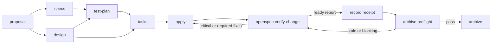

# Design

## Context

参见 `proposal.md` 的 Why。TaskPilot 已在根架构和三个子项目测试策略中定义风险分层、覆盖率门槛和测试工具，但当前 OpenSpec `spec-driven` schema 仍只生成 proposal、specs、design、tasks，无法保证每个 change 在任务拆分前完成风险到测试的映射。

OpenSpec schema 描述实施前的 artifact DAG；`apply` 实施代码，官方 `openspec-verify-change` 在实施后只读核对 artifacts、源码和测试。因此，TDD 适合作为 schema 和 apply 的强制约束，而 code review 不应成为一个在实施前即可标记完成的规划 artifact。

当前 OpenSpec 1.13.2 的 workflow profile 是用户级配置，项目内没有独立 profile 设置；项目级 schema 和已生成的 `.agents/skills/` 则可随仓库交付。

## Goals / Non-Goals

**Goals:**

- 让所有受 OpenSpec 管理的行为变更在实现前形成可执行的测试计划。
- 让 tasks 和 apply 按行为切片落实 Red → Green → Refactor，而不是末尾补测试。
- 在 archive 前执行独立、只读、可复核的 review/verify，并形成阻断问题的修复回路。
- 复用现有分层测试策略，不重复维护工具、覆盖率和边界规则。
- 让 schema、模板、规则和必要 Skill 都保存在仓库内，便于复现和审查。

**Non-Goals:**

- 不把每个文件变更机械拆成三个任务，也不要求对无可执行行为的变更伪造 Red 阶段。
- 不新增一套与子项目 testing strategy 平行的测试标准。
- 不让 review 阶段自动编辑实现或规划产物。
- 不将 OpenSpec `validate` 的结构成功视为实现通过。

## Decisions

### 1. 派生项目级 `taskpilot-sdd` schema

从 OpenSpec 1.13.2 内置 `spec-driven` schema fork 到 `openspec/schemas/taskpilot-sdd/`，保留内置 artifact 的核心语义和校验兼容性，并将 `openspec/config.yaml` 的默认 schema 改为 `taskpilot-sdd`。

选择项目级 fork 而不是直接编辑 npm 全局模板，因为全局包升级会覆盖修改且无法随仓库版本化。fork 后通过 `openspec schema validate taskpilot-sdd` 验证结构；升级 OpenSpec 时人工比较上游 schema，选择性吸收变化，不盲目覆盖本地约束。

### 2. 新增 `test-plan` 规划产物

artifact DAG 调整为：

`test-plan.md` 模板包含：

- 风险等级与失败影响；
- requirement/scenario 到测试层的映射；
- 每个行为切片的 Red 失败证据、Green 最小实现目标、Refactor 保护范围；
- 必须运行的 focused、affected 和跨边界自动化命令；
- 无法自动化或不适用 TDD 的例外、原因、替代证据和后续责任。

测试层和命令必须引用根架构及最近子项目 testing strategy；模板不硬编码所有项目都使用同一种 runner。一个风险只在能最早、最稳定发现它的最低可靠层充分覆盖，端到端测试只覆盖关键跨项目旅程。

### 3. tasks 按行为切片承载 TDD

`tasks.md` 不创建独立的“最后补测试”阶段。对可执行行为，每组任务按以下顺序出现并包含明确命令或自动化证据：

1. **Red**：先新增或修改最小测试，运行目标测试，确认它因目标行为尚未实现而失败；编译错误、环境错误和无关失败不算有效 Red。
2. **Green**：实现使目标测试通过的最小生产行为，并运行该切片相关测试。
3. **Refactor**：在测试保持通过时改善结构，再运行 focused/affected checks。

文档、生成文件刷新、纯脚手架或测试工具自身配置没有可观察生产行为时，可在 `test-plan.md` 标记 TDD 不适用；其任务仍需提供结构校验、fixture/self-test 或可执行命令，不能用手工观察冒充自动化验证。人工验收说明不写成 `tasks.md` 的开发 checkbox。

### 4. apply 指令执行证据化 TDD

schema 的 `apply.instruction` 明确要求：

- 读取 `test-plan.md`、specs、design 和 tasks；
- 一次只推进一个行为切片；
- Red 阶段记录运行命令和预期原因的失败摘要后才进入 Green；
- 不允许通过删除断言、跳过测试、放宽正确契约或把 production logic 放进测试来取得 Green；
- Refactor 后运行最低必要 focused checks，再按风险运行 affected checks；
- 只有对应自动化证据存在时才勾选任务；
- 发现规格/设计冲突时停止实现并返回 `openspec-update-change`，不静默改写契约。

### 5. 使用官方 verify Skill 作为独立 review 门禁

启用 OpenSpec 1.13.2 官方 `openspec-verify-change` Skill，并将生成文件保存在 `.agents/skills/openspec-verify-change/SKILL.md`。由于 workflow profile 是用户级配置，仓库提供 `tools/openspec/update-workflows.sh`：脚本在临时 `XDG_CONFIG_HOME` 中声明 core workflows 加 `verify`，调用 `openspec update` 后清理临时配置。这样可以刷新官方生成文件而不修改用户真实全局 profile；仓库以脚本、已生成 Skill 和 AGENTS 路由作为可复核结果。

review 阶段必须：

- 在 apply 完成后单独调用，保持只读；优先使用新的上下文或 reviewer 角色，避免沿用实现者结论；
- 核对任务完成度、需求和场景覆盖、设计一致性、代码模式、测试结果及未验证项；
- 使用 CRITICAL、WARNING、SUGGESTION 分级并提供文件/行号与具体修复建议；
- CRITICAL 或被确认必须修复的 WARNING 返回 apply，修复后重新运行 review；
- 存在 applicable 的 `Not verified` 时不得宣称 ready for archive；
- review 通过或用户明确接受剩余非阻断项后才能 archive。

`openspec validate --strict` 仍只验证 artifact 结构。review 必须实际检查代码和运行适用测试，不能以 schema 校验代替实现证据。

### 6. 仓库规则与架构文档只维护稳定契约

根 `AGENTS.md` 记录触发顺序和角色边界；`docs/architecture.md` 记录跨项目 TDD/review 质量门禁。具体 artifact 结构只保存在 schema/template，具体子项目测试工具继续由各自 testing strategy 拥有，避免多处复制漂移。

### 7. Review receipt 与 archive preflight 分离

官方 `openspec-verify-change` 继续保持只读，不直接编辑实现、规划产物或证据。独立 reviewer 输出报告后，由协调阶段使用仓库工具把结构化报告持久化到 `openspec/changes/<change>/evidence/verification-report.json`。receipt 包含 reviewer 声明、时间、执行命令、分级 findings、`Not verified` 项、最终 verdict，以及生成时的保守工作区内容指纹。self-review 不能声明为 independent receipt。

`tools/openspec/archive-preflight.sh <change>` 在调用官方 archive Skill 前运行并阻断以下状态：receipt 缺失或格式错误、reviewer 非 independent、verdict 非 ready、存在 CRITICAL、WARNING 未明确接受为非阻断、存在 applicable `Not verified`，或者当前工作区指纹与 review 时不一致。preflight 只检查并退出，不负责归档，也不修改官方生成 Skill。

工作区指纹覆盖仓库内源码、文档、OpenSpec 配置和 active changes，排除 `.git` 元数据、依赖/构建/覆盖率缓存、归档目录和 verification evidence 自身。该策略有意保守：任何相关工作区内容变化都要求重新 review 和重新记录 receipt，避免在无 Git 仓库中依赖不可用的 commit SHA。

### 8. 可重复的 workflow 语义回归测试

`tools/openspec/test-workflow.sh` 在 `/tmp` 创建自包含的 disposable OpenSpec root，复制项目 schema/config 后验证默认新 change 使用 `taskpilot-sdd`、artifact graph 包含 `test-plan`、tasks/apply 指令包含 TDD 与工具类例外约束、严格校验通过，并覆盖 receipt 缺失、格式错误、self-review、失败命令、阻断 finding、未接受 WARNING、applicable `Not verified`、通过与过期拒绝路径。脚本总是清理 fixture，不在正式 `openspec/changes/` 留下测试 change。

`tools/openspec/update-workflows.sh` 在刷新后检查六个 core Skills 与 verify Skill 全部存在，并核对每个 `generatedBy` 与当前 `openspec --version` 一致。

## Risks / Trade-offs

- **[本地 schema 与上游 schema 漂移]** → 固定 fork 来源版本，在 schema 中注释来源；OpenSpec 升级时运行 schema validation 并比较上游差异后再更新。
- **[TDD 被形式化为勾选框]** → 要求 Red 的失败原因必须对应缺失行为，Green/Refactor 必须有命令证据；review 抽查测试是否能捕获真实缺陷。
- **[所有变化都被迫写无意义测试]** → 允许明确的“不适用”分类，但必须说明原因和替代自动化证据；review 判断例外是否合理。
- **[测试重复导致执行过慢]** → 先跑最低可靠层的 focused tests，只按风险扩大到 affected、contract 或 E2E；不以 E2E 重复子项目矩阵。
- **[同一上下文自审产生确认偏差]** → review 独立调用且只读，优先新上下文/专职 reviewer；self-review 不得生成 independent receipt，所有结论附源码和命令证据。
- **[receipt 与被审状态脱节]** → receipt 绑定保守工作区指纹；preflight 检测任何内容变化后要求重新 review。
- **[官方 Skill 升级覆盖本地门禁]** → 不手改生成 Skill；稳定门禁保存在根规则和仓库脚本，并用语义 smoke test 验证。
- **[verify Skill 受用户级 profile 影响]** → 提交仓库本地生成 Skill，并在升级流程中显式检查其存在和 `generatedBy` 版本；不把全局配置当作仓库事实来源。

## Migration Plan

1. Fork 内置 schema 为 `taskpilot-sdd`，增加 `test-plan` artifact 并定制 templates/apply instruction。
2. 验证 schema 后，将 `openspec/config.yaml` 默认 schema 切换为 `taskpilot-sdd`。
3. 启用并生成官方 `openspec-verify-change` Skill，确认现有 OpenSpec Skills 未丢失。
4. 更新根 `AGENTS.md` 和 `docs/architecture.md` 的 TDD/review 路由。
5. 创建临时 smoke change，验证 artifact DAG、模板内容、apply context 和严格校验，再删除临时 change。
6. 固化 workflow smoke test、verification receipt 和 archive preflight，并加强 Skill 刷新校验。
7. 对本变更运行严格校验；实施完成后使用新 verify Skill review 本变更，独立 review 后再记录 receipt。

回滚时将默认 schema 恢复为 `spec-driven`，删除项目级 `taskpilot-sdd` schema 和 verify Skill 路由；已有使用自定义 schema 的 change 保留其 schema 文件直至完成或迁移，不能先删 schema。
