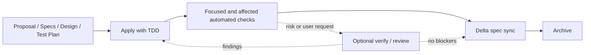

# Design

## Context

见 `proposal.md`。当前仓库把独立 verification attestation 设计成 archive 的通用硬门禁，并通过 policy、receipt、fingerprint 和 preflight 脚本实现。该机制比 OpenSpec 自带的 artifact/task 完成检查、delta spec sync 和项目自动化测试更重，且对低风险与文档类 Change 的边际收益不足。

本变更是工程治理和工具简化，不改变产品行为。测试归属根级 OpenSpec workflow self-test；子项目测试策略不受影响。

## Goals / Non-Goals

**Goals:**

- 让日常 Change 在完成实现和适用自动化检查后可以直接进入 spec sync 与 archive。
- 保留 TDD/test-plan、严格校验、任务完成检查和 delta spec sync。
- 保留 `openspec-verify-change` Skill 作为可选深度 review，而非硬门禁。
- 删除只服务于强制 attestation 的 policy、receipt、fingerprint 和 preflight 工具与文档契约。

**Non-Goals:**

- 不降低各子项目 testing strategy 定义的测试层次、覆盖率和关键场景要求。
- 不修改 OpenSpec 官方生成 Skill 的内容。
- 不重写历史 archive 中的 Change、receipt 或 policy；历史证据保持原样。
- 不修改当前 Desktop/Agent Runtime 架构 Change 的内容。

## Decisions

### 1. 完成路径以可执行质量信号为核心

默认路径调整为：

选择自动化检查、task completion 和 spec sync，是因为它们直接验证实现、计划完成度和规范一致性。独立 reviewer 仍可用于高风险、安全敏感或用户明确要求的场景，但不再由仓库级脚本强制。

### 2. 删除 attestation 子系统，而不是继续增加例外

删除 `record-verification.sh`、`workspace-fingerprint.sh` 和 `archive-preflight.sh`，并从根 `AGENTS.md`、`docs/architecture.md`、`taskpilot-sdd` apply guidance 与 workflow self-test 中移除对应契约。相比继续维护 owner-acceptance policy，这能显著降低概念数量、报告格式和失效模式。

历史 archive 内的 `verification-policy.json` 和 receipt 不迁移、不删除，因为它们记录当时流程。

### 3. workflow self-test 只验证长期保留的约束

`tools/openspec/test-workflow.sh` 继续在隔离 fixture 中验证：

- 默认 schema 为 `taskpilot-sdd`；
- artifact graph 含 `test-plan`；
- tasks/apply 指令含 TDD 与合理例外；
- schema 和 Change 严格校验通过；
- workflow refresh 仍产生七个版本一致的官方 Skills。

移除 receipt parsing、policy eligibility、scoped fingerprint 和 archive preflight 测试。

### 4. TDD 例外

本变更以文档、Shell 工具删除和测试脚本简化为主，没有新增产品运行时行为，行为级 Red/Green 不适用。采用结构化回归：先让现有 self-test 中 attestation 断言因目标变化而不再适用，再删除相关实现与断言，最终以 shell syntax、workflow self-test、strict validation 和链接检查作为 Green 证据。

## Risks / Trade-offs

- **[高风险 Change 可能缺少第二视角]** → 根规则明确 verify/review 可按风险或用户要求启用；安全和业务关键变更仍由 owning testing strategy 与人工 review 决策覆盖。
- **[删除脚本后残留文档链接]** → 使用仓库 Markdown 本地链接检查和全文检索验证无活动文档引用已删除工具。
- **[误删历史证据]** → 仅修改活动规则与工具，明确排除 `openspec/changes/archive/`。
- **[self-test 被过度削弱]** → 保留 schema、artifact DAG、TDD guidance、strict validation 和 Skill 版本断言。

## Migration Plan

1. 更新根 `AGENTS.md`、`docs/architecture.md` 与 `taskpilot-sdd` apply guidance，把 verify 设为可选并删除 attestation/preflight 契约。
2. 简化 `tools/openspec/test-workflow.sh`，删除 attestation 专属 fixture 与断言。
3. 删除三个 attestation 工具脚本。
4. 运行 shell syntax、workflow self-test、schema validation、doctor、strict all-change validation、文档链接检查和 `git diff --check`。
5. 对本 Change 做 delta spec sync 评估；由于 `skip_specs: true`，预期无可同步内容，然后使用官方 archive 流程归档。

回滚时可从版本历史恢复脚本和文档契约；历史 archive 不参与回滚。
