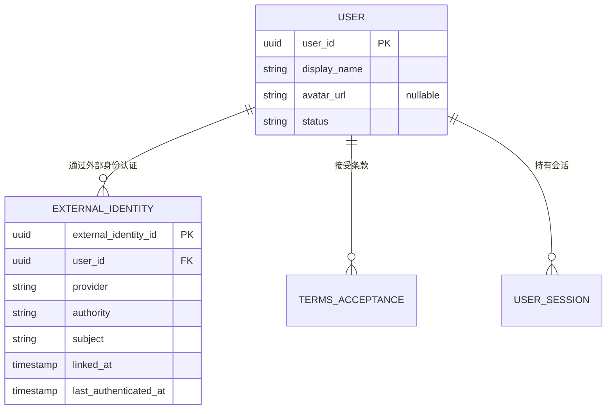
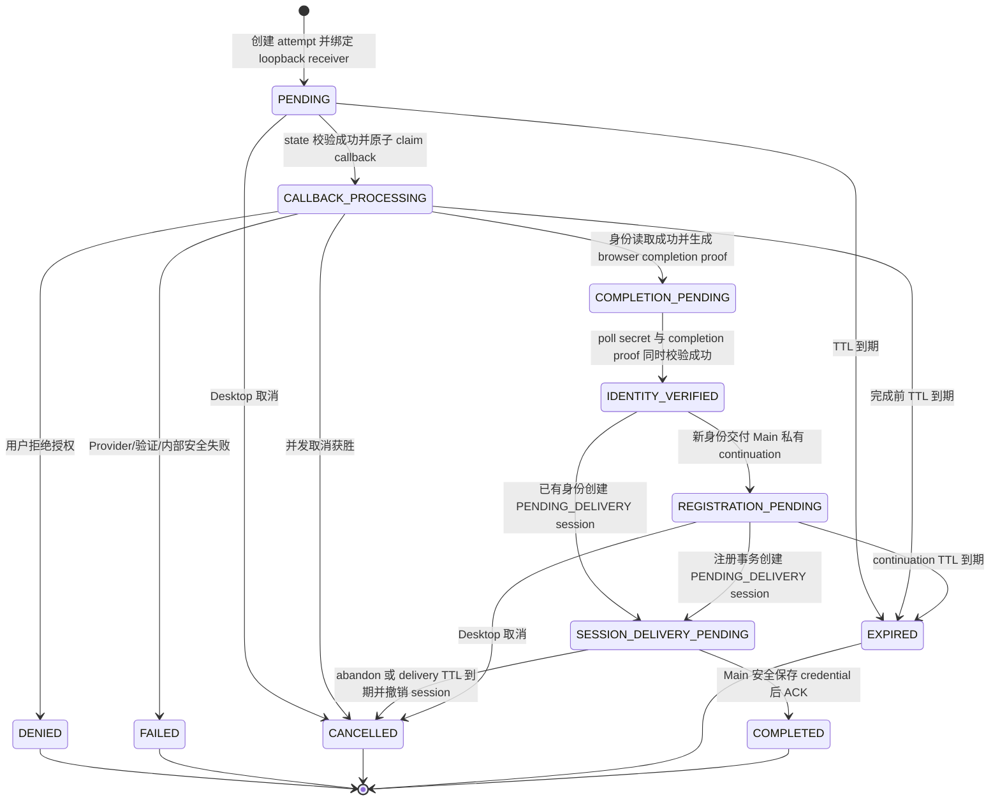

# Design

## Context

动机与产品范围见 [`proposal.md`](proposal.md)，可观察行为见本 Change 的 `desktop-authentication` 与 `desktop-api-documentation` delta specs。

当前 runnable slice 已把邮箱身份作为认证主键贯穿多个边界：Core API `access` 包含 `EmailIdentity`、密码、OTP、邮件投递、邮箱 continuation、session 与 `CurrentUserView.email`；Flyway `V1`–`V3` 建立相应表；Desktop Renderer、Main/Preload contract 和 session coordinator 暴露邮箱注册/登录/找回流程；local dev 同时启动 PostgreSQL 与 Mailpit。现有 TaskPilot access/refresh session、Workspace onboarding、Project list 与业务授权边界可以保留，但必须从邮箱凭据模型解耦。

本 Change 同时跨越外部 OAuth 信任边界、Core API 持久化/API、安全、Electron Main/Preload/Renderer 和 local dev 编排。GitHub 是身份认证 Provider，不是仓库 Integration；GitHub 凭据只能由 Core API 在一次 callback 中短暂使用。项目没有生产环境和存量用户，因此实现以新的开发数据库基线为准，不承担在线数据迁移或旧客户端兼容。

## Goals / Non-Goals

**Goals:**

- 用通用但最小的 `ExternalIdentity` 映射隔离 TaskPilot `UserId` 与 GitHub 身份，并允许以后以相同模型增加 Google 或 Lark。
- 让系统浏览器 OAuth、Core API callback、Desktop polling、首次资料确认和 TaskPilot session 交接具有明确状态机、单次 proof 消费、并发和可恢复 session 交付语义。
- 让 OAuth state、PKCE verifier、poll secret、registration continuation、GitHub token 与 TaskPilot token 各自具有独立用途、存储与生命周期。
- 保留现有 session 轮换/撤销和 Electron OS credential 边界，同时移除邮箱、密码、OTP、SMTP 与 Mailpit 认证依赖。
- 为外部 HTTP、时间、随机数、密钥加密、并发状态转换和 Electron 系统浏览器建立可确定测试 seam。

**Non-Goals:**

- 不构建动态 Provider 插件系统、Provider 管理后台或运行时加载机制；第一版只注册一个代码内 GitHub adapter。
- 不实现 Google、Lark、GitHub Enterprise、账号绑定/解绑/转移/合并、按 email 自动关联或多账号切换 UI。
- 不申请或持久化 GitHub 仓库、组织或 email scope；不实现 GitHub 仓库访问能力。
- 不实现生产部署、域名与反向代理方案、安装包、签名、自动更新、线上迁移、灰度或旧认证回滚。
- 不把 Renderer、Desktop Main 或 Gateway 变成 OAuth confidential client，也不改变 Workspace/Project 授权规则。

## Business Model

本设计使用关系图、状态机、具体场景映射和 OAuth 信任边界威胁分析。稳定结论将在实现切片中反馈到 [`docs/business-model.md`](../../../docs/business-model.md)；未变化的 Workspace、Membership 和授权规则继续由该文档拥有。

### 身份、关系与所有权



- `UserId` 是 Workspace、Project、Session、Membership 和后续业务记录唯一引用的内部稳定身份。
- `ExternalIdentity` 由 Core API `access` 拥有，必须且只能关联一个 User；一个 User 可以有零到多个 ExternalIdentity。第一版注册事务完成后新 User 恰有一个 GitHub identity，但不添加 `UNIQUE(user_id, provider, authority)`，避免阻断未来同 Provider 多身份或多 authority 的显式绑定设计。
- 外部身份唯一键是 `UNIQUE(provider, authority, subject)`。GitHub 固定映射为 `provider=github`、`authority=https://github.com`、`subject=<durable numeric user id 的十进制字符串>`。
- GitHub `login`、name、email、avatar 与 token 不是身份键。相同 email 不产生关联或合并；后续 login/email 变化不改变 UserId。
- User 自有资料保留 `displayName`，并增加可空 `avatarUrl`。首次确认只能选择是否采用 Core API 从可信 GitHub 响应得到的建议头像，不能提交任意远程 URL；确认后的值属于 TaskPilot profile，后续登录不自动覆盖。若建议头像缺失或不符合允许的 HTTPS GitHub avatar URL 规则，则不保存头像。
- `TermsAcceptance` 与 User、ExternalIdentity、session 在首次注册事务中一起创建。提交的条款版本必须等于服务端当前版本。
- `User.status` 至少区分 `ACTIVE` 与 `DISABLED`；只有 `ACTIVE` 可以建立或刷新 session。GitHub 认证成功不绕过内部状态检查。

### 登录尝试与 session 交付状态机

`FederatedLoginAttempt` 是短期流程记录，不是 User，也不授予业务权限。Desktop Main 在创建 attempt 前绑定只监听 `127.0.0.1` 随机高端口的一次性 HTTP receiver，并安全持有 `attemptId`、poll secret、loopback receiver nonce、browser completion proof、registration continuation 和 delivery recovery state；Renderer 只看到无秘密的流程 view。



- `PENDING → CALLBACK_PROCESSING` 使用条件更新或行锁完成。重复 callback、错误 state 或已终止 attempt 不得再次交换 authorization code。
- `CALLBACK_PROCESSING` 是持久 claim，不允许另一个 worker重试 code exchange。若进程在 Provider 调用期间崩溃，短租约/attempt TTL 将其收敛为 `FAILED` 或 `EXPIRED`；不猜测一次性 code 是否已被消费。
- Provider 结果返回后，Core API 在短事务中保存加密身份候选、生成一次性 browser completion proof，并返回带 `no-store` 与 `Referrer-Policy: no-referrer` 的结束页；结束页只向 attempt 预绑定的精确 loopback receiver 执行一次 HTTP POST。proof 不进入远程 URL、日志或 Renderer。若 authorization URL 被转发到另一设备，该设备没有匹配 listener，发起方又没有 proof，因此两方都不能单独领取身份结果。
- Main 可用正确 poll secret 读取不含身份资料或 credential 的安全等待/拒绝/失败状态；当 poll 领取已验证身份结果时，必须同时提交正确 poll secret、completion proof 和预先安全持久化的 `deliveryRequestId`。Core API 只在三者匹配时从 `COMPLETION_PENDING` 前进；只有 poll secret 或只有 proof 都不能读取身份候选、continuation 或 session。
- 对已有身份，首次有效 poll 原子创建 `PENDING_DELIVERY` session 和加密交付结果；对未知身份，poll 向 Main 交付 registration continuation 与安全预览。相同 attempt、secret 与 `deliveryRequestId` 在恢复窗口内确定性返回相同结果，不产生第二个 session；不同 request id 或错误秘密 fail closed。
- 注册请求只接受 Main 持有的匹配、未过期 continuation，并携带同一预持久化 `deliveryRequestId`。成功时原子插入 User、ExternalIdentity、TermsAcceptance 与 `PENDING_DELIVERY` session并保存加密交付结果。相同 continuation + request id 的安全重试返回同一结果；不同 request id 或并发 identity 冲突不留下孤立 User/session。
- Main 收到交付结果后，先把 refresh token 与 pending delivery ACK state 原子写入 OS credential；随后使用交付专用高熵 ACK secret 幂等 ACK。ACK 在重新校验 User 为 `ACTIVE` 后才把 session 转为 `ACTIVE`，之后 access/refresh 才可使用。ACK 响应丢失可安全重试；Main 崩溃后从 OS credential 恢复 pending ACK。
- Main 明确 abandon、credential 写入失败，或 delivery TTL 到期时，Core API 将 `PENDING_DELIVERY` session family 撤销并删除加密交付结果。若 poll/registration 响应在 Main 收到前丢失，Main 以安全持久化的 attempt recovery state 和同一 request id 恢复；若该 state 也丢失，session 始终不可用并按 TTL 撤销。
- `DENIED`、`FAILED`、`CANCELLED`、`EXPIRED`、`COMPLETED` 是不可逆终态。过期清理删除 verifier、加密身份候选、completion proof、result、continuation 与 ACK secret；业务 session 继续按自身生命周期清理。

### 不变量、授权与异常路径

- GitHub 只证明一次外部账号控制权；Core API 仍用内部 User 与 Membership 完成 Workspace/Project 授权。
- OAuth state、poll secret、browser completion proof、registration continuation 与 delivery ACK secret 分别生成，均为高熵随机值且数据库只保存带用途域分离的 digest；一个值不能替代另一个。
- PKCE verifier、外部身份候选与可恢复交付 result 必须以运行时注入密钥进行带用途、attempt 和 schema version 绑定的认证加密；明文只存在于完成当前操作所需的内存中。
- GitHub token 只存在于 callback adapter 调用栈，用于立即读取 authenticated user，随后丢弃。任何异常、结构化日志、Problem Details、OpenAPI 示例和测试快照都不得包含秘密或 Provider 原始 body。
- 用户拒绝、state/PKCE 不匹配、Provider 超时/限流/畸形响应、跨设备转发、User disabled、本地 credential 写入失败、poll/ACK 重放与并发注册都 fail closed。不能确认交付完成时不激活或发布 authenticated 状态。
- attempt 创建按来源网络与 Desktop installation 的非秘密标识进行有界限流，并设置总量/TTL 清理，防止匿名写放大；限流不用于判断账号是否存在。
- GitHub callback、Core API 结束页到 loopback receiver 的 completion POST 与 Desktop polling 是异步边界；无须自定义 URI scheme，浏览器不携带 TaskPilot token、poll secret、continuation 或 session result。

## Decisions

### 1. 采用内部 User 与通用 ExternalIdentity 映射

Core API 使用独立 `external_identities` 表，最小字段为：

```text
external_identity_id
user_id
provider
authority
subject
linked_at
last_authenticated_at
```

`provider` 使用代码内受控值，`authority` 是规范化绝对 URI，`subject` 是 Provider 作用域内的不可变标识字符串。数据库添加 `(provider, authority, subject)` 唯一约束和 `user_id` 查询索引，不添加 `(user_id, provider, authority)` 唯一约束。

**理由：** TaskPilot 业务引用稳定 UserId，同时保留未来一个 User 多外部身份的正确基数；三元组也能自然表达 OIDC `issuer + subject` 和未来多 authority。

**替代方案：** 直接把 GitHub id 放在 User 表会把首个 Provider 固化进核心模型；使用 email/login 会因可变性和重用产生账号接管风险；第一版建设完整动态 Provider registry 则没有真实复用需求。

### 2. 采用 Core API confidential client、系统浏览器、loopback completion 与 Desktop polling

固定 HTTP 形状为：

```text
GET  /desktop/v1/auth/capabilities
POST /desktop/v1/auth/federated/attempts
GET  /desktop/v1/auth/federated/github/callback
POST /desktop/v1/auth/federated/attempts/{attemptId}/poll
POST /desktop/v1/auth/federated/attempts/{attemptId}/cancel
POST /desktop/v1/auth/federated/registrations
POST /desktop/v1/auth/federated/deliveries/{deliveryId}/ack
POST /desktop/v1/auth/federated/deliveries/{deliveryId}/abandon
```

Main 创建 attempt 前绑定仅监听 `127.0.0.1` 的随机高端口 receiver，并生成随机 receiver nonce；attempt body 只允许受控 `provider=github`、bounded installation identifier，以及 `http://127.0.0.1:<ephemeral-port>/taskpilot/oauth/complete/<nonce>` 形状的精确 completion URI。服务端拒绝 hostname、IPv6/非 loopback 地址、默认/特权端口、userinfo、query、fragment、路径穿越和非固定前缀，不跟随该地址，也不从服务端主动请求它。

GitHub 仍只回调服务端固定 URL。验证身份后，Core API 返回安全结束页，以单次 HTTP POST 把 completion proof 送到预绑定 loopback receiver；proof 不放在 redirect query、fragment、日志或远程请求中。Main 收到并校验本地 method/path/origin-independent nonce、body schema/size 后关闭 listener。attempt 创建和系统浏览器打开之间的失败必须取消服务端 attempt。

poll/cancel 把 poll secret 放在请求 body；poll 还携带 completion proof 和由 Main 在打开浏览器前安全持久化的 `deliveryRequestId`。注册 body 包含 display name、`useSuggestedAvatar`、当前 terms version、Main 私有 continuation 和同一 delivery request。ACK/abandon 使用 delivery id 与交付专用 secret，均不放 URL。callback URL、GitHub authorization/token/user endpoint 为代码内固定 `github.com` allowlist，不接受客户端覆盖。

Desktop Main 使用 `shell.openExternal` 打开 Core API 返回且通过 origin/path allowlist 校验的 authorization URL。Preload 只暴露 `getAuthCapabilities`、`startGitHubLogin`、`cancelGitHubLogin`、`confirmFederatedRegistration` 与安全状态订阅，不暴露 arbitrary URL/HTTP、loopback receiver 或任何秘密。

**理由：** 系统浏览器保留用户已有 GitHub session；服务端持有 client secret；loopback completion proof 将授权浏览器所在设备与 poll secret 汇合，阻断仅转发 authorization URL 后由发起方领取受害者身份结果；可恢复 delivery 避免网络丢包制造活跃孤立 session。

**替代方案：** Electron WebView/BrowserWindow 扩大凭据窃取面；仅凭 poll secret 无法证明授权浏览器与发起 Desktop 同机；自定义 URI scheme需要安装/抢注/单实例处理；把 client secret 放 Desktop 无法形成 confidential client。本 Change 只使用临时 loopback listener，不注册自定义 scheme。

### 3. OAuth state、PKCE 与 polling 使用独立秘密和存储

`federated_login_attempts` 保存 attempt 元数据、状态、版本/时间、精确 loopback URI、`poll_secret_digest`、`oauth_state_digest`、`completion_proof_digest`、加密 PKCE verifier、callback claim、加密身份候选及安全终态 code。`federated_registration_continuations` 保存 attempt 关联、continuation digest、加密外部身份候选/建议资料、创建/过期/消费时间。session recovery 存储保存 delivery id/request id、交付与 ACK secret digest、加密 session result、状态和短 TTL。

state、poll/completion/continuation/ACK secret 使用带用途前缀的 HMAC digest；PKCE verifier、身份候选和 session result 使用 AEAD，并把 attempt/delivery id、用途和 schema version 作为 associated data。HMAC key 与 AEAD key 是分别注入的 runtime secret；client id、client secret、精确 callback、HMAC key 和 AEAD key 任一缺失或无效时 capability 必须 disabled。密钥不能来自仓库默认值。日志只记录 correlation id、attempt/delivery id 的不可逆/截断表示、状态转换和安全分类，不记录请求秘密。

**理由：** callback 必须恢复 verifier，poll/registration 必须支持确定性恢复 TaskPilot credential/continuation，因此单纯 hash 不够；用途域分离、独立 HMAC/AEAD key 和 associated data 防止数据库泄漏直接暴露可用秘密或密文替换。

**替代方案：** 仅内存存储无法支持 Core API 重启且难以测试多实例语义；把 state 当 poll credential 会让浏览器可见值获得 Desktop 结果读取权；明文数据库列扩大泄漏影响。

### 4. GitHub adapter 是窄端口，不是插件框架

`access` application 定义窄 `FederatedIdentityProvider` 端口，输入为受控 attempt 上下文，输出只包含规范化 `provider/authority/subject`、建议 display name 与可选安全 avatar URL，或稳定的拒绝/暂时失败类别。GitHub infrastructure adapter 负责 authorization URL、code exchange、authenticated-user HTTP 和 Provider 错误映射；SDK/raw JSON/token 类型不得穿过端口。

第一版通过显式 Spring bean/配置注册 GitHub；capability 只有在 client id、client secret、精确 callback、federated HMAC key 和结果 AEAD key 全部有效时才启用。Google/Lark 后续可实现相同端口，但各自 authority、subject、scope、callback 和响应验证必须由独立 Change 决定。

**理由：** 隔离第三方协议并提供 fake seam，同时不为尚不存在的动态安装、配置 UI 或 Provider 生命周期建设框架。

**替代方案：** Controller 直接调用 GitHub 会把 Provider 细节扩散到业务事务和测试；通用插件 SPI/数据库 Provider 配置属于过早抽象。

### 5. 首次注册通过独立 continuation，不在 callback 静默建 User

callback 只保存加密身份候选；在同机 completion proof 与 poll secret 汇合后，未知 identity 才产生短期 continuation 与建议资料。Main 私有并安全恢复 continuation，Renderer 只得到包含可编辑 display name、是否可采用建议头像及当前条款的非秘密 registration view。注册 use case 重新验证 continuation、attempt 状态、delivery request、条款版本与字段，并在单个 PostgreSQL 事务内完成 User、ExternalIdentity、TermsAcceptance 与 `PENDING_DELIVERY` session。

**理由：** 用户有明确同意点，资料和条款是 TaskPilot 自有事实；callback 重试/爬虫访问不会静默制造账号。

**替代方案：** callback 自动注册减少一步但无法表达条款和资料确认；把 GitHub profile 持续同步会让外部可变字段覆盖产品资料。

### 6. 保留 TaskPilot session，实现可恢复的两阶段 session 交接

现有 opaque access/refresh token、family/generation、rotation、revocation 和 refresh recovery 继续由 Core API 拥有。既有 identity 的首次有效 poll，或首次注册事务，创建 `PENDING_DELIVERY` session 并保存短期加密结果；该状态的 access/refresh token 均不可用于 protected access、refresh 或 current-user。相同 `deliveryRequestId` 的安全重试确定性返回同一结果，不创建额外 session。

交付结果包含 delivery id 和独立 ACK secret。Main 将 refresh token、pending ACK 元数据和必要的恢复 generation 原子写入当前 environment/account 的 OS credential entry 后，调用幂等 ACK；Core API 在 ACK 时重新校验 User 为 `ACTIVE` 并将 session 原子转为 `ACTIVE`。ACK 响应丢失时，相同 ACK 可重试并返回已激活状态。Main 收到 session result 前崩溃时，从预先安全持久化的 attempt/poll/completion/request state 恢复同一交付；收到后崩溃时，从 OS credential 的 pending ACK state 恢复。credential 写入失败、显式 abandon 或 delivery TTL 到期会撤销 session family，不能仅等待普通 30/90 天 session 到期。

`User.status=DISABLED` 的检测规则对登录、delivery ACK、protected access、普通 refresh 和 refresh recovery 一致：不得创建或激活新 session，不得接受现有 access token，不得返回 refresh/recovery result，并在检测事务中撤销对应 session family。未来若增加显式 disable command，它必须在写入 `DISABLED` 的同一业务事务中撤销该 User 的全部 session family；本 Change 不增加管理 UI/API。

`CurrentUserView` 改为 `{ userId, displayName, avatarUrl? }`，不再有必填 email。Workspace/Project client state 仍按 environment、UserId、WorkspaceId 隔离，旧 session generation 的迟到响应不得覆盖 GitHub 新登录或 logout。

**理由：** 外部 Provider 只负责初始身份证明，不能成为每个业务请求的在线依赖；两阶段交付让客户端安全存储成为 session 获得业务权限的前置条件，也让响应丢失、ACK 丢失和进程崩溃可恢复而不留下活跃孤立 session。

**替代方案：** 直接把 GitHub token 当 TaskPilot bearer 会泄露 Provider credential并耦合权限；创建 ACTIVE session 后再“尽力撤销”无法处理成功响应丢失；最多一次交付会让客户端无法恢复已消费结果。

### 7. 在 0→1 阶段重建 Flyway 开发基线

实现时改写尚未发布的 `V1`–`V3`：`V1` 建立 User、ExternalIdentity、TermsAcceptance；`V2` 建立 federated attempt/registration 临时表和约束；`V3` 只建立 TaskPilot session/recovery。`V4`/`V5` 的 Workspace/Project 关系保持引用 `app_users`。删除 email/password/verification 表，而不是追加新 migration 后保留死 schema。

所有已有本地开发数据库必须在新代码启动前通过项目 dev controller 的显式 reset/清理流程重建；Flyway 不执行 checksum repair、不在启动时自动删除数据。测试每次从空 PostgreSQL 应用最终 migration 链。

**理由：** 当前没有生产或存量账号，维护干净基线比制造永久兼容层更符合已确认范围。

**替代方案：** 追加 `V6` 迁移适用于已有部署，但会留下无业务用途的凭据/OTP/邮件表和复杂清理；保持旧 migration checksum 则与“无迁移兼容”目标冲突。

### 8. 删除邮箱认证及 Mailpit/SMTP，而不是保留隐藏 fallback

删除 EmailIdentity、password/OTP/verification continuation、mail adapter、相关 controller/DTO/config/dependency/test；local Compose、doctor、smoke 和 `.env` 示例不再要求 Mailpit/SMTP。GitHub 未配置时 capability 明确 unavailable，不能回退邮箱认证。README 与 owning docs 只记录新的 Current/Target 边界，不把真实 client secret 写入仓库。

**理由：** 隐藏 fallback 仍需维护安全、依赖和测试面，违背以外部登录降低开源维护成本的目标。

**替代方案：** 双栈认证会扩大本 Change 和长期攻击面；只隐藏 UI 会留下可达 API。

### 9. 测试 seam 与边界

- Core API domain/application：注入 `Clock`、secure random/token generator、purpose-separated digester、result cipher 和窄 Provider port；对状态转换、过期、重放、条款与并发用例使用确定输入。清晰可自动化的 use case 采用 Red-Green-Refactor。
- Provider adapter：使用本地 fake HTTP server 覆盖 token/user 请求、超时、非 2xx、畸形 JSON、durable id、scope 与日志脱敏；自动化测试不需要真实 GitHub 凭据。
- PostgreSQL/API：按 [`services/core-api/docs/testing-strategy.md`](../../../services/core-api/docs/testing-strategy.md) 使用 Testcontainers、真实 Flyway、HTTP/OpenAPI 与并发测试验证唯一约束、原子事务、安全链和 endpoint contract。
- Desktop Main/Preload：mock 固定 auth client、loopback listener、`shell.openExternal`、clock/timer 与 credential store，证明精确 URI/URL allowlist、转发 URL 无法领取结果、单 attempt、poll/cancel、delivery recovery/ACK/abandon、秘密不跨 IPC、generation 隔离和 credential 失败恢复。
- Renderer：按 [`apps/desktop/docs/testing-strategy.md`](../../../apps/desktop/docs/testing-strategy.md) 在 Preload boundary 测试用户状态与无障碍，不导入 Main。实现前使用 `frontend-design`，React 实现期间使用 `vercel-react-best-practices`，完成后使用 `web-design-guidelines` 审查。
- local dev：脚本测试验证配置/capability 与 Mailpit 移除；`pnpm dev:smoke` 只验证未配置时安全禁用和已配置进程健康，不自动访问真实 GitHub。真实 OAuth App smoke 是手工 dev 证据，凭据留在 Git-ignored `.env.local`。

## Risks / Trade-offs

- [GitHub 不可用时没有登录 fallback] → capability 明确状态、可恢复 UI 与稳定暂时错误；不重新引入邮件认证。Core API fake-provider 与 Desktop 状态测试覆盖。
- [匿名 attempt 可被滥用写放大或消耗 GitHub 配额] → 短 TTL、来源/installation 限流、总量边界、清理索引与只在 callback 后调用 GitHub；PostgreSQL/API 测试覆盖 429、过期清理和不可枚举响应。
- [callback 处理进程崩溃造成一次性 code 结果不确定] → 持久 claim、禁止二次交换、租约/TTL 后 fail closed，用户重新开始；并发和崩溃恢复集成测试覆盖。
- [authorization URL 被转发给另一台设备授权] → attempt 绑定精确 loopback receiver，poll secret 与 browser completion proof 必须汇合；任一方单独持有都不能领取身份结果。Main/HTTP 测试覆盖转发、错误 receiver/proof 和无 listener。
- [poll/registration/ACK 响应丢失或 Main 崩溃] → 预持久化 delivery request、短期加密确定性结果、OS credential pending ACK、幂等 ACK/abandon；未 ACK session 不可使用并在 TTL 到期撤销。API/Main 重启与丢包测试覆盖。
- [两次首次流程竞争创建同一 identity] → `(provider, authority, subject)` 唯一约束、短事务和失败事务无残留；真实 PostgreSQL 并发测试覆盖。
- [远程头像扩大隐私、CSP 或内容风险] → 只允许 GitHub authenticated-user 响应中的受控 HTTPS avatar URL，用户显式选择，Main/Renderer schema 与 CSP allowlist 限制来源，不由 Core API 抓取；UI/安全测试覆盖缺失和恶意 URL。
- [临时密文或配置秘密泄露] → AEAD、用途域分离、运行时 secret、日志过滤、错误白名单、短保留期和测试占位值扫描；API/OpenAPI/日志测试覆盖。
- [改写 migration 导致已有开发库 checksum 失败] → 在启动前显式停止并重置本地 volume/database；doctor 报告旧基线而不 repair。dev 脚本测试和全新 PostgreSQL migration 测试覆盖。
- [Provider-neutral 端口仍可能无法覆盖未来 Lark/Google 差异] → 只冻结稳定 identity 输出和安全错误，不抽象 scope/tenant/profile 全集；未来 Provider Change 可扩展窄端口而不改变 UserId/ExternalIdentity 不变量。
- [只验证当前开发主机不能证明发布可用] → 本 Change 只声明 local/dev；不把未执行的 Windows/macOS 安装、签名或生产 callback 验证描述为通过。

## Migration Plan

这里的“迁移”仅指本地开发基线重建，不是线上 rollout：

1. 完成 Core API、Desktop 与 dev tooling 的同一实现切片，确保新 migration 与新代码不会和旧邮箱链路混用。
2. 停止 `pnpm dev` 管理的进程和 Compose 服务。
3. 使用项目明确提供/记录的 dev reset 操作删除该 checkout 的 PostgreSQL 开发 volume/database；不执行 Flyway repair，也不保留旧邮箱、OTP 或 session 数据。
4. 由最终 `V1`–`V5` migration 链从空库重建，启动 Core API；GitHub 配置不完整时服务仍可健康启动但 capability 必须为 disabled。
5. 在 Git-ignored `.env.local` 配置 GitHub OAuth App client id、client secret、精确 callback、federated HMAC key 与临时结果 AEAD key，运行 local/dev 手工 OAuth smoke；自动化套件继续使用 fake Provider。
6. 出现问题时修复代码/migration 后再次重置开发数据库，不恢复旧邮箱认证、不提供数据降级或双写回滚。

实现完成后按 Change test plan 执行 focused 与 affected checks，并进行 model-drift/documentation-feedback audit；稳定身份、流程和架构结论同步到 owning docs 与主 specs 后才能归档。

## Completion UX and Legal Bundle Follow-up

### Business Model

`TermsAcceptance` 的身份、基数和原子注册规则不变。现有 `termsVersion` 明确解释为不可变法律文档组合版本：一版用户协议和一版隐私政策共同组成一个 consent bundle；首次注册只记录 User、bundle id 与服务端接受时间。客户端复选框是主动操作状态而非持久化权威，服务端仍以注册命令携带的当前 bundle id 和事务内接受记录为权威。当前 0→1 客户端只内置一个 bundle；若服务端返回未知版本，客户端必须 fail closed，不能让用户对未展示的正文完成注册。

### Decisions

- callback HTML 使用严格 `no-store`、`no-referrer` 和 nonce CSP。页面先通过既有受限 loopback URI POST proof；仅在收到成功 HTTP 响应后把可见状态更新为“授权完成”、清理当前 URL 的 query/fragment 并调用 `window.close()`。脚本关闭被浏览器拦截时保留无秘密的手动关闭说明；交付失败时保留可重试动作，不把失败伪装为成功。
- Desktop Main 在 loopback receiver 接收并校验 proof 后，通过构造时注入的窄窗口激活回调恢复、显示并聚焦现有 BrowserWindow。该回调不进入 Preload/Renderer，不创建 deep link，也不授予任何认证状态；实际登录仍必须通过 poll、session delivery 与 ACK。
- 法律文档作为 Renderer 内置、只读、可键盘访问的静态内容展示，不依赖尚不存在的官网，也不开放任意 URL。注册页隐藏内部版本日期，文档正文保留生效日期。文档链接不会自动勾选复选框，返回注册页后保留用户尚未提交的显示名称和头像选择。
- 当前 bundle 常量与服务端 `termsVersion` 必须精确匹配；不匹配时禁用接受和提交，并提示更新客户端。未来需要无需发版更新法律正文时，应由独立 Change 设计带完整性与历史版本约束的法律文档 manifest，本补充不预建该平台。

### Risks / Trade-offs

- [系统浏览器通常禁止非脚本打开页面调用 `window.close()`] → 始终提供“已完成，可以关闭此页面”的无秘密 fallback；Desktop 回焦不依赖浏览器允许关闭。
- [窗口抢焦可能打断用户] → 只在该 Desktop 自己绑定的 loopback receiver 收到有效一次性 proof 后执行一次，不在普通轮询或失败重试中触发。
- [内置法律文档与服务端版本漂移] → 版本精确匹配并 fail closed；focused Renderer tests 冻结日期不出现在接受文案、链接可查看且未知版本不能提交。
- [通用法律草案被误认为适用于所有部署] → 文档明确区分开源许可证、官方/实际运营者服务和第三方自部署责任；生产发布前仍需实际运营者完成法律审查与主体信息公示。
