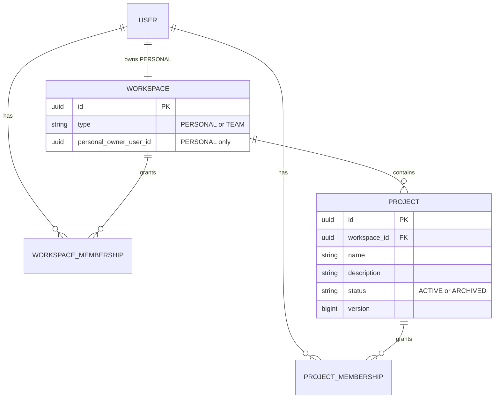
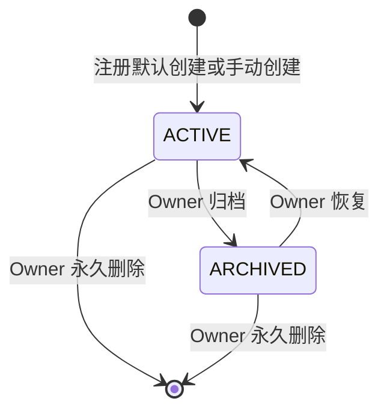
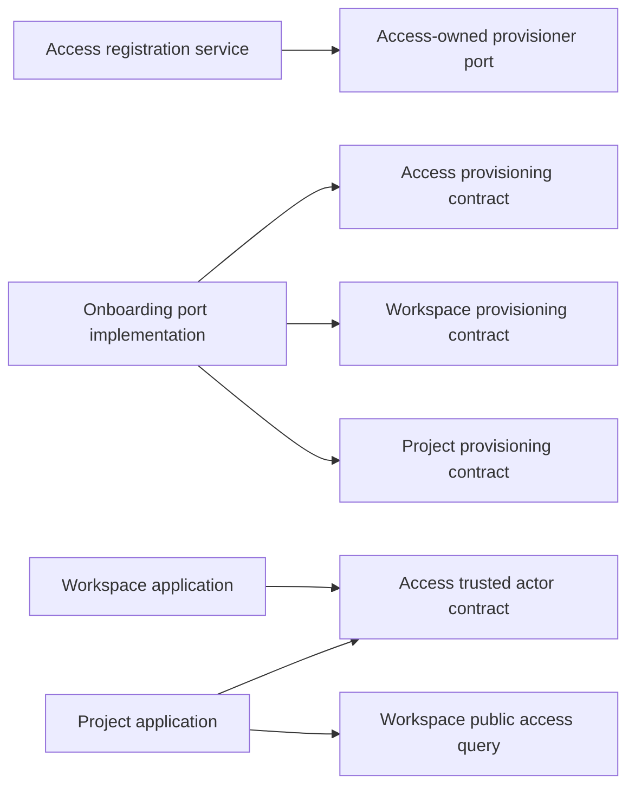

# Design

## Context

参见 [`proposal.md`](proposal.md) 的动机与四份 delta spec。当前可执行系统只有 Access 中的 User、ExternalIdentity、TermsAcceptance 与 GitHub/opaque-session 认证；`project` 仅有 Spring Modulith marker，Desktop 登录后停留在账号视图，运行时 OpenAPI 明确排除 Workspace/Project。

本 Change 同时改变业务模型、PostgreSQL、Access/Workspace/Project capability 协作、Desktop Main/Preload/Renderer 契约和应用壳。关键约束是：Access 拥有 User、ExternalIdentity、TermsAcceptance 与认证会话；Workspace 拥有 Workspace 和 WorkspaceMembership；Project 拥有 Project 和 ProjectMembership；Workspace 与 Project 是独立聚合与 capability，Project 通过 Workspace 的公开授权契约引用其稳定身份；任何 capability 不得读取另一 capability 的私有表；注册配置必须是一个本地数据库事务；Redis session 不能参与 PostgreSQL 原子提交；Renderer 不持有 bearer 或通用 HTTP 能力。

## Goals / Non-Goals

**Goals:**

- 用一个清晰的同步事务边界配置完整账号，不以事件最终一致性暴露半成品 User。
- 保持统一 Workspace/Project 模型，当前只启用 PERSONAL 与 OWNER，同时使 TEAM 和未来角色可增加而不复制模型。
- 让 Core API 在所有 Project 操作重新执行身份、Workspace 和 Project 授权。
- 让 Desktop 直接进入可靠的 Project 上下文，并隔离旧 session、旧 User、旧 environment 的状态与迟到响应。
- 使用最低可靠层的确定性测试证明模型约束、事务、并发、IPC 和 UI 状态。

**Non-Goals:**

- 不实现 TEAM Workspace 的创建、邀请、成员管理或 UI 占位。
- 不实现 Project 成员管理，以及 OWNER 之外角色的行为。
- 不实现 Board、Work Item、Workflow、Agent、指标 dashboard 或 Agent Runtime 集成。
- 不实现 Workspace 删除/转移、Project 跨 Workspace 移动、回收站、保留期、异步清理或删除时重新认证。
- 不引入通用 shared/common 层、事件总线、第二份 OpenAPI、生成 client 或新的基础设施依赖。

## Business Model

### 方法与关系

使用关系图、具体场景映射、Project 状态机和删除威胁分析；它们只用于澄清事实与策略，不要求对应生成聚合、事件或 Repository 类型。

- `UserId`、`WorkspaceId`、`ProjectId` 是稳定身份；名称和 locale 均不是身份。
- PERSONAL Workspace 以 `personalOwnerUserId` 建立每 User 唯一约束；WorkspaceMembership 是授权事实，两者在同一事务建立。TEAM 的 owner/membership 规则由后续能力决定，当前不得推导。
- Project 必须且只属于一个 Workspace。ProjectMembership 是 Project 权限事实；创建者在创建事务中得到 OWNER。
- Project 名称仅用于展示和高风险删除确认；同 Workspace 重名合法。

### 生命周期与不变量

- 每个 User 恰有一个 PERSONAL Workspace；它不能由当前用户操作删除、转移或扩充成员。
- 注册数据库提交必须同时包含身份、法律、个人 Workspace、两级 OWNER Membership 和默认 Project。
- 默认 Project 在创建后没有特殊标志；删除最后一个 Project 不改变 Workspace，也不触发补建。
- `ACTIVE ↔ ARCHIVED` 使用乐观版本；物理删除是终态。
- Project 后续出现子资源时，删除政策必须由相应能力批准；未批准依赖使用 `RESTRICT`。

### 授权、失败与并发

- ACTIVE session 只建立可信 User。创建 Project 校验路径 Workspace 与 `WorkspaceMembership(OWNER)`，不要求尚不存在的 ProjectMembership；已有 Project 的读取和写入校验路径组合、WorkspaceMembership 与 ProjectMembership。无权与不存在统一为 not-found，避免枚举。
- 注册并发由 ExternalIdentity 唯一约束和 PERSONAL owner 唯一约束封口；后到注册解析为同一完整账号。
- 创建重试由 actor + Workspace + request id 唯一约束和请求指纹区分“同请求重放”与“改载荷复用”。
- 更新、实际改变状态的转换和删除以 `version` 防止丢失更新；已达到归档/恢复目标状态的授权重试优先按幂等成功返回当前 view，即使携带转换前旧版本也不再写入；删除再比较数据库中的当前名称，避免用户确认过期名称。
- PostgreSQL 提交后才签发 Redis session。若 session 签发失败，长期账号已完整存在；客户端重新登录即可恢复，不得为追求跨存储原子性而回滚已提交数据库或创建恢复表。

## Decisions

### 1. 用窄 Onboarding 应用协调者连接 Access、Workspace 与 Project

新增顶层 `workspace` capability，拥有 Workspace、WorkspaceMembership、Workspace HTTP 查询与 Workspace 授权；新增顶层 `onboarding` capability 作为无自有表的注册配置协调边界。Access controller/service 继续拥有 registration continuation、法律校验、provider identity 解密和 session/attempt 完成；Access 定义由自身调用的 `FederatedAccountProvisioner` port，但不依赖其实现包。Onboarding 实现该 port，并在唯一 `@Transactional` 应用事务中依次调用三个 capability 的公开配置操作：

1. Access service 验证并 claim registration continuation，构造尚未持久化的可信注册资料。
2. Onboarding 调用 Access 写入 User、ExternalIdentity 与 TermsAcceptance，获得稳定 `UserId`。
3. Onboarding 把可信 `UserId` 传给 Workspace 公共配置契约，创建 PERSONAL Workspace 与 WorkspaceMembership(OWNER)，获得稳定 `WorkspaceId`。
4. Onboarding 把 `UserId`、`WorkspaceId` 与 locale 传给 Project 公共配置契约，创建普通默认 Project 与 ProjectMembership(OWNER)。三个 capability 的 JDBC 操作加入同一个 ambient transaction；任何 store 都不得自建嵌套 `TransactionTemplate`。
5. Onboarding 返回安全的已配置 User/Project 结果。事务提交后，Access service 才签发 Redis session、完成 attempt，并把首页 bootstrap 交给 Desktop Main；失败时沿用 Access 的 continuation release/retry 语义。

普通 Project 用例通过 Workspace 的窄 `WorkspaceAccessQuery` 校验 Workspace Membership；它不得查询 Workspace 私表。Workspace controller 使用 Access 建立的可信 `DesktopActor`，但 Workspace 持久化不得 join 或读取 Access 私表来重复判断 User 状态。编译依赖方向为：

Spring Modulith 允许 `workspace -> access`、`project -> access, workspace` 与 `onboarding -> access, workspace, project`；Access 保持无 capability 依赖。Access 对自身 port 的调用是依赖反转而非 `access -> onboarding` 编译依赖。Onboarding 不能成为通用 orchestration/common 包，只承载跨 capability 原子注册这一真实用例；它不拥有 HTTP endpoint、认证秘密、Redis attempt 或 session 生命周期。

**替代方案：** Workspace 留在 Access 会把认证主体和租户/资源归属混为一个 capability；Workspace 合并进 Project 会把生命周期不同的租户边界与其子资源合成一个聚合；Access 直接写 Project 表会破坏所有权；数据库事件/outbox 会违背立即完整账号要求。因此均不采用。

**测试边界：** Modulith/ArchUnit 验证公开契约、依赖方向和私表隔离；Testcontainers 应用测试注入三类配置任一步失败并验证全事务回滚，同时证明 session 只在事务成功返回后签发。

### 2. 在现有 V1 migration 上建立 capability-owned schema

项目尚未发布且用户明确不存在迁移/回滚兼容要求，因此直接重写 `V1__initialize_taskpilot.sql`，不叠加过时的演进 migration。持久化按 owner 分为 `access`、`workspace`、`project` 三个 PostgreSQL schema；schema 是 capability 的表所有权边界，不表示三个独立数据库或分布式事务。

主要约束：

- `access.users`、`access.external_identities`、`access.terms_acceptances` 只保存 Access 身份与法律事实。
- `workspace.workspaces(id, type, personal_owner_user_id, created_at, updated_at)`；partial unique index 保证 `type='PERSONAL'` 时 owner 唯一，并用 check 约束 PERSONAL 必须有 owner、TEAM 当前仅是允许值。
- `workspace.workspace_memberships(id, workspace_id, user_id, role, created_at)`；唯一 `(workspace_id,user_id)`；当前 role check 只接受 `OWNER`，后续角色通过独立 Change 扩展。
- `project.projects(id, workspace_id, name, description, status, version, created_by_user_id, create_request_id, create_request_fingerprint, created_at, updated_at, archived_at)`；规范化 name 为 1..200 Unicode code point、description 为 0..2000 Unicode code point且缺失值落为空字符串；数据库用长度/check 做防线，应用层按 code point 给出稳定字段错误；状态/archivedAt 一致；唯一 `(workspace_id,created_by_user_id,create_request_id)`。
- `project.project_memberships(id, project_id, user_id, role, created_at)`；唯一 `(project_id,user_id)`；对 Project 使用 `RESTRICT`，永久删除用例显式先删该 Project 的 Membership，再删 Project；其他未知子资源同样默认 `RESTRICT`。
- schema-qualified FK 保证 `workspace -> access` 与 `project -> workspace/access` 的引用完整性；它们不授权应用代码绕过 capability 公共契约读取他方私表。Workspace/User 删除均 `RESTRICT`。
- 列表索引覆盖 `(workspace_id,status,created_at,id)` 与 Membership 的 user/project 查找路径。

**替代方案：** 给 Personal/Team 建不同表或不同 Project 模型会制造两套授权链；把 Workspace 表留在 Access 或 Project schema 会错误表达所有权；把 session/最近 Project 放 PostgreSQL 会混合临时设备偏好与业务事实；软删会引入用户未要求的保留生命周期。因此不采用。

### 3. REST 契约以 Workspace scope、稳定错误和乐观并发为中心

当前 Desktop API 新增：

- `GET /desktop/v1/workspaces`
- `GET /desktop/v1/workspaces/{workspaceId}/projects?status=ACTIVE|ARCHIVED&limit=&cursor=`
- `POST /desktop/v1/workspaces/{workspaceId}/projects`
- `GET /desktop/v1/workspaces/{workspaceId}/projects/{projectId}`
- `PATCH /desktop/v1/workspaces/{workspaceId}/projects/{projectId}`
- `POST .../{projectId}/archive`
- `POST .../{projectId}/restore`
- `POST .../{projectId}/permanent-deletion`

创建 body 包含 `requestId`、`name`、可选 `description`；更新包含 `expectedVersion` 及名称/描述；归档/恢复包含 `expectedVersion`；永久删除包含 `expectedVersion` 与 `confirmationName`。永久删除用带明确动作名的 POST，避免 DELETE body 在客户端/代理中的兼容歧义；确认名称与数据库当前规范化名称执行大小写和空白敏感的精确字符串比较。列表按 `createdAt,id` 排序并使用 opaque cursor；首个 fallback 因而确定。

成功契约固定为：创建返回 `201 + ProjectView`；列表与详情返回 `200`；编辑返回 `200 + ProjectView`；归档与恢复返回 `200 + ProjectView`；永久删除返回无响应体的 `204`。失败统一 `TaskPilotProblemDetails`：`VALIDATION_FAILED`、`AUTHENTICATION_REQUIRED`、`PROJECT_NOT_FOUND`、`PROJECT_VERSION_CONFLICT`、`IDEMPOTENCY_CONFLICT`、`PROJECT_NAME_CONFIRMATION_MISMATCH`、`PROJECT_DELETE_RESTRICTED`、`TEMPORARILY_UNAVAILABLE`。无权访问也映射 `PROJECT_NOT_FOUND`。

**替代方案：** 以名称作为 URL 或唯一键不稳定；只靠前端按钮授权不安全；用通用 mutation endpoint 降低契约可读性。因此不采用。

**测试边界：** Controller/API 测试固定 status、schema、auth、错误码和 scope；运行时 OpenAPI 契约测试固定完整路径集合且排除未实现能力。

### 4. Desktop Main 持有网络与最近 Project 偏好，Renderer 持有展示状态

`TaskPilotDesktopApi` 从单一 `auth` 扩展为窄 `workspaces`、`projects` capability；Preload 不暴露 bearer、URL、fetch 或 generic invoke。Main 的固定 allowlist adapter 调用 Core API，session coordinator继续处理 refresh/logout，并给每次认证身份分配单调 session generation。

最近 Project 是设备偏好，不是业务事实。Main 以 `environment + UserId` 分区保存 `lastProjectId`，不放入 PostgreSQL、Redis session 或 Project 表。每次登录均向服务端重新验证；归档、删除、无权或 not-found 时清理并 fallback。写盘失败不阻断登录，只退化为确定性的第一个 ACTIVE Project。logout 清除内存 Project view；偏好可保留用于同 User 下次登录，但永远不能绕过服务端检查。

Renderer 查询 key 至少包含 session generation、UserId、WorkspaceId、ProjectId/列表状态。所有异步完成在提交 UI 前比较 generation 和 key；切换、logout、重新登录或 environment 变化使旧结果失效。401 只由 Main 统一 refresh/清凭据；Renderer 不自行持有 token。

**替代方案：** Renderer `localStorage` 虽不含 secret，但难以可靠包含 environment/session generation；服务端保存最近 Project 会把设备偏好升级成跨设备业务语义。因此不采用。

### 5. Project 首页采用 Quiet control desk，而非 dashboard

沿用 `apps/desktop/docs/design-foundation.md` 的 Context Spine 视觉语言，并在实施时使用 `frontend-design → vercel-react-best-practices → focused tests → web-design-guidelines`。最小 `960×640` 窗口内：

- 左侧 Context Spine 顶部显示 TaskPilot 与本地化“个人空间”上下文，其下是 ACTIVE Project 列表、创建动作与归档入口；背景看板纹理只承担氛围，不与导航线竞争。
- 主区顶部显示当前 Project 名称和紧凑描述，右侧为 Project Settings；内容区是克制的项目起始面，不伪造卡片指标、Board 或 Agent 数据。
- 账号、语言和 logout 集中在侧栏底部的轻量 account menu；不在页面堆叠业务规则说明。
- 创建/编辑使用短表单；永久删除只在 Settings/Danger Zone，危险文案短而明确，输入精确名称后才可提交。
- loading 使用稳定骨架避免布局跳动；空状态只给一个主动作；error 区分可重试故障与 session 失效；焦点、键盘、错误关联、reduced-motion、双语折行和高对比度均为实现验收条件。

不展示 TEAM、邀请、成员角色、Board、Agent 或“即将推出”的禁用入口。首次进入不增加 onboarding 弹层。

### 6. 物理删除只删除本能力明确拥有的数据

删除事务锁定目标 Project，按路径 Workspace 校验 scope，再检查 Project OWNER、expected version 和精确 current name。随后显式先删除该 Project 的 ProjectMembership，再删除 Project；FK 保持 `RESTRICT`，不使用通配或隐式级联。

未来 Project 子资源的 FK 必须先采用 `ON DELETE RESTRICT`。当 Board/WorkItem/WorkflowRun/AgentRun 等真实能力出现时，各自 Change 必须选择阻止、归档或显式清除，不能复用本期规则推断。

**替代方案：** 通配级联有数据丢失风险；软删和异步 purge 超出用户选择的直接物理删除；要求重新认证会扩大 Auth 契约。因此不采用。

## Risks / Trade-offs

- **[注册已提交但 Redis session 签发失败]** → 数据库内账号始终完整；返回暂时失败并允许重新登录，不尝试跨 PostgreSQL/Redis 分布式事务。应用集成测试覆盖该恢复路径。
- **[Onboarding 变成任意跨模块逻辑堆放处]** → marker、责任文档和架构测试限制其只拥有首次注册配置，不允许自有表或通用 helper。
- **[TEAM enum 被误认为已支持]** → API、OpenAPI、Desktop 和负向测试均拒绝/排除 TEAM 行为；文档明确为 Target extension point。
- **[同名 Project 导致删除误认]** → 永久删除 URL 和授权使用 ProjectId，名称只作为当前值确认；对话框同时呈现 Workspace/Project 上下文。
- **[最近 Project 偏好损坏或陈旧]** → 解析前服务端验证，失败清理并 fallback；偏好存储故障不阻断首页。
- **[直接物理删除限制未来资源]** → 所有新子资源默认 RESTRICT，后续能力必须显式设计删除政策；迁移和集成测试审计 FK。
- **[英文或长名称在 960×640 溢出]** → Renderer/Cypress 覆盖双语、长名称、缩放/折行，最终以原生窗口人工视觉走查补充。
- **[V1 重建会清空本地验收数据]** → 这是用户明确接受的 0→1 策略；开发脚本的数据库修复继续通过受控 recreate 执行并清晰提示，不声称支持生产无损升级。

## Migration Plan

1. 在 0→1 开发阶段停止本地 Core API，重写 V1 并通过现有 dev 数据库修复/recreate 流程重建 PostgreSQL；不迁移现有 demo 账号。
2. 先落地 schema、Access/Workspace/Project/Onboarding 公共契约和模块边界测试，再实现原子注册；在 Desktop 切换前保证新注册与已有（重建后）登录都只会看到完整账号。
3. 实现 Workspace/Project API 与运行时 OpenAPI，完成授权、并发和删除测试后再接入 Desktop Main/Preload。
4. 最后切换 Renderer 的认证后落点，完成 960×640、双语、键盘和原生窗口验收；Agent Runtime 保持不启动也可用。
5. rollback 仅适用于未发布开发环境：回退代码和 V1 后再次 recreate 数据库。没有生产数据迁移或双写路径。
6. 每个实现切片同步更新其 owning 文档；完成前执行 model-drift/documentation-feedback audit，只有可执行证据支持的行为才从 Target 转为 Current。
