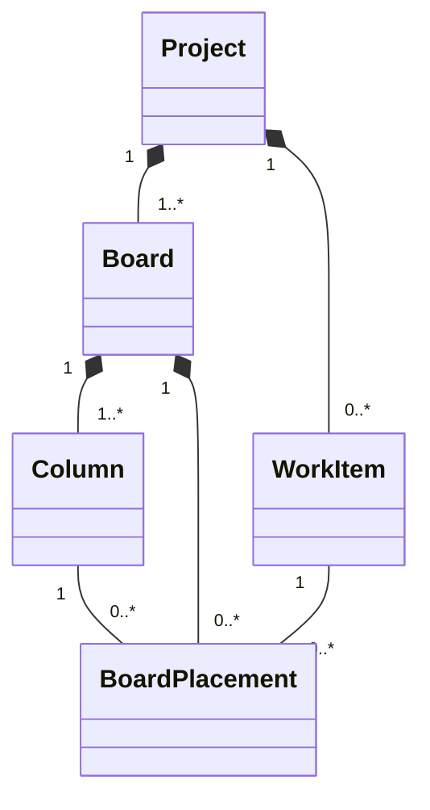

# Design

## Context

参见 [proposal.md](proposal.md) 的动机。当前可运行切片在 Core API `project` capability 与 PostgreSQL `project` schema 中实现 Project、Project Membership、OWNER 授权、幂等创建和乐观并发；Desktop Main 通过窄 Preload 能力持有认证网络边界，Renderer 只显示 Project 上下文。Board、Column、Work Item 与 Placement 尚无生产代码或数据表。

仓库仍处于首次发布前，Flyway 只有可丢弃本地数据的 `V1__initialize_taskpilot.sql`；现有架构明确允许在获批后重写 V1。当前 Desktop 未引入通用数据请求或拖拽框架，本 Change 不以一个新依赖替代小而明确的能力边界。

权威业务模型已经把 Project、Board 与 Work Item 归入 Project Work，但其 Target 文本仍把 Card 描述为纯计算结果、把移动解释为 Workflow 动作，并要求每个 Work Item 固定 Work Item Type Version。本 Change 有意把尚未实现的 Target 收敛到当前可交付切片：Placement 是持久化视图状态；当前移动只改变布局；基础 Work Item 暂不依赖尚未实现的类型系统。

## Goals / Non-Goals

**Goals:**

- 在现有 `project` capability/schema 中交付多 Board、可配置 Column、最小 Work Item 和持久化 Placement 的完整闭环。
- 保持 Project OWNER、Workspace/Project 路径范围、幂等创建、乐观并发、Problem Details 和 Main-owned bearer 边界。
- 让注册、手动创建 Project 与创建 Board 都原子获得可立即使用的初始 Board/Column。
- 在 `zh-CN`、`en` 和 `960×640` 下交付键盘、辅助技术与拖拽等价可用的真实 Board。

**Non-Goals:**

- TEAM Workspace、成员/邀请、Board 或 Work Item 独立删除、Board 模板或特殊默认 Board。
- Work Item Type、自定义字段、Assignment、Comment、Swimlane、过滤、WIP、搜索或批量操作。
- Work Item 完成/取消/重开，Workflow/Agent 启动，或把 Card 移动解释为业务状态迁移。
- realtime、多窗口同步、离线写入队列、审计事件流、公共 API、生成客户端或新前端状态/拖拽依赖。

## Business Model

本设计使用关系图、不变量表、状态分析和失败/并发场景收口实现决策；不把分析名词机械映射为独立 aggregate、repository 或模块。

- `ProjectId`、`BoardId`、`ColumnId` 与 `WorkItemId` 是稳定身份。Card 复用 `WorkItemId`；不存在 `CardId`。Placement 对外由 `(BoardId, WorkItemId)` 寻址，表内仍使用仓库统一的 `id UUID` 主键并约束该组合唯一。
- Board、Column、Work Item、Placement 均由 Project 拥有且落在 `project` schema。冗余 `project_id` / `board_id` 配合复合外键在数据库层阻止跨 Project、跨 Board 拼接，不以 UUID 全局唯一性绕过父路径。
- Board 创建后至少一个 Column；只有空且非最后一个 Column 可删除。Board 与 Work Item 无独立删除动作。Project Danger Zone 是当前唯一删除边界。
- 基础 Work Item 初始为 `OPEN`。本切片没有生命周期转换，也不虚构 Work Item Type Version；未来类型化字段功能必须显式决定既有基础 Work Item 如何选择或迁移到类型版本。
- 注册和 Project 创建原子创建 Project、OWNER Membership、Board、Column；Board 创建原子创建 Board、Column；从 Board 创建 Card 原子创建 Work Item、Placement。任一步失败均不留下半成品。
- 初始名称按创建请求 locale 固化：Board 为 `工作看板` / `Board`，Column 为 `待处理` / `To do`。创建后它们是普通用户数据，切换语言不自动改名。
- 所有命令由 Core API 按 access bearer、Workspace、Project 与 Project OWNER 重新授权。组合其他范围的 ID 统一返回 not-found，避免归属探测。
- Board 元数据、Column 配置、Placement 创建或移动都会递增 Board version，Board version 是整个布局的并发栅栏。创建 Work Item 及其首个 Placement 也必须校验 expected Board version；Column 改名/删除同时校验 Column version，Placement 移动同时校验 Placement version，Work Item 编辑校验 Work Item version。过期写入不合并，返回稳定冲突并要求重载权威数据。
- 本切片完全同步，不发布业务事件、不启动后台任务。Desktop 的最近 Board 只是 environment/User/Project 范围的本机偏好，不是云端业务事实。

## Decisions

### 1. 继续使用一个 Project Work capability 与 `project` schema

Board 与 Work Item 扩展现有 `project` capability，使用其 public use-case contract、internal application service、JDBC persistence 与 Desktop API adapter；不创建 `board` 模块或新 PostgreSQL schema。这样边界与 `docs/business-model.md` 的 Project Work 业务区一致，Project 创建/删除也可在一个本地事务内维护不变量。

**Alternatives:** 为每个名词建 Modulith module/schema 会引入循环协调与跨 schema 事务，却没有独立权限、部署或变化所有权；把 Board 放 Workspace 下则错误扩大作用域。

### 2. 重写发布前 V1，并用约束表达范围

在现有 V1 中增加：

- `project.boards`：普通 Board、创建幂等键/指纹、version 与审计字段；
- `project.board_columns`：Board 内名称、`position BIGINT`、创建幂等键/指纹、version；
- `project.work_items`：Project 内基础内容、`OPEN` lifecycle、创建幂等键/指纹、version；
- `project.board_placements`：内部 `id UUID`、`project_id`、`board_id`、`column_id`、`work_item_id`、`position BIGINT` 与 version。

所有外键保持 `ON DELETE RESTRICT`。`(board_id, work_item_id)` 唯一；Column 顺序和每列 Placement 顺序使用可延迟唯一约束，应用在事务内完整重排。Project 删除按 Placement → Column → Board → Work Item → Membership → Project 显式删除；任何未知依赖仍由 RESTRICT 使事务回滚。

**Alternatives:** 新增 V2 会保留尚未发布且已反复调整的错误 baseline；`ON DELETE CASCADE` 隐藏未来所有权决定；无复合 FK 只能靠应用约定范围。

### 3. 用简单整数重排与 Board version 处理布局并发

Column 与 Placement 保存 `BIGINT position`，每次新增、重排或移动在锁定 Board 后把受影响顺序规范化为连续的固定步长整数，并更新受影响资源 version；读排序始终追加稳定 ID 作为兜底。布局写请求携带 expected Board version；创建 Work Item 还携带目标 Column，移动还携带当前 Placement version、目标 Column 与可选 `beforeWorkItemId`，缺失锚点表示目标列末尾。服务端在同一事务内校验版本、目标 Column 和锚点；过期创建不得留下 Work Item 或 Placement，移动成功后返回完整权威 Board 视图，有效 no-op 不更新时间或 version。

**Alternatives:** LexoRank/分数索引减少写放大但会引入稠密键再平衡、额外实现和当前规模不需要的复杂度；仅相信客户端数组无法阻止丢失并发写入。

### 4. 创建幂等键按 actor 与所属范围持久化

Project 创建沿用 actor+Workspace；Board、Column 和 Work Item 创建使用 actor+Project 范围的 UUID request id，并保存规范化 payload 指纹。Board/Project 创建 payload 包含用于生成初始名称的 locale；Work Item 指纹包含 Board、目标 Column 与 expected Board version。同键同载荷的成功重试先命中既有结果，即使 Board 已因首次成功而递增版本也返回原结果；同键不同载荷返回稳定幂等冲突。新 request id 携带过期 Board version 时原子拒绝。

幂等键只解决不确定重试，不替代资源 version。创建响应和后续读取都返回足够的稳定 ID 与 version，Desktop 不根据名称推断结果。

### 5. Desktop API 是显式资源能力，不暴露 generic fetch

当前 Desktop API 增加下列路径族，所有路径均位于 `/desktop/v1/workspaces/{workspaceId}/projects/{projectId}`：

- `GET|POST /boards`，`GET|PATCH /boards/{boardId}`；
- `POST /boards/{boardId}/columns`、`PATCH|DELETE /boards/{boardId}/columns/{columnId}`、`PUT /boards/{boardId}/column-order`；
- `POST /boards/{boardId}/work-items`；
- `GET|PATCH /work-items/{workItemId}`，其中 PATCH 可在同一事务中更新内容并把当前 Board Placement 移到目标 Column 末尾，响应同时返回权威 Work Item 与 Board；
- `POST /boards/{boardId}/placements/{workItemId}/move`。

DELETE 的并发字段使用 query 参数而非含义不稳定的请求 body。创建成功为 `201`，删除 Column 为 `204` 并由 Desktop 随后重新读取 Board，其余读取/修改为 `200`；其他布局修改返回完整 Board 视图。Controller 只负责 transport 映射，授权、规范化、幂等和事务属于 Project application service。运行时 OpenAPI 与 Main transport fixture 固定路径、安全、schema、状态和 Problem Details。

Main 新增 Project Work client/coordinator 与最近 Board store；Preload 只暴露 list/create/read/edit/reorder/move 等窄方法。每个异步响应携带 session generation 与 Workspace/Project/Board response key，logout、环境/用户/Project/Board 切换后的迟到结果必须丢弃。同一 Board 还维护单调 request generation：成功提交任何会改变其 snapshot 内容的 mutation 后，所有在该 mutation 成功提交前启动且随后才返回的 Board 读取均失去提交资格，不能覆盖新内容。Renderer 永不接触 bearer、URL 或 fetch。

### 6. Renderer 使用权威快照和可回滚的局部乐观移动

Board 页面以一个权威 Board snapshot 渲染 Column 与 Card。普通创建/编辑等待 Main 成功后提交 UI；Card 拖拽移动可先局部预览，但发送前保留权威 snapshot，失败时完整回滚并公告原因，成功时直接采用服务端返回布局。编辑 Work Item 时可同时选择“所在列表”；内容和跨列 Placement 更新由一个 Core API 事务原子提交，成功采用同一响应中的权威 Work Item 与 Board，失败不得留下半成功内容或位置。目标 Column 未变化时只应用 Work Item version 栅栏且不改变 Board/Placement version；目标 Column 变化时再校验 Board 与 Placement version，并移动到目标列末尾。切换 Project/Board 取消当前呈现资格；同一 Board 的 mutation 成功也推进其 request generation，使该 mutation 成功提交前启动的迟到 Board 读取失效，而不是让旧 promise 覆盖新内容。

拖拽使用平台/React 已有能力并作为指针主路径，不引入动画或拖拽依赖，也不提供独立移动按钮或移动弹窗。落点按指针相对 Card 中线的最近边缘解析：上半区表示该 Card 前，下半区表示下一张 Card 前，仅越过最后一张 Card 或进入空列时落到列末尾。拖起后原 Card 退出布局和落点计算，由唯一等高占位槽保留插入位置；鼠标旁只显示一张固定尺寸、轻微抬升并增强阴影的拖拽预览，避免源位置与指针下出现两张相同 Card。目标 Column 使用轮廓、抬升和顶部结构信号，而非只改变颜色。占位位置变化前后记录未拖动 Card 的布局坐标，并以 `180ms` FLIP 位移动画让受影响 Card 平滑滑入新位置；动画只改变视觉呈现，不改变落点计算、DOM 顺序或权威状态。服务端确认后以约 `200ms` 的克制落位反馈结束。编辑表单的“所在列表”是主要无拖拽等价路径。焦点在成功后回到移动 Card，在失败回到原 Card；`prefers-reduced-motion` 不启动 FLIP，并移除非必要 transform/transition，但保留轮廓、占位槽和公告。Board 主区域横向滚动，应用壳、Board 选择、主要创建动作和全局账号/语言动作保持可达。实现前按 Desktop 指令依次使用 `frontend-design` 与 `vercel-react-best-practices`，完成后用 `web-design-guidelines` 复核；不在规划阶段预造未经视觉验证的组件系统。

### 7. 国际化分离产品消息与用户数据

所有 Board/Column/Card/Work Item 操作、校验、加载/空/错误状态和 live-region 公告进入现有 `en`/`zh-CN` 目录；稳定 code 映射到本地文案。日期使用当前 locale；用户输入的名称/描述和创建时已固化的初始名称不翻译。语言切换只重渲染消息与格式，不重新请求业务数据。

### Unicode 文本规范化

Board、Column 与 Work Item 的用户文本在 Core API 业务边界先去除首尾空白，再统一为 Unicode NFC，随后执行 code point 长度校验并生成幂等指纹。Renderer 可提前执行相同规范化改善即时反馈，但服务端规范化是权威规则，避免其他客户端以视觉相同的 NFC/NFD 文本产生不同持久值或幂等结果。

## Risks / Trade-offs

- **[V1 重写会清空不兼容的本地开发数据]** → 仅适用于首次发布前、checkout-owned Compose volume；`pnpm dev` 的受控恢复验证 PostgreSQL 与 Redis volume 所有权并同步清理二者，避免 session 指向已删除 User。真实发布后必须改用增量 migration。
- **[整数重排在超大 Board 上写放大]** → 当前无产品数量上限但不是无限性能承诺；用单 Board 锁、批量 SQL 和集成测试保证正确性，出现真实规模证据后再独立设计稀疏排序。
- **[Board version 使并发操作保守冲突]** → 优先防止静默覆盖；Desktop 保留输入、重载权威布局并给出重试路径。
- **[拖拽容易产生仅指针可用或失败后幽灵状态]** → 键盘等价命令、焦点恢复、live region、权威 snapshot 回滚和 Cypress 组件测试共同覆盖。
- **[基础 Work Item 暂无类型版本]** → 不制造占位类型；业务模型明确未来类型化字段的迁移门，后续 Change 在引入自定义字段前解决。
- **[多 Board 同一 Work Item 的能力暂未提供“添加现有 Work Item”入口]** → schema 与读取模型允许多个 Placement，但本切片只从当前 Board 原子创建首个 Placement；后续显式入口无需改变身份模型。

## Migration Plan

1. 先以失败的 Project 模块、迁移目录契约、HTTP/OpenAPI 与 Desktop transport/Renderer 测试固定行为。
2. 重写 V1 并扩展 Project application/persistence/API；本地不兼容 schema 由已验证 owner 的开发脚本重建 PostgreSQL 并同步清理 Redis。
3. 扩展 Desktop Main/Preload，再交付 Renderer Board 与双语/可访问交互；每个切片通过其 focused gate 后再进入下一层。
4. 运行 Core API、Desktop、Cypress、system journey、根检查和当前主机 packaged smoke，随后执行模型/文档漂移审计。

本 Change 没有生产数据迁移或在线回滚承诺。首次发布前回滚是回退代码与 V1 后重建 disposable local volumes；一旦存在任何已发布 baseline，不得沿用此策略。
