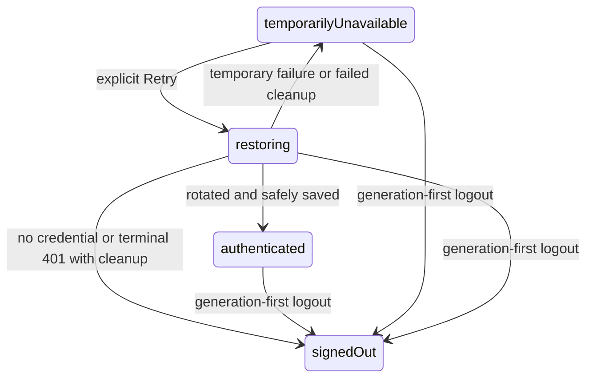

# Design

## Context

- **Status: Archived; approved implementation complete; main specs synced.** 动机见 [proposal.md](proposal.md)，实际实施证据见 [tasks.md](tasks.md)。本节的Current缺陷/限制描述为Apply前基线；两个 [delta specs](specs/) 的批准行为已同步到main specs；独立review/manual acceptance未获通过证据，详见tasks。
- Current `AuthenticationController.logout()` 只解析 bearer；`RedisSessionUseCases.logout()` 先查询短 TTL access 索引再撤销，access 到期后不能找到仍可 refresh 的 session。Redis 已有 session hash、active refresh marker 和保留至 absolute expiry 的 used marker。
- Current `SessionCoordinator` 的 refresh 有 single-flight，但 restore 不加入该 flight，且在异步 credential load 后才取得默认 generation；App Retry 只 reload。现有 credential mutation queue、generation 和 safe SessionView 可在原 owner 内完善，不需要新协调服务。
- Current `main/ipc.ts` 与 `DesktopRequestGuardFilter` 的 body 上限为 16384 字节；产品上限由 trim/NFC/code-point policy 拥有，Gateway 默认 body 上限为 1048576 字节。
- HTTP projection 仅存在于 build；checked-in OpenAPI owns wire，Core Access owns credential authentication/revocation，Gateway 只 owns transport admission。遵守 root architecture 和三个子项目的 architecture/responsibilities/testing documents。

## Goals / Non-Goals

**Goals:**
- 通过原 logout operation 撤销过期 access 对应的仍有效 session，且 rotation/logout 的任意 Redis 执行顺序均 fail closed。
- 在 Main owner 内统一凭据消费和 generation fencing，不将秘密或任意 transport 暴露给 Renderer。
- 用精确原始字节预算容纳代表性合法产品文本，并保留限量读取与独立字段校验。

**Non-Goals:**
- 不延长 token TTL，不新增持久 session/撤销队列、request-id recovery、自动 refresh 重试、Redis fallback、shared package 或依赖。
- 不新增 logout HTTP 路径，不改变身份/tenant/业务授权，不重塑登录界面，不扩大 C4/D1/D2 已完成局部修复。
- 不保证离线服务端即时撤销或任意规范化后合法但原始无限膨胀的请求均可提交。

## Business Model

使用具体场景映射、客户端状态机和 credential trust-boundary 分析； unchanged 产品词汇、关系、文本与历史规则见 [business model](../../../../docs/business-model.md)。

| 维度 | 本 Change 的结论 |
| --- | --- |
| 身份与关系 | 一个 credential marker 仅解析到其自身 session/User；其他 session 不受影响。不接受客户端指定 UserId/sessionId/scope，没有新业务实体、关系、表或历史版本。 |
| 授权与安全 | refresh 是可撤销其所属 session 的 possession credential，只在 Main/Core 使用；legacy bearer 权限不扩大。Core 独立认证，Gateway 不选择 session。 |
| 生命周期 | temporarilyUnavailable → restoring → authenticated/signedOut/temporarilyUnavailable 是本地恢复状态；authenticated 必须在 credential 安全保存后发布。logout 先使旧 generation/UI 失效。 |
| 不变量 | 同一 generation 至多一个凭据消费 flight；旧 generation 的读取、保存、错误及成功不改新状态。Redis 原子撤销当前 credential pair，不延长 session absolute expiry。 |
| 异步与失败 | OS store、HTTP、Redis 为独立边界。临时 transport 故障保留可能有效 refresh；terminal 401 清理；保存失败撤销新签发凭据且不发布 authenticated。离线撤销 best-effort，存储失败必须报告。 |
| 竞争与滥用 | 覆盖 logout/rotate 双序、late load/save/error、账号替换、重复 Retry、双凭据、伪造 scope、超限/chunked 请求。response 丢失仍适用原 replay fail-closed，不发明 recovery。 |

## Decisions

### 1. 同一 logout operation 使用明确二选一认证

在 `openapi.yaml` 为 logout 声明 optional request body `LogoutRequest`：object、`additionalProperties: false`，可选但出现时非 null 的 `refreshToken`（string，1..512 code points，无 example/default）。复用已存在的生成 null-fail 支持，HTTP adapter 显式检查非空和 credential bound，不把 generated model 传入 application/persistence。

| 请求 | 结果 |
| --- | --- |
| body absent 或 `{}` + strict bearer | legacy mode；保持已存在的 bearer parser 与 204 幂等语义 |
| body absent 或 `{}`，无 bearer 或 malformed bearer | 401 AUTHENTICATION_REQUIRED |
| `{refreshToken}` 且无 Authorization header | refresh mode，按 digest 原子定位撤销 |
| refreshToken + 任意 Authorization header | 400 VALIDATION_FAILED，拒绝歧义而不选择优先级 |
| 额外属性、非 object/显式 null body、null/错误类型/空/超长 refreshToken、无效 JSON | 400 VALIDATION_FAILED，在撤销前拒绝 |
| 形状合法但未知/已过期/已撤销的 credential | 204，不透露 session 是否存在 |
| Redis 无法完成 lookup/revoke | 保留当前通用 handler 的 503 TEMPORARILY_UNAVAILABLE Problem Details，不伪报 204 |

logout 的 Redis 故障沿用 `AuthenticationProblemHandler` 当前通用映射 `503 TEMPORARILY_UNAVAILABLE`，HTTP 回归同时断言 status 与 Problem Details code；不新增 logout 专用错误映射，不修改其他端点的既有错误码。

不 trim/normalize credential，不改变 refresh endpoint 的既有 credential policy；这里使用独立 logout request。空字符串不满足新 logout schema；其他界限内 opaque 字符串未知则幂等 204。

可选 generated request 的 null 参数本身无法区分无 body 与 JSON `null`，Jackson 默认的 unknown-field 行为也不能代替 strict shape 约束。logout HTTP adapter 必须利用既有 cached request body 作局部 presence/shape 检查（无字节 body 与空对象作为 legacy、显式 null/额外字段拒绝），再将解析后的 credential 传入手写 port；不全局改变其他 operation 的 Jackson 兼容规则。`DesktopBearerAuthenticationFilter` 对精确的 `POST /v1/session:logout` 不做通用 bearer lookup；该route既有permitAll不变，由logout adapter独立执行strict形状/二选一credential校验，再调用session port。这样malformed/双凭据在Redis lookup前拒绝，且Redis故障不会让本应400的歧义payload先变成filter错误。其他route的bearer authentication不改；HTTP矩阵证明logout不是匿名无校验入口。

标准 OpenAPI security 使用 OR：`[{accessBearer: []}, {}]`；`x-taskpilot-authentication` 为 `access-bearer-or-refresh-credential-body`。description 明确空 security requirement 是 body credential 的标准表示局限，绝非无凭据入口；契约测试同时检查 security、schema、description、400/401/503。`GET /v1/me` 仍 bearer-only，refresh 声明不变。必要时只局部扩充现有 validator 的 supported authentication value，不引入第二份 endpoint/security catalog。

**理由与替代：**保持 method/path/operationId 兼容旧客户端，避免新路径与接口复制；先 refresh 再 logout 增加网络请求和 replay 风险；过期 bearer 接受/延长 TTL 会扩大旧 credential 权限，均不采用。owner：ContractToolTest、Core AuthenticationHttpIntegrationTest/AuthenticationApiBranchTest 与 OpenApiIntegrationTest。

### 2. Redis 在一个原子操作内解析 marker 并撤销当前 pair

在 `RedisSessionUseCases` 复用 namespace/digest 和 Lua 技术。refresh logout 的 marker lookup、校验、session lookup、DEL 当前 access/refresh/session 在同一脚本内完成，不能在 Kotlin GET 后分开 REVOKE。

- `active:<sessionId>`：验证 session 当前 refreshDigest 与输入 digest 一致及 expiry 不越界，然后撤销当前 pair。
- `used:<sessionId>`：可在既有 absolute expiry 内定位该 session 并撤销其当前 pair，不签发 token，不延长 marker/session TTL。
- marker/session 缺失、失效或不一致：不创建/恢复记录、不误撤销其他 session；沿用 fail-closed 数据完整性行为并幂等完成不存在目标的 logout。
- used tombstone 保留原 TTL；logout 不遍历删除历史 used keys，session 删除后它们不能产生有效凭据。不存在 PostgreSQL migration 或无限 marker 集合。

| 原子执行顺序 | 最终结果 |
| --- | --- |
| logout(active) → rotate | 当前 marker/pair/session 已删，rotate 无法签发 |
| rotate → logout(used old refresh) | old marker 解析到同一 session，删除 rotation 新 pair/session |
| 多次 rotate → logout(任一未过 absolute expiry 的 used marker) | 撤销同一 session 当前 pair；其他 session 保持有效 |

legacy bearer 分支保留；有效 bearer 查得 session 时撤销当前 pair，已过期/不存在索引仍是原有幂等 no-op 限制。新 Desktop 不依赖它。测试使用真实 Redis，expired access 必须以实际 key expiry/明确 expire 操作验证，单独推进注入 Clock 不能证明 Redis key 到期。

**替代：**Kotlin 的非原子 GET+revoke 有竞争窗；新增 sessionId 入参允许客户端选目标；新增撤销表/恢复协议超出修复范围。owner：SessionUseCasesIntegrationTest，复用 Clock/token generator 和真实 Testcontainers Redis。

### 3. Main generation-first logout 与凭据清理

Session port 在手写 application boundary 明确区分 refresh logout 和 legacy bearer fallback；`composition.ts` 将 refresh 模式映射为 body，不附带 Authorization，不为了退出调用 refresh。`revokeIssued()` 也用其 Main-owned issued refresh credential，防止 access 已过期的迟到清理失效。

- 先捕获旧 access/已拥有的 credential snapshot，再增加 generation、清空 in-memory auth、立即 publish signedOut。
- OS credential read-for-logout 与 clear 走既有 mutation queue；logout 在任何 await 前同步登记该 cleanup entry，从中取得旧 refresh 后再 clear。所有 establish/save/terminal cleanup 都进入同一队列，后发新账号 save 必须在这次 cleanup 后执行。已在 Main 安全取得的当前 credential snapshot 可用于撤销；若需 store read，只读排在新 save 前的旧 slot，不得晚于新 save 重新读取。普通旧 save/terminal cleanup 检查 generation；已登记的 logout cleanup 按队列所属旧 slot 完成，不因新 establish 已分配 generation 就错误跳过旧 slot 清理，也不得越过新账号 save。异步结果的 UI 发布仍检查 generation。
- 若旧 flight 已拿到 token或刚签发新 pair，旧 marker 的服务端撤销与旧 issued pair 的 cleanup 均可幂等进行。凭据只在 Main 内持有，不新增磁盘 snapshot。
- 尽力用捕获到的 refresh 撤销；credential read 失败则若有旧 access 仅作 legacy best-effort fallback。不假装已撤销 refresh，不启动隐藏 refresh。
- credential read与clear分别捕获失败：即使read失败也必须继续尝试clear，不能因读异常跳过本地清理；已捕获refresh即使clear失败也继续best-effort远程撤销。clear/read 失败不恢复 UI；以 CREDENTIAL_STORAGE_UNAVAILABLE 显式报告。远程失败沿用 best-effort，不添加持久重试队列。后续旧 completion 不再次 publish signedOut/error 去覆盖新账号。

**理由与替代：**复用原 queue 可确定清理和保存顺序；新 Main-only credential snapshot 仅为已读取/已保存 token 的内存引用，不新增存储或 owner。仅在 clear 后读 refresh 会丢失撤销凭据，先等待网络再 fence 会让退出期间旧请求继续拥有上下文，均不采用。owner：session-coordinator.test.ts 和 composition.test.ts 的 deferred store/port fakes；Renderer 错误交接由 App 和 auth-experience.test.tsx 拥有。

#### Renderer 退出错误的 App 层交接

- `app/App.tsx` 提供一个 App-owned 的窄退出回调，将 `features/shell/project-home.tsx` 的账号菜单和 Project 加载失败页两个入口都接到该回调。不新增 IPC capability，不把凭据或 Main generation 暴露给 Renderer，不只在卸载的子组件中 catch。
- App 在调用 `auth.logout()` 前登记本地 operation identity，负责捕获 rejection。Main 立即发布 signedOut 后 App 仍挂载；同次退出的 signedOut 通知不能取消该操作的错误反馈。read/clear 失败返回 `CREDENTIAL_STORAGE_UNAVAILABLE` 时，在登录页保留 `role=alert` 的 `zh-CN/en` 安全提示：本次已退出，但本地凭据未能确认清除，重新启动后可能恢复会话。不能只写日志、吞异常或声称完全清除；不显示原始 OS 错误、token、credential handle 或用户隐私。其他退出 rejection 也被捕获并显示安全的通用失败提示，远程 best-effort 撤销失败不额外伪造成存储失败。
- 子组件卸载不会丢失 App 的错误反馈，也不在卸载后清 pending/setState。用户可关闭提示；开始新的登录意图、收到新的 authenticated 状态、切换 api 或 App 卸载时使旧 operation 失效并清提示，即使再次登录的是同一 User 也如此。旧 catch/finally 不能把提示或 pending 写入新登录/账号状态；session subscription 仍拥有 session 状态，错误处理不恢复认证、不阻塞新登录，也不新增持久提示/退出队列。
- Renderer integration 使用 deferred logout 与真实 App 渲染，分别从两个入口触发：先发送 signedOut 使 ProjectHome 卸载，再拒绝 logout，断言登录页仍有安全可访问的提示且无 unhandled rejection。另测成功退出无提示、offline 加 clear 失败、新登录意图/新 authenticated 状态后旧 rejection 被忽略、App 卸载后的迟到 finally 不写状态。Main unit 仍证明 read 失败也 clear、clear 失败仍尽力 revoke；不能用这些 unit 断言替代 Renderer 可见证据。

### 4. 每 generation 一个 credential-consumption flight

在 SessionCoordinator 内统一 startup restore、显式 retry 和 protected-call refresh 的协调入口；flight 包含 generation 与 promise，先安装 flight，再异步读取 credential。启动调用仍由 `bootstrap.ts` 在 federated recovery 后触发；但 startup restore 意图必须在等待 federated recovery 前捕获 generation，迟到的 startup continuation 仅在该 generation 仍有效且未已建立 authenticated session 时恢复，不能在期间logout/new establish后重新捕获generation重启旧意图。startup scheduling fence 与 load前fence均需测试；不将读取 SessionView 改成命令。

- retry 返回 `Promise<SessionView>` 的安全视图；temporarilyUnavailable 开始 restore，restoring 加入已有 flight；authenticated/signedOut safe no-op，不读 store/发 HTTP。
- 同一 generation 的 restore/refresh 调用共享整个 load → rotate → save → publish flight，而不是只共享 HTTP。退出/establish 使旧 flight 失效；新 generation 能建立自己的 flight，旧 finally 仅在 identity 相同才清空 slot，不能删除新 flight。
- 在 load 前 capture generation；load 后、发 HTTP 前、保存队列执行前、保存后、任何 error cleanup/state publication 前检查。恢复成功不额外无条件 bump generation；establish/logout/terminal invalidation 继续显式 fence。
- late load 不消费 credential；late issued session best-effort revoke；late error 不清除新账号数据/状态。OS writes 串行化后新 credential 最终优先，保存失败不能 authenticated。
- 临时 load/transport 失败 → temporarilyUnavailable，不清除可能有效 refresh；terminal 401 → clear/signedOut，clear 失败 → temporarilyUnavailable + storage error。轮换后保存失败 → best-effort revoke issued、清理旧 credential，成功清理为 signedOut，失败为 temporarilyUnavailable + storage error。任何terminal cleanup的queue entry执行前再次校验generation；远程revoke不应挡住本地失效/cleanup，也不得把await远程后的旧错误变成清新账号动作。
- 错误通过既有 IPC error mapping 返回；Renderer catch/finally 清 pending、依 session subscription 呈现安全状态，不产生 unhandled rejection，也不添加自动定时 refresh 重试。Retry 的返回值不得无条件 setSession 覆盖请求期间已收到的较新 logout/账号切换事件；在 App 保留 subscription 为状态权威，返回值仅作当前操作反馈，卸载/旧操作 completion 不 setState。

新 capability 在 shared contracts、Preload、CHANNELS/schema/owner 注册、Main composition 均为固定无参数入口，保留 sender validation。App Retry 保留原视觉语言，仅加入 pending disabled/可访问状态、错误处理，移除 reload。Apply 时 React Skill 和最终 web-design-guidelines review 生效；没有新体验/视觉重塑，不触发 frontend-design redesign。

**替代：**reload 不能重启 Main restore；让 getSessionView 隐式 refresh 会让任意读取消费 credential；单独 retry flight 会引入 replay；全局不区分 generation 的 promise 阻塞新账号，均不采用。owner：session-coordinator、IPC/Preload、Renderer auth-flow tests。

### 5. 两个局部预算常量与跨层 regression，不增加共享包

IPC 按现有 JSON UTF-8 serialization size，Core 按 raw body bytes，均设为 131072。Core 保留 Content-Length 快速拒绝以及 `readNBytes(limit + 1)`/CachedBodyRequest；unknown/chunked 不绕过，前者 error 仍 413 REQUEST_TOO_LARGE，IPC 仍 VALIDATION_FAILED。预算接受仅代表 guard 放行，后续 schema/auth/字段/版本校验照常。

代表性紧凑 JSON `{description: ...}`（实际key带引号，不含标题和 operation metadata）说明 64 KiB 不够：

| 5000 NFC code points 的输入 | 正常 JSON UTF-8 | 全 Unicode escapes JSON |
| --- | --- | --- |
| 5000 emoji | 20018 bytes | 60018 bytes |
| 5000 个 `ᾂ` 的 NFD（20000 raw code points） | 40018 bytes | 120018 bytes |

完整测试还包含 160-code-point 最大标题、UUID/scope/version 和 create/SET patch 元数据，实际 serialize 后断言不超过 131072。IPC 从 JS 对象序列化，不伪称接收 raw escape text；raw escaped JSON 在真实 HTTP 层验证。精确边界用 schema 合法、trim 后仍合法的 padding 构造，同时单独证明 guard 放行/拒绝和无副作用。

**理由与替代：**128 KiB 容纳已确认代表性最坏编码；64 KiB 不足，1 MiB 统一放宽无必要，无界读取不可接受。两个 owner 各存常量，跨层边界测试防 drift，不新增通用 package。Gateway 生产默认无需改，测试经 Gateway 路径证明未先拒绝该预算；部署自定义 limit 的容纳关系列为 rollout/manual evidence。

## Risks / Trade-offs

- [used marker 也是敏感撤销凭据] → 保持秘密隔离、绝对 TTL 和单 session scope；Redis integration 验证多轮 rotation/隔离/expiry。
- [logout body standard security 空 requirement 被误读为匿名] → extension、description、strict Core adapter 与契约测试一起约束；Gateway不产生业务 principal。
- [新 Desktop 连到旧 Core] → 先服务端后客户端发布；不能靠 silently bearer fallback 声称修复 expired-access logout。
- [OS clear 失败后重启仍可读取旧凭据] → 本次 UI/generation 失效且显式存储错误，在线尽力撤销；离线+存储失败不承诺跨重启退出，不新增持久机制。native acceptance 验证可观察错误。
- [128 KiB 提高每请求缓存上限] → 仍限量读取，Gateway admission/timeouts 不变；精确/超限/chunked 与 no-side-effect tests 防绕过。
- [flight 旧 finally/late load 擦除新状态] → generation/identity fencing + queue ordering 的 deferred fake tests，覆盖 logout/new establish 全时间窗。
- [refresh 服务端完成而响应丢失] → 不自动重试；用户显式重试仍可能触发 replay 撤销，维持既有安全取舍。

## Migration Plan

1. Apply 后在每个实现切片更新 owning docs 和 tests；产品模型无需改词汇/关系/文本规则，记录核验理由。只在代码和证据具备后描述 Current。
2. 先发布支持 optional logout body、原子 refresh revocation 和 128 KiB 的 Core/contract；旧 Desktop bearer 模式继续工作，Gateway route manifest method/path/operationId 不变。Redis keys 兼容，无表或 schema migration。
3. 确认部署 Gateway/edge 容纳 Core budget，随后发布 Desktop refresh logout、统一 restore/retry 和 IPC budget。执行真实 Gateway hop、离线/恢复与当前host native evidence；macOS/Windows各平台发布分别需要其native证据，不声称未执行的部署/另一OS门禁通过。
4. 回滚先 Desktop 再 Core；回滚后可能重新出现本次旧客户端缺陷，明确记录，不作为等价修复。旧键/tombstone 自然到期，不能清 Redis 或延长 session。
5. Planning 完成停在独立规划评审；明确 Apply 后才实施。实施后独立代码评审/手工验收，再等待单独 sync/archive 授权；本 Change 不自动 sync/archive/commit。
