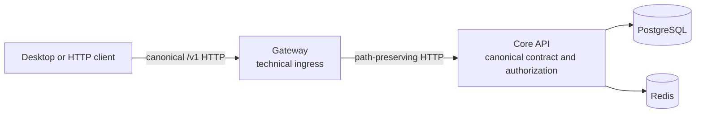

# Gateway Architecture

- **Status:** Current with explicitly marked Target extensions
- **Owns:** Gateway runtime, canonical route catalog, transport policy, health,
  and Core upstream integration
- **Read after:** [`../AGENTS.md`](../AGENTS.md),
  [`../../../docs/business-model.md`](../../../docs/business-model.md),
  [`../../../docs/architecture.md`](../../../docs/architecture.md)
- **Mandatory before:** Changing Gateway structure, filters, routing,
  configuration, or dependencies

## Current Runtime Role

The Gateway is an independently runnable Kotlin/Spring Cloud Gateway WebFlux
service between clients and `core-api`:



The current Desktop, provider callback, local development lifecycle, and system
journey use the Gateway public origin. The Gateway forwards only an explicit
method/path catalog to one configured internal Core origin. It has no generic
`/v1/**` catch-all, no `/desktop/v1/**` compatibility route, and no alternate
Core fallback.

Gateway implementation is organized by technical responsibility:

```text
ai.taskpilot.gateway
├── GatewayApplication.kt
├── config/       # validated properties and upstream HTTP client configuration
├── route/        # canonical route value, catalog, and Spring route configuration
├── transport/    # ingress/egress policy filter and stable transport errors
└── health/       # Core readiness contribution
```

The root package owns only the application entry point. `GatewayProperties`
keeps its explicit name because it binds the external `taskpilot.gateway`
configuration contract; other internal types rely on their package context
instead of repeating a `Gateway*` prefix. This split is an internal ownership
boundary, not an additional runtime layer or business abstraction.

Core API remains the application Resource Server: it independently validates
opaque access credentials and performs final Workspace/Project/resource
authorization from persisted facts. Gateway correlation data, URL parents, and
inbound identity-like headers are never authorization evidence.

## Current Technology and Build

- Kotlin and Java 21
- Spring Boot and Spring Cloud Gateway WebFlux using the pinned compatible
  Spring Cloud release train
- Actuator liveness/readiness probes
- Gradle `bootJar`, ktlint, Detekt, JUnit/WebTestClient, and Kover
- no Spring MVC, JDBC/JPA, PostgreSQL driver, Flyway, Redis runtime, Spring
  Modulith runtime, Core API production dependency, or business database

`./gradlew --no-daemon :services:gateway:qualityCheck` owns the complete module
gate. The build contract inspects actual runtime dependencies and the packaged
JAR.

## Current Request Pipeline

```mermaid
flowchart LR
    request["Inbound request"]
    correlation["Validate or generate correlation ID"]
    allowlist["Explicit method and PathPattern catalog"]
    headers["Header allowlist and spoofing removal"]
    requestLimit["Bound request headers and body"]
    route["Path-preserving Core route"]
    responseLimit["Timeout and bounded response"]
    caller["Caller"]

    request --> correlation --> allowlist --> headers --> requestLimit --> route
    route --> responseLimit --> caller
```



Current transport policy:

- accepts exactly the canonical operations listed in
  `route.RouteCatalog`; unknown paths, wrong methods, legacy paths, Swagger,
  runtime OpenAPI, and arbitrary management paths do not reach Core;
- preserves the accepted path, query, and body without client-specific rewrite;
- removes hop-by-hop, proxy, forwarded, cookie, and identity/tenant/scope-like
  spoofing headers while forwarding the required credential and content
  headers;
- accepts one bounded valid `X-Correlation-Id` or generates one and returns the
  same value to the caller;
- enforces bounded request headers/bodies, response headers/bodies, connect and
  response timeouts before returning a stable transport Problem Details body;
- never retries mutations automatically; and
- passes Core business Problem Details through while keeping internal origin,
  credentials, bodies, stack traces, and low-level transport errors out of
  Gateway errors and logs.

The Gateway buffers bounded request and response bodies so limits remain valid
for declared, chunked, and unknown-length publishers. A malformed/truncated
upstream response is converted to a complete local transport error rather than
reusing upstream framing headers.

## Health and Configuration

The public management surface contains only:

- `/actuator/health/liveness`: Gateway process/liveness state;
- `/actuator/health/readiness`: Gateway readiness including a bounded Core
  readiness probe.

Configuration binds the loopback/public host and port, internal Core origin,
body/header limits, and timeouts. Local development gives only the Gateway URL
to Desktop; `TASKPILOT_CORE_API_INTERNAL_URL` is process-internal configuration
for Gateway and local orchestration.

The repository proves loopback local topology and a packaged cross-service
journey. It does not contain production deployment/network-policy evidence.
Until a deployment owner proves Core is privately bound and unreachable through
an external bypass, this architecture must not be described as production-ready
network isolation.

## Contract Ownership

The checked-in canonical OpenAPI artifact owns HTTP request/response schemas,
Problem Details representation, operations, and ingress metadata. Core API owns
business controllers, Problem Details behavior, authentication/authorization,
and the internal runtime documentation endpoint. Runtime OpenAPI is available
only from the internal Core origin in Local/Test profiles and is disabled in
Production. Gateway does not generate or publish Swagger/OpenAPI.

**Current:** the contract build projects approved ingress operations into an
independent route-manifest resource. Gateway strictly loads that resource once
as the single immutable catalog shared by routing and admission; missing,
empty, duplicate, or invalid manifests fail startup. This build-time allowlist
is not another business API definition, is not environment configuration, and
never depends on Core runtime OpenAPI availability.

## Target Extensions

Managed-execution, public API credentials/quotas, distributed rate limiting,
multiple upstreams, and richer edge observability remain Target. Each requires
an approved Change and route-specific trust model. They must not turn the
Gateway into a business orchestration layer or replace Core authentication and
authorization.

## Non-Goals

- No business persistence, migration, transaction, or domain state.
- No screen-specific aggregation or client-specific API copy.
- No trusted identity derived from caller-supplied forwarding headers.
- No API schema or runtime OpenAPI ownership.
- No implicit retries for mutation requests.
- No claim of production network isolation from local tests alone.
