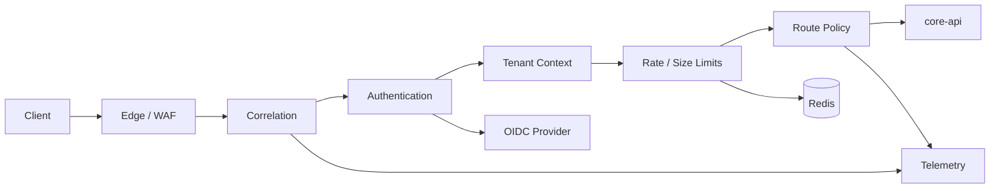

# Gateway Architecture

- **Status:** Target
- **Owns:** Gateway runtime, request pipeline, routing, trust boundaries, and
  infrastructure integrations
- **Read after:** [`../AGENTS.md`](../AGENTS.md),
  [`../../../docs/business-model.md`](../../../docs/business-model.md),
  [`../../../docs/architecture.md`](../../../docs/architecture.md)
- **Mandatory before:** Initializing or changing the Gateway structure

## Runtime Role

The Gateway is an independently deployable Kotlin/Spring service between the
external edge and `core-api`. It provides technical policy enforcement without
owning business workflows.

## Technology Direction

- Kotlin
- Spring Boot
- Spring Cloud Gateway WebFlux
- Spring Security resource server support
- Redis-backed distributed rate limiting when required
- Micrometer and OpenTelemetry-compatible observability

Use the Spring Cloud release train to select compatible stable versions.

## Request Pipeline

Filter ordering is explicit and tested. Untrusted inbound headers are removed
before trusted internal context is written.

## Route Boundaries

| Route class | Target | Policy |
| --- | --- | --- |
| First-party Web API | `core-api` Web controllers | User session/token, first-party limits |
| Public HTTP API | `core-api` public controllers | Versioned routes, API credentials, public quotas |
| Health and readiness | Gateway management endpoints | Restricted exposure |

The Gateway must preserve the distinction between Web and public API surfaces.

## Tenant Context

- Tenant identity is derived from trusted claims, approved host mapping, or API
  credentials.
- Client-provided internal tenant headers are stripped.
- Normalized tenant context is forwarded only on trusted internal routes.
- `core-api` independently verifies membership and domain authorization.
- The Gateway never turns tenant context into proof of resource ownership.

## Failure Behavior

- Authentication and policy failures stop before routing.
- Upstream timeouts and unavailable responses use stable transport-level error
  responses.
- Retries are disabled by default for non-idempotent requests.
- Circuit breaking or retries are added per route only with an explicit
  idempotency argument.
- Request and response bodies are not logged by default.

## Configuration

- Routes and policy defaults are version-controlled.
- Secrets and credentials are environment-injected.
- Environment overrides must not redefine business behavior.
- Management endpoints use a separate exposure policy.

## Non-Goals

- No business database.
- No ticket, project, board, or Agent workflow.
- No final domain authorization.
- No response composition BFF.
- No public API schema ownership.
