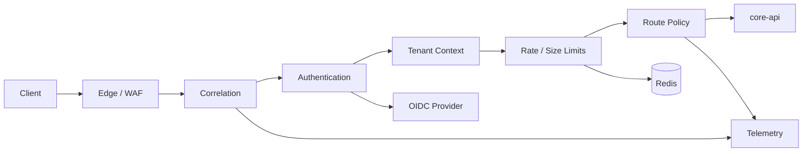

# Gateway Architecture

- **Status:** Target
- **Owns:** Gateway runtime, request pipeline, routing, trust boundaries, and
  infrastructure integrations
- **Read after:** [`../AGENTS.md`](../AGENTS.md),
  [`../../../docs/business-model.md`](../../../docs/business-model.md),
  [`../../../docs/architecture.md`](../../../docs/architecture.md)
- **Mandatory before:** Initializing or changing the Gateway structure

## Runtime Role

The Gateway is an independently deployable Kotlin/Spring service between the
external edge and `core-api`. It provides technical policy enforcement without
owning business workflows.

## Technology Direction

- Kotlin
- Spring Boot
- Spring Cloud Gateway WebFlux
- Spring Security resource server support
- Redis-backed distributed rate limiting when required
- Micrometer and OpenTelemetry-compatible observability

Use the Spring Cloud release train to select compatible stable versions.

## Request Pipeline

Filter ordering is explicit and tested. Untrusted inbound headers are removed
before trusted internal context is written.

## Route Boundaries

| Route class | Target | Policy |
| --- | --- | --- |
| First-party Desktop API | `core-api` Desktop controllers | Authenticated user identity, first-party limits |
| Local managed-execution API | `core-api` internal Runtime controllers | Authenticated Runtime identity, execution-scoped technical credential, strict limits |
| Provider callback ingress | `core-api` provider callback controllers | Provider-specific authentication/verification, replay and size limits; no Desktop or Runtime credential |
| Public HTTP API | `core-api` public controllers | Versioned routes, API credentials, public quotas |
| Health and readiness | Gateway management endpoints | Restricted exposure |

The Gateway must preserve the distinction among Desktop, local
managed-execution, provider-callback, and public API surfaces. The local
managed-execution route authenticates the execution-scoped credential and
preserves every claim required by the root
[identity and execution authorization contract](../../../docs/architecture.md#identity-and-execution-authorization).
It does not accept a raw local path as tenant identity or required grant material.
Exact wire format and technical validation belong to the implementation change;
route documentation must not weaken the root bindings or replace Core API
authorization. Provider callbacks use a separate route and provider-specific
verification policy; the Gateway may verify transport authenticity but never
maps a raw provider identifier directly to TaskPilot business identity.

## Identity and Tenant Context

- User, Runtime, or callback source identity is derived only from credentials
  accepted for the selected route class; Desktop, Runtime, provider callback,
  and public credentials are not interchangeable.
- Tenant identity is derived from trusted claims, approved host mapping, or API
  credentials.
- Client-provided internal identity and tenant headers are stripped.
- Normalized identity and tenant context are forwarded only on trusted internal
  routes.
- `core-api` independently verifies membership, execution scope, resource
  binding, and domain authorization.
- Gateway validation and normalization never turn identity or tenant context
  into proof of resource ownership or permission to advance an `AgentRun`.

## Failure Behavior

- Authentication and policy failures stop before routing.
- Upstream timeouts and unavailable responses use stable transport-level error
  responses.
- Retries are disabled by default for non-idempotent requests.
- Circuit breaking or retries are added per route only with an explicit
  idempotency argument.
- Request and response bodies are not logged by default.

## Configuration

- Routes and policy defaults are version-controlled.
- Secrets and credentials are environment-injected.
- Environment overrides must not redefine business behavior.
- Management endpoints use a separate exposure policy.

## Non-Goals

- No business database.
- No ticket, project, board, or Agent workflow.
- No final domain authorization.
- No response composition BFF.
- No public API schema ownership.
